# How this design loop works

This repository is a test of one idea: an agent designs better UI when the constraints live in the project, where a failing check can stop a pull request, than when they live only in a prompt.

The product is **Meridian**, an accounts-payable workspace. The task the code already names is `approve-vendor-invoice`: review a vendor invoice and approve it. The screen a newcomer should picture is the **To approve** queue, and the invoice that opens from it.

This page is for a designer or engineer who has never opened the repo. It describes main, and it is not pinned to a commit, because a pin goes stale on the next merge. Commit ids below are history, not the current main. If this page and the code disagree, the code and the checks win. [AGENTS.md](../AGENTS.md) stays a pointer for the agent. It does not restate the inventories, and this page is not a second inventory.

## The control ladder

The repo is built as a ladder of controls. A higher rung does not need the agent to cooperate. A lower rung does.

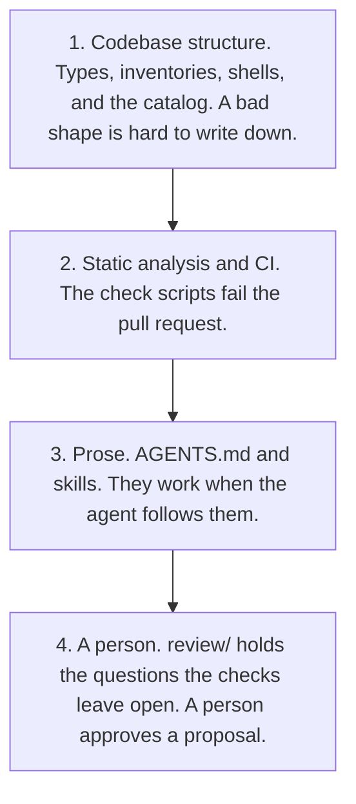

Read it from the top. Structure is the strongest control this repo has. Prose is weaker, because text has to be noticed. A person is last, for the decisions the structure cannot make.

Lauren Tan (poteto) states why a check beats an instruction in [Encode lessons in structure](https://www.skills.sh/poteto/plugins/principle-encode-lessons-in-structure). The page says textual instructions are easy to miss: "They require the reader to notice, remember, and comply." Structural mechanisms, "lint rules, metadata flags, runtime checks, automation scripts", enforce the rule without that cooperation. When more than one mechanism would work, the page says to pick the strongest the situation allows: an unrepresentable state that cannot compile, then a lint or banned API that fails CI, then a canonical helper, then a runtime check, "because agents copy whatever the surrounding code already does and a weaker guard becomes the next template."

The diagram is this repo's use of that idea. Codebase structure is the unrepresentable state and the helper the next edit copies. The check scripts are the CI rung. Prose and a person are the case the page leaves for judgment. The page does not call those structural rungs.

Here is how those rungs show up in this repo:

- **Cannot compile.** `renderedStates` in `src/features/invoice-approval/views.tsx` is `satisfies readonly ModeledState[]`. Drop a modeled state from that list and `npm run typecheck` fails. The view `switch` ends in `never` for the same reason. `success_state` on a task is typed as `ModeledState`.
- **Fails CI.** `npm run check` is the lint, the UX checks, the inventory check, and the tests. `npm run lint:product-ui` rejects a raw `button`, `input`, `select`, `textarea`, or `a`, a `style` attribute, a direct `@tounsoo/todae` import outside `src/catalog`, and a foreign component kit.
- **Canonical helper.** The catalog, the page-type shells, and the content layouts are the code the next edit is supposed to copy. There is no second way to build a button.
- **Runtime check.** `CollectionPage` and `DetailPage` throw while rendering if a required slot is missing or any slot is repeated, and the detail primary slot throws unless it holds one button. CI checks the detail primary slot in `npm run lint:slots`, so a bad primary fails before anyone opens the screen.

The page's pattern, when the same instruction is about to be written a second time: if it can be a lint rule, a metadata flag, a runtime check, or a script, encode it and delete the instruction. If it genuinely requires judgment, make the instruction prominent and add an example of the failure. The corollary on the page: "If the fix is structural, ONLY use the structural fix. The instruction IS the symptom." That is why `AGENTS.md` stays a pointer. Growing the skill text is the weaker move. Growing an inventory, and a check that reads it, is the stronger one.

A check beats an instruction for that reason. The instruction needs the agent's cooperation. The check exits non-zero, and CI on every pull request runs it. There is no LLM judge on CI.

## The layers on a Meridian screen

An agent designs inside layers the repo already recorded. From the outside of the screen inward:

| Layer | What it is on main | Where |
| --- | --- | --- |
| Component catalog | The only UI entry. Product code imports these names. | `src/catalog/index.ts` re-exports `@tounsoo/todae` |
| Chrome layout | The frame around the page. One id, `app-shell`. | `allowed_layouts` in `src/inputs/product.ts`, directory `src/layouts/app-shell` |
| Page type | The job of one page. `collection` and `detail`. | `allowed_page_types`, directories under `src/page-types` |
| Content layout | The composition that fills a page type's body. One id, `data-table`. | `allowed_content_layouts`, directory `src/content-layouts/data-table` |
| Flow | The modeled states of the task, and the legal moves between them. | `src/flows/invoice-approval` |
| UX rules | A check, a product-owned input, and a review question for each rule. | `src/rules/ux-rules.ts`, inputs in `src/inputs/product.ts` and the caps beside the rules |

Chrome layouts and content layouts are different lists. `allowed_layouts` is the frame. `allowed_content_layouts` is the body. A different body is a new content layout. It is not a new entry in `allowed_layouts`, and the app shell is not a third page type.

The shells are product-owned glue, encoded from [Todae](https://github.com/tounsoo/todae) recipes. Recipes are copyable glue, not package namespaces. `@tounsoo/todae` has no `AppShell` or `DataTable` export, and this repo does not fork Todae. The app shell follows the [app shell recipe](https://todae.omsoo.design/recipes/app-shell). The data table follows the [filter bar](https://todae.omsoo.design/recipes/filter-bar) and [data table](https://todae.omsoo.design/recipes/data-table) recipes. Icons come from Lucide. Todae ships no icons.

### To approve, the default screen

Opening the app with no query string lands on **To approve**. Three routes share the collection page: To approve (`/`), All invoices (`?route=invoices`), and Vendors (`?route=vendors`). A route is not a page type. `collectionRoutes` in `src/flows/invoice-approval/location.ts` says so.

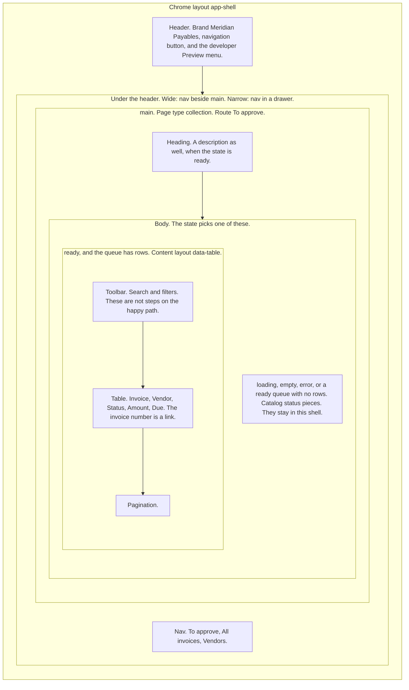

Arrows in that diagram follow the regions down the page. `loading`, `empty`, and `error` replace the data table. They are not a step that happens before it.

The collection shell's slots are `Heading`, an optional `Description`, and `Body`. It has no primary-action slot. Approve is not on the queue. On To approve and All invoices the invoice number is a `Link` into the detail page. Vendors is the same shell and the same content layout, with columns Vendor, Open invoices, and Last invoice, and no row link.

Search, filters, sort, and paging live in the data table. The task graph does not count them as steps. The default invoice sort is due date, ascending.

`loading`, `empty`, and `error` render in the collection body and are not content layouts. The ready body, when the filtered queue has rows, is `<DataTable />` with a toolbar, a table, and pagination. An empty ready queue uses `EmptyState` in the shell instead.

### One invoice

Choosing an invoice number opens the detail page inside the same app shell. The URL is `?invoice=inv-1842` from To approve, and it keeps `route=invoices` when you came from All invoices. Vendors rows have no link.

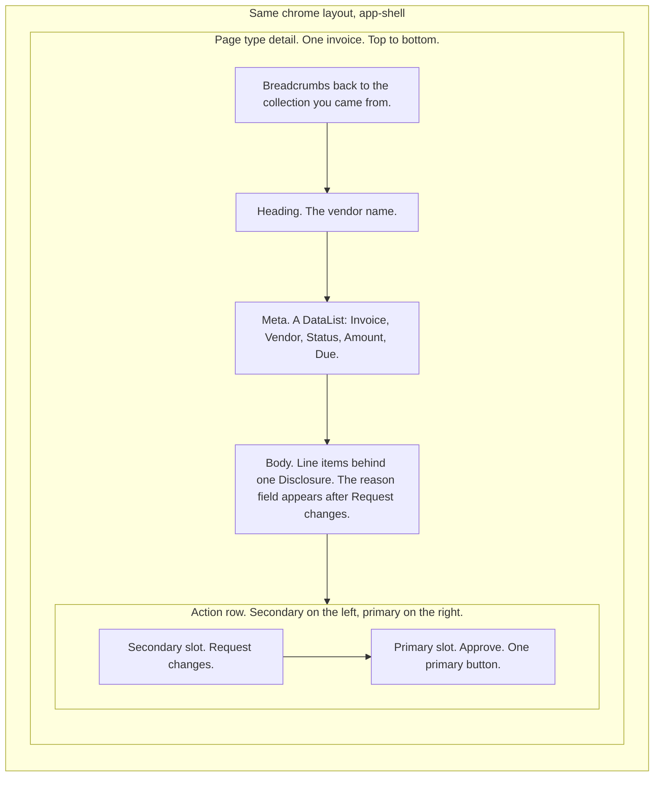

The arrows follow the regions down the page. The action row places secondary to the left of primary, which is how `DetailPage` renders them.

Detail slots are optional breadcrumbs, a heading, optional meta, a body, one primary, and optional secondary. The primary slot accepts one button. Request changes is `variant="secondary"`.

### Flow states

Six names are modeled, in `modeledStates`:

`loading`, `empty`, `error`, `ready`, `invoice-approved`, `changes-requested`.

`ready` covers both screens. Opening an invoice stays in `ready` and sets `screen` to `detail`. The shell stays up in every modeled state. Loading, empty, and error render inside `main`. A `?state=` value that is not one of those six names is ignored. An unknown `?route=` falls through to To approve. The **Preview** menu in the header is a developer aid for opening the modeled states. The default URL does not depend on it.

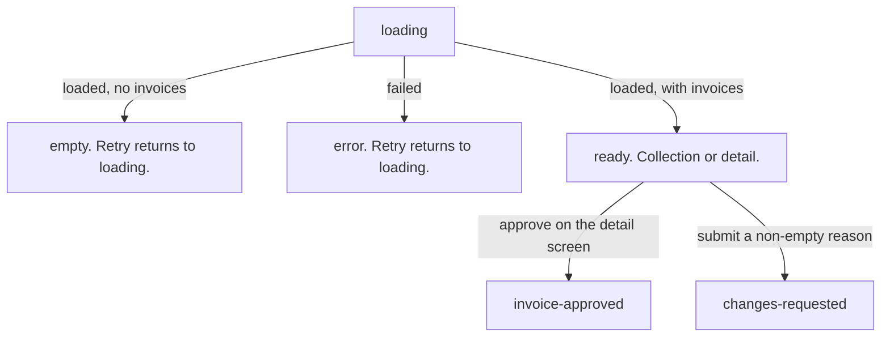

`transition` ignores `approve` on the collection screen and in `error`. An empty reason cannot reach `changes-requested`. `invoice-approved` and `changes-requested` have no further moves. Approve in the transition function does not require the line-item disclosure to be open, by decision. The step budget measures both this reducer and a separate task graph, below.

### Product-owned inputs

The rules read numbers and names the product owns, so a check can fail without a person re-deciding the number every time.

| Input | Value on main | Where |
| --- | --- | --- |
| Step budget | `approve-vendor-invoice` has `max_steps` 3 and `success_state` `invoice-approved` | `tasks` in `src/inputs/product.ts` |
| Priority | Approve, rank 1, primary. Request changes, rank 2, secondary. | `priority` in `src/inputs/product.ts` |
| Page types | `collection`, `detail` | `allowed_page_types` |
| Disclosure depth | 1. Line items are the one disclosure. Nothing nests under them. | `MAX_DISCLOSURE_DEPTH` in `src/rules/ux-rules.ts` |
| Disclosed sections | `Line items` sit behind a disclosure | `disclosed_sections` in `src/inputs/product.ts` |
| Disclosures per page | 1 | `MAX_DISCLOSURES_PER_PAGE` |
| Visible questions | 1 per page outside a disclosure. A field on a branch, like the request-changes reason, still counts. | `MAX_VISIBLE_QUESTIONS` |
| Target size | 24 CSS px. No product exception is recorded. | `TARGET_MIN_PX` |

The budget check measures two paths for every task in `tasks`. Each task maps to one task graph module under `flows[].tasks` in `harness.config.ts`. Meridian's one task maps to `src/flows/invoice-approval/graph.ts`.

- **Modeled path.** The shortest path through the task graph in `src/flows/invoice-approval/graph.ts`. This is the reviewed path the budget is set for. Request changes is not an edge. Opening Line items is optional, so it is not an edge either. There is no approval-note step.
- **Shipped path.** The shortest path through the real `transition` reducer, from `flowStart` (the loaded To approve queue) over `userEvents` (the events a person can cause) to `success_state`. Today it is `open-invoice → approve`, 2 steps.

Both must fit `max_steps`, and they must be the same steps. Graph step names are the event types they stand for. A reducer that grows a step fails the build even if nobody updates the graph. A reducer that drops or swaps a step, or a graph that keeps one the reducer never needed, fails too.

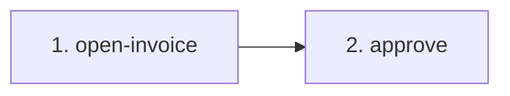

The modeled path length is 2, and `max_steps` is 3. Success is the state `invoice-approved`, which is not an extra counted step. [Proposal 0001](../proposals/0001-approval-note.md) asks to require an approval note and raise the budget to 4. It is open. It is not applied. The shipped invoice does not ask for a note. [Proposal 0003](../proposals/0003-two-step-approve.md) records the 2-step path and corrects 0001: with the note, the path is 3, inside the current budget.

## Which check enforces which rule

Each entry in `uxRules` names a structural check, an input, and a review question. The checks fail the build. The questions stay in `review/`.

The `input` column is the field on the rule. The last column is the file the script actually imports or parses. Those differ for progressive reveal: the rule points at `priority`, and `check:disclosure` reads the caps in `ux-rules.ts`.

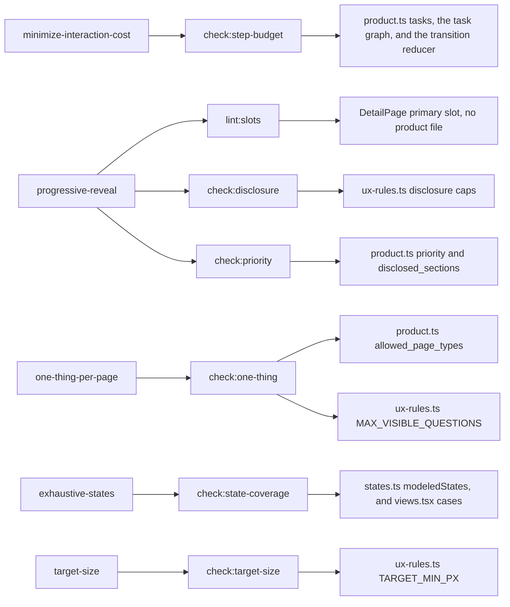

| Rule | Check named on the rule | Input named on the rule | What the script reads | Review question |
| --- | --- | --- | --- | --- |
| `minimize-interaction-cost` | `npm run check:step-budget` | `src/inputs/product.ts#tasks` | Every entry in `tasks`. For each, the task graph and the `transition` reducer exported by the module `flows[].tasks` in `harness.config.ts` maps it to | Is an extra step earning its cost? |
| `progressive-reveal` | `npm run lint:slots && npm run check:disclosure && npm run check:priority` | `src/inputs/product.ts#priority` | Slot shape in JSX. Disclosure caps in `src/rules/ux-rules.ts`. `priority` and `disclosed_sections` in `src/inputs/product.ts`. | Is the thing shown first actually what people need first? |
| `one-thing-per-page` | `npm run check:one-thing` | `src/inputs/product.ts#allowed_page_types` | `allowed_page_types`, and `MAX_VISIBLE_QUESTIONS` | Does research support grouping these questions? |
| `exhaustive-states` | `npm run check:state-coverage` | `src/flows/invoice-approval/states.ts#modeledStates` | `modeledStates`, and the `case` labels in `src/features/invoice-approval/views.tsx` | Did we model the states that actually happen? |
| `target-size` | `npm run check:target-size` | No product exception is recorded. WCAG 2.5.8 spacing may pass an undersized control. | `TARGET_MIN_PX` | Should an important control aim for the stricter 44 CSS px enhanced size? |

The Todae names below, such as `Button.Root` and its `variant`, `Disclosure.Root`, `Disclosure.Summary` and `Field.Root`, are not in the scripts. Each script reads them from the design system adapter that `harness.config.ts` names, `adapters/todae.ts`. `fixtures/fake-ds/` is UI for a stand-in design system with other names, and `check:fixtures` requires the checks to pass it under its own adapter.

Write a button's variant as a plain string, as in `variant="secondary"`. A braced literal, `variant={"secondary"}`, is read as the variant too, but `check:priority` also reads it as part of the button's text, so "Request changes" becomes "secondary Request changes" and the check fails. A button with no variant is primary, because the adapter says Todae's default is. A variant computed from an expression, such as `variant={tone}`, counts as neither primary nor secondary. So a computed variant on Approve or Request changes fails `check:priority`, and one in the detail primary slot fails `lint:slots`. On a collection page, `check:one-thing` does not count it as a primary, even if it renders as one.

What each script fails, in the words the code implements:

- **Step budget.** Every task maps to one task graph in `harness.config.ts`, every mapped id is a task, and each graph exports that task's id as its `taskId`. For each task, the modeled path and the shipped path must exist, be at most `max_steps`, and be the same steps. `fixtures/illegal/over-budget` has a longer graph. `fixtures/illegal/over-budget-flow` has a 3-step graph and a reducer that needs 4. `fixtures/illegal/graph-flow-drift` has a 3-step graph and a reducer that needs 2. `fixtures/illegal/task-without-graph` maps a graph for only one of two tasks, and `fixtures/illegal/second-task-over-budget` puts the second of two tasks over budget. `fixtures/two-tasks` passes with both tasks measured.
- **Slots.** Every `DetailPage` has exactly one `DetailPage.Primary`, and that slot has exactly one primary `Button.Root`. `fixtures/illegal/two-primaries` puts two buttons there. The check does not name `DetailPage`: `shells.primarySlots` in `harness.config.ts` maps a page type to its primary slot, Meridian's `{ detail: "Primary" }`, and the shell's name comes from that page type's module. Every page type named there renders at least one page, a page type that is not in `allowed_page_types` fails, and a config that names none fails, so the rule cannot go quiet. `fixtures/illegal/primary-slot-from-config`, `fixtures/illegal/shell-rule-unknown-page-type` and `fixtures/illegal/no-primary-slot` prove it.
- **Disclosure.** A page is one rendered page-type shell in `src/features`, plus what renders on it: components its JSX uses (local, or imported from a relative path), its content layouts, the page-type shell module, and the chrome layouts. `scripts/lib/page-scope.ts` builds that scope. It follows JSX tags and calls to helper functions, and it undoes import aliases such as `Field as F`. A `Disclosure.Root` or `Field.Root` in `src/features` that no page reaches, such as JSX held in a variable outside the shell, fails both checks, because a per-page cap cannot count it. The checks also fail when no page is found. On each page, the number of `Disclosure.Root` elements is at most `MAX_DISCLOSURES_PER_PAGE`, and nesting, followed across components, is at most `MAX_DISCLOSURE_DEPTH`. `fixtures/illegal/disclosures-per-page` puts one disclosure in each of two component files on one page. The check also fails if the catalog stops exporting `Disclosure`.
- **Priority.** The only primary button's text is the rank-1 action, Approve, and it is not inside a disclosure. The rank-2 action, Request changes, is one `variant="secondary"` button. Each entry in `disclosed_sections` is the text of a `Disclosure.Summary`. The sections come from that input, not from the script: `fixtures/own-sections` discloses "Attachments" and passes, and `fixtures/illegal/renamed-disclosed-section` runs the same inputs on the fixture product's pages, which disclose only Line items, and fails. `fixtures/illegal/missing-disclosed-section` shows line items in the open.
- **One thing.** `allowed_page_types` decides which shells exist. The check does not keep a second list of page-type ids. The rules hold per page, not per product: a product may render a page type as often as it needs, from as many files, but no page renders another page inside it, in its own JSX or through a component it renders, including one imported under another name, and each allowed page type renders at least one page. `fixtures/two-collection-pages` passes with two collection pages in two files, and `fixtures/illegal/nested-page` renders a collection page inside a detail page. The nesting rule follows the same page scope as the caps, so a page held in a variable and rendered as `{others}` is not seen as nested. A collection page has no primary button, including inside a content layout that page uses. Which page types are collections, and which of their slots are chrome rather than body, comes from `shells.collections` in `harness.config.ts`, Meridian's `{ collection: ["Heading", "Description"] }`. `fixtures/illegal/collection-from-config` names detail as a collection too and fails, and `fixtures/no-collection` names none and passes. A question is a `Field.Root`, the catalog part that wraps every Todae input, select and textarea. On each page, in the same scope as the disclosure check, the questions outside a disclosure are at most `MAX_VISIBLE_QUESTIONS`. A field shown only on a branch still counts, because the check reads code, not runtime state. Two arms of one ternary both count, even if only one shows at a time. Menu-based filter facets are not `Field.Root`, so they are not questions. The detail page's one question is the request-changes reason. The collection page's one question is the data table's search field. The check fails if the catalog stops exporting `Field`, so the cap cannot go quiet. `fixtures/illegal/two-questions`, `fixtures/illegal/hoisted-question` and `fixtures/illegal/dead-question-part` prove it.
- **State coverage.** Every string in `modeledStates` is a `case` in the views. `fixtures/illegal/missing-view` omits `invoice-approved`. Typecheck is a second gate for the same idea: `renderedStates` has to satisfy `ModeledState`.
- **Target size.** The script builds and serves the app in `paths.web`, the directory with the product's `index.html`. Controls inside `[data-page]` are at least 24 CSS px on each side, or the WCAG 2.5.8 spacing exception applies. The script also checks that the Todae button token floor is at least 24. It needs Chrome. It opens every state in each flow's `modeledStates`: bare, or once per query string that flow's `previews` in `harness.config.ts` lists for it, such as `page=detail`. A state added later is opened without editing the script, and a `previews` entry for a state that is not modeled, or one that sets `state` itself, fails. It clicks a disclosure summary on the page when one is present. `--list` prints the previews without Chrome, which is how `fixtures/two-tasks` and `fixtures/illegal/stale-preview` test it.

`check:inventories` is not one of the five UX rules. It is the membership gate in the next sections. `npm run check` runs it between `check:one-thing` and `check:state-coverage`.

## What an agent does on a task

`AGENTS.md` states the loop. The checks are the part that does not depend on the agent remembering it.

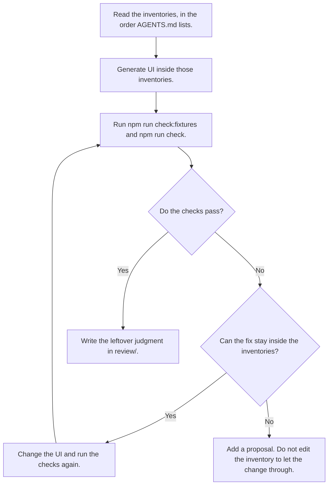

The inventories to read, in order, are the product inputs, the UX rules, the catalog, layouts, content layouts, page types, the flow model, and `proposals/README.md`.

`npm run check:fixtures` runs the harness's own tests. `fixtures/product/` is a small Todae product with its own `harness.config.ts`, and every check passes it. Every other folder directly under `fixtures/` or `fixtures/illegal/` is a case. Its `case.ts` names the config paths it replaces in the fixture product's config, and the checks to run on the result, each with the phrase it must print. `check:fixtures` runs each check the way a product runs it, as its npm script with `--config`, so a case differs from the fixture product only in what it names. It exits 0 only when every illegal case fails its checks with their phrases and every legal case passes its checks with theirs. A folder with no `case.ts` fails the run, so no fixture is left out. So does a case that names a path that does not exist, or whose phrase is part of one of its own paths, since a crash prints the path and could pass a case whose rule never ran. A fixture has no pull request base, so `check:inventories` compares it through `--base`: with the fixture product when its case gives a `base`, and with itself otherwise.

`npm run check` is the build gate, in this order: `typecheck`, `lint` (ESLint, then `lint:product-ui`, then `lint:slots`), `check:step-budget`, `check:disclosure`, `check:priority`, `check:one-thing`, `check:inventories`, `check:state-coverage`, `check:target-size`, and `test`.

CI runs that pair on every pull request and on every push to `main`. The workflow checks the repo out with full history, installs Node 22 and Chrome, runs `npm ci`, and sets `INVENTORY_BASE` to the pull request's base SHA, or to `github.event.before` on a push. The inventory check needs that SHA in the clone.

The fixtures the gate has to reject:

| Fixture | What is wrong | Phrase the output must contain |
| --- | --- | --- |
| `two-primaries` | Two buttons in the detail primary slot | `accepts exactly one primary button, found 2 primary` |
| `over-budget` | A task graph and shipped flow with an approval-note step | `modeled path length 4 exceeds max_steps` |
| `over-budget-flow` | A 3-step graph, and a reducer that needs Line items and a note before Approve | `shipped flow path length 4 exceeds max_steps` |
| `graph-flow-drift` | A 3-step graph that requires Line items, and a reducer that lets Approve through without them | `does not match the modeled path` |
| `task-without-graph` | Two tasks, and a task graph mapped for only one | `has no task graph` |
| `second-task-over-budget` | Two tasks, and the second one's graph over its budget | `exceeds max_steps 2 for archive-note` |
| `graph-without-task-id` | A task mapped to a graph that exports no `taskId` | `does not export a taskId` |
| `stale-preview` | A preview for a state that is not in `modeledStates` | `which is not a modeled state` |
| `preview-sets-state` | A preview query that sets `state` itself | `sets state itself` |
| `nested-page` | A collection page rendered inside a detail page | `page inside it` |
| `aliased-nested-page` | A detail page imported under another name, inside a collection page | `page renders a DetailPage page inside it` |
| `two-questions` | A note field and a reason field outside a disclosure on one detail page | `questions outside a disclosure` |
| `hoisted-question` | Two fields built in variables outside the shell | `is not reached from any page` |
| `dead-question-part` | A catalog without `Field` | `not exported by the catalog` |
| `disclosures-per-page` | Two disclosures on one detail page, one per component file | `more than 1 per page` |
| `missing-disclosed-section` | Line items in a table with no disclosure | `is not behind a disclosure` |
| `renamed-disclosed-section` | Inputs that disclose Attachments, on the fixture product's pages | `"Attachments" is not behind a disclosure` |
| `off-catalog` | A raw `<button>` | `raw <button> is not a catalog control` |
| `missing-view` | `invoice-approved` has no view case | `has no view` |
| `undeclared-layout` | A `side-panel` directory beside `app-shell` | `undeclared layout` |
| `inventory-expansion` | `allowed_layouts` gains `side-panel`, and no proposal | `without a proposal` |
| `undeclared-content-layout` | A `board` directory beside `data-table` | `undeclared content layout` |
| `content-layout-expansion` | `allowed_content_layouts` gains `board`, and no proposal | `without a proposal` |
| `ad-hoc-content` | A status board and page CSS inside the collection body | `not a registered content layout` |
| `fake-ds-two-primaries` | Two strong actions in the primary slot, under the stand-in adapter | `found 2 primary and 2 Action` |
| `fake-ds-nested-reveal` | A disclosure inside a disclosure, under the stand-in adapter | `disclosure depth 2 exceeds 1` |
| `fake-ds-over-caps` | Two disclosures, two open questions, and the strong action in a disclosure, under the stand-in adapter | `page has 2 disclosures`, `shows 2 questions outside a disclosure`, `a primary button is inside a disclosure` |
| `fake-ds-collection-primary` | A strong action on a collection page, under the stand-in adapter | `puts a primary button on the collection page` |
| `fake-ds-hoisted` | A disclosure and a question held outside any page, under the stand-in adapter | `Reveal.Root is not reached from any page`, `Ask is not reached from any page` |
| `fake-ds-off-catalog` | `@fake/ds` imported outside its catalog | `off-catalog: import "@fake/ds" directly` |
| `primary-slot-from-config` | The config names the detail shell's `Secondary` slot as its primary slot | `found 0 primary and 1 Button.Root` |
| `collection-from-config` | The config names detail as a collection too | `puts a primary button on the collection page`, `is not a registered content layout` |
| `shell-rule-unknown-page-type` | The shells rules name page types the product does not allow | `which is not in allowed_page_types` |
| `no-primary-slot` | The config names no primary slot | `names no page type, so no primary slot is checked` |

The cases the gate has to pass:

| Case | What it shows | Checks |
| --- | --- | --- |
| `product` | The fixture product passes every check, so each case above fails for its own change | All nine rule checks; `check:target-size` with `--list` |
| `fake-ds` | Pages in a stand-in design system with no Todae names. Every check here but the off-catalog lint fails them under the Todae adapter, so passing shows a check reads its names from the adapter | `lint:slots`, `check:priority`, `check:disclosure`, `check:one-thing`, `check:inventories`, `lint:product-ui` |
| `two-tasks` | A notes inbox with two tasks: every mapped task is measured, and every modeled state is previewed | `check:step-budget`, `check:target-size` with `--list` |
| `two-collection-pages` | Two collection pages in two files: a product may render a page type as often as it needs | `check:one-thing` |
| `own-sections` | Inputs that disclose Attachments: the disclosed sections come from the input | `check:priority` |
| `no-collection` | A config that names no collection: the collection rules read only what the config names | `check:one-thing`, `check:inventories` |

`check:fixtures` is how the repo knows those gates still fire. A green `check` on the product, with a green `check:fixtures`, means the product passed and the known-bad shapes still fail.

`products/nook/` is a second product, a room booking app called Nook, with its own `harness.config.ts`, inputs, rules, catalog, flow, page types (`booking` and `rooms`), layout and content layout. It is not a copy of Meridian: its record page is `BookingPage`, with its one primary action, Book room, in `BookingPage.Action`, and its list is `RoomsPage`. It passes every check in `npm run check` without a change to a rule. CI runs it as its own job with `npm run check:product -- --config products/nook/harness.config.ts`, which runs each check in `check` against that config, `check:target-size` included. `npm run dev:nook` starts it.

Anything the checks cannot decide goes in `review/` as a short note. The notes on main are `review/approve-vendor-invoice.md`, `review/inventories.md`, and `review/content-layouts.md`. Each one splits "what the checks already decided" from "what the checks cannot decide."

## How the repo gets more capable

A gap is a design that needs a catalog export, a layout, a content layout, a page type, a flow state, or a rule input the inventories do not record. The agent does not invent that piece. It writes a proposal.

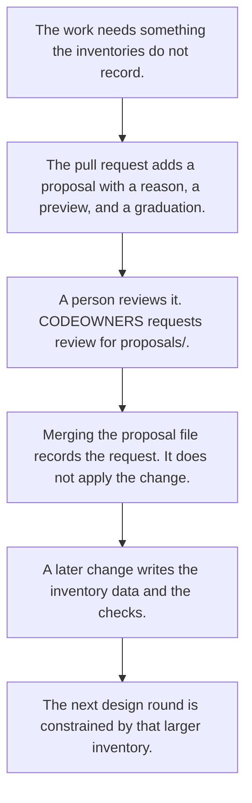

`proposals/README.md` requires four things in the file: the rule or input it wants to change, a reason, a preview of the UI or the path, and the graduation, meaning which file would change on approval. `CODEOWNERS` requests review from `@tounsoo` for everything under `proposals/`.

Proposal 0001 is the example on main of a request that has been recorded and not applied. It asks for an approval note and `max_steps` 4. Proposal 0003 corrects its step counts rather than editing it. Until a graduating change lands, the budget stays 3 and the note stays out of the UI.

A proposal can also record a decision instead of a request. Proposals 0003 and 0004 say `Status: decided`: each one landed with the change it describes, so nothing graduates later. `proposals/README.md` describes both kinds.

The next round is more capable because the structure grew. The agent reads a longer allowlist and a check that enforces it. The skill text did not have to get longer. The page's words for that move are "encode it. Delete the instruction."

## When a proposal is required

`npm run check:inventories` compares membership with the pull request base. On CI the base is `INVENTORY_BASE`. If that variable is unset, empty, `true`, `false`, or all zeros (what `github.event.before` holds when a push has no previous commit), the script uses `origin/main`, or a local `main` when the clone has no `origin/main`. If `HEAD` is that commit, it compares the tree with itself. Otherwise it uses the merge-base of `HEAD` and main.

A product whose config and inputs the base has neither of is new: the check records its inventories without a comparison, and still runs the directory and content-layout checks below. That is how Nook's first pull request passed. A list the base file does not export is skipped. That is the bootstrap that recorded `allowed_layouts`, and the one that recorded `allowed_content_layouts` in pull request 8. Since pull request 8 both lists exist on main, so a later pull request cannot introduce either list again. Adding or removing an id is a membership change.

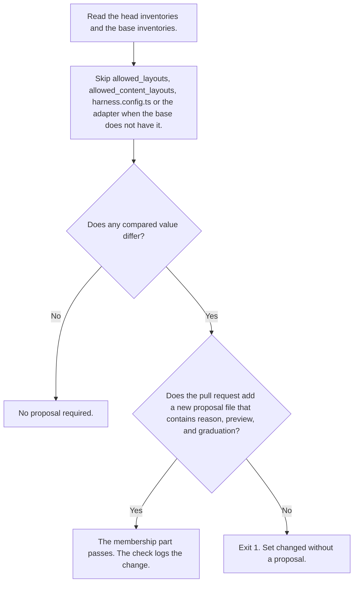

Compared values, from `membershipChanges` in `scripts/check-inventories.ts`:

- `allowed_layouts` and `allowed_content_layouts`, only when the base already exports them
- `allowed_page_types`
- catalog export names: named exports and re-exports, including `export type { … }`, and exported variables, functions, classes and type aliases. Exported interfaces and enums, and `export *`, are not read. The check compares names only, so pointing an existing name at another component is not a change
- `modeledStates`
- each task's `max_steps`
- each priority item's action, rank, and level
- `disclosed_sections`, only when the base already exports it
- `MAX_DISCLOSURE_DEPTH`, `MAX_DISCLOSURES_PER_PAGE`, `MAX_VISIBLE_QUESTIONS`, and `TARGET_MIN_PX`
- every path in `harness.config.ts` and its `flows` list, only when the base already has the file, and the adapter path it names, only when the base config already names one. The base is read at the paths its own config names, or at the head's paths when it has none
- the design system adapter that `harness.config.ts` names, field by field, only when the base config already names one
- the config's `shells` rules, which page types have a primary slot or are collections, and their slots

String lists are sorted and de-duplicated before the comparison, so reordering `allowed_page_types` without adding or removing an id is not a change. Changing `max_steps` from 3 to 4 is a change, even though the task id stays.

**Editing an existing id is not a membership change.** Rewriting `src/layouts/app-shell`, `src/content-layouts/data-table`, or a page-type shell, while the id stays in the allowlist, does not require a proposal. `proposals/README.md` says that in those words. Slot behavior, copy, and invoice fields are outside the membership set.

**A new file is required.** The check ignores `proposals/README.md`. It counts any `.md` file under `proposals/`, subfolders included, that the base does not already have. Editing proposal 0001 does not explain a new membership change. The words are a case-insensitive substring test: the body has to include `reason`, `preview`, and `graduation`. The check does not read whether those sections describe this diff.

Two other checks in the same script always run, and a proposal does not waive them:

- Directory names under `src/layouts`, `src/content-layouts`, and `src/page-types` match the allowlists in both directions. Any other file directly in those directories, besides `index.ts`, fails too. Imports of those ids must be on the lists. The `pageTypes` export matches `allowed_page_types`, and `src/page-types/index.ts` may not re-export an id that is not on it.
- In the ready state, a collection body is one registered content layout, and the feature does not pass ad-hoc children into it. Loading, empty, and error may stay in the shell. Page CSS for a class the feature uses fails when no content layout, chrome layout, or page type uses that class.

So a new content layout needs three things that are different jobs: the id in `allowed_content_layouts`, a matching directory, and a new proposal if that id is a membership change against the base. The directory check fails an extra folder even when a proposal is present. The membership check fails a new id when the proposal is missing.

## Worked example: the tracking board

This is the loop under a real gap, as it stood when [pull request 8](https://github.com/tounsoo/agent-design-loop/pull/8) merged as `4a473ed`. [Pull request 7](https://github.com/tounsoo/agent-design-loop/pull/7) was open then. It was closed on November 11, 2026 (UTC) without merging, so main's only content layout is still `data-table`, the board never shipped, and proposal 0002 is not on main. The example is history: it shows the gate firing, not something main contains.

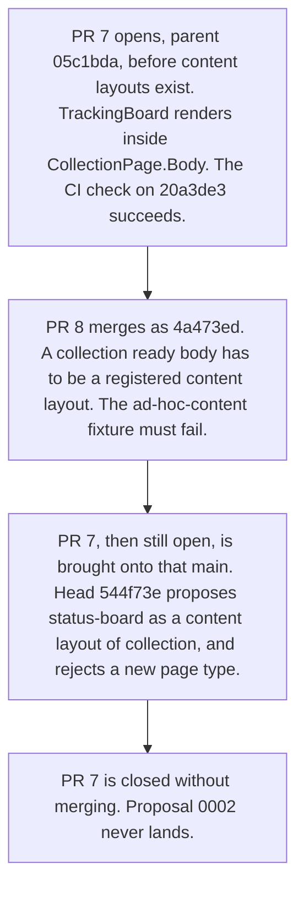

**Before content layouts.** The first commit on pull request 7, `20a3de3`, is based on `05c1bda` (pull request 6, the inventory gate, before content layouts). Its tree has no `src/content-layouts` directory. The Tracking route renders `<TrackingBoard />` inside `CollectionPage.Body`. That component lives in `src/features/invoice-approval/tracking.tsx`: columns of cards, not a registered layout id. The GitHub check run on `20a3de3` completed with success. Nothing in the checks of that parent looked at the shape of a collection body. A distinct composition could ship inside `collection` without touching `allowed_layouts` or `allowed_page_types`. That is the gap pull request 8 records in its description.

**The gate.** Pull request 8 records content layouts. `allowed_content_layouts` is `data-table`, the filter bar, table, and pagination already used by To approve, All invoices, and Vendors. The base of that pull request did not export the list, so recording the existing composition was the bootstrap. It adds `fixtures/illegal/ad-hoc-content`: a `CollectionPage` whose ready body is a stack of cards with the page class `tracking-board`. `check:fixtures` requires the inventory check to reject it with `not a registered content layout`. After this landed, dropping a board into the collection body fails.

**After the rebase.** Pull request 7's head `544f73e` is updated onto main `4a473ed`. Tracking stays a nav item in the app shell. It is not a step on `approve-vendor-invoice`. The ready body is a new content layout, id `status-board`, used as `<StatusBoard />` with no ad-hoc children. `allowed_page_types` stays `collection` and `detail`. `allowed_layouts` stays `app-shell`. `max_steps` stays 3.

The proposal on that branch, `proposals/0002-tracking-board-card.md`, explained why the other inventory was the wrong one to grow. A page type is a new shell. Tracking still uses the collection shell: one heading, a description, a body, and no primary action. Loading, empty, and error stay in that shell. The reader picks one invoice and opens the existing detail. The difference from To approve, All invoices, and Vendors is the body, columns of cards instead of a filter bar and a table. Content layouts are the compositions that fill a page type's body. Adding a page type would duplicate the collection shell for a body the content-layout inventory was added to hold. `check:one-thing` reads `allowed_page_types` for the shells a page can use.

The same proposal also asked to export `Card` from the catalog, because the card was not in the catalog on main. The check accepts either a new content layout or a new page type once a proposal file explains it. It does not choose. That judgment is written down in `review/content-layouts.md` on main. Pull request 7 had its own note, `review/invoice-tracking.md`, which closed with it.

## What this shows, and what it does not

The checks on main pass, and the fixture script requires the known-bad shapes to fail. CI runs both on pull requests. The check run on pull request 8 passed before it merged. The check run on pull request 7's first commit, `20a3de3`, succeeded while the board was still loose markup. The check run on its later head, `544f73e`, succeeded again after the board was registered with proposal 0002. Pull request 7 was then closed without merging.

That is a small number of runs. The agents that opened these pull requests were working in a repo that already tells them the theory, in `AGENTS.md` and in the task. A green check shows that these gates fire on the fixtures and on these branches. It does not show what an agent would do if nobody had told it the loop.

Three limits are in the code and in `review/inventories.md`, and they are still open:

**Proposal quality is keyword-matched, not judged.** `proposalExplains` lowercases the file and looks for the three substrings `reason`, `preview`, and `graduation`. A file that contains those words passes the test. The check does not decide whether the reason is good, or whether the preview is the right UI.

**A pull request can graduate early.** The intended path is the graduation diagram above: merging the proposal records the request, and a separate change applies it. `reportMembership` accepts the membership edit in the same pull request, as soon as one new explaining proposal exists. It does not check that the proposal and the diff waited for each other.

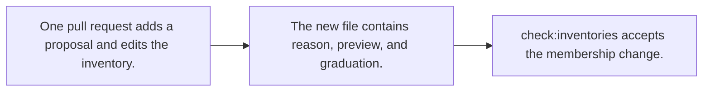

Pull request 7 was an example before it closed: proposal 0002 applied the `Card` export and `status-board` in the same change, and the keyword check allowed it. Proposals 0003 and 0004 land with their changes on purpose, marked `Status: decided`. The check cannot tell that from a request graduating early. `review/inventories.md` says a reviewer has to refuse an edit that should have waited. The check will not.

**Judgment stays in `review/`.** The five review questions are unanswered by the checks: whether a step earns its cost, whether the first thing on screen is the right first thing, whether research supports the page split, whether the modeled states are the ones that happen, and whether an important control should aim for 44 CSS px instead of the 24 CSS px floor. The inventory notes add more that the check cannot see. A proposal's reason can be weak and still match the keywords. An implementation edit that keeps the same ids can change the product enough to deserve a proposal, and the membership set will not notice. A redesigned table inside `src/content-layouts/data-table` keeps the id `data-table`, and the check cannot tell that redesign from a different composition that reused the directory. Whether a future board should be a content layout or a page type is a choice the check accepts either way, once a proposal exists.

Those limits are the next gaps. The way the repo is built to close one is the same loop: a check or an inventory entry for a lesson that keeps recurring, and a review note where a person still has to decide.

## If you are about to change the UI

Read [AGENTS.md](../AGENTS.md), then the files it lists. Run `npm run check:fixtures && npm run check`. Fix exit codes inside the inventories. Write a review note for what the checks cannot decide. If the work needs a recorded thing that is missing, add a file under `proposals/` and leave the inventory alone until a person approves the graduation.
