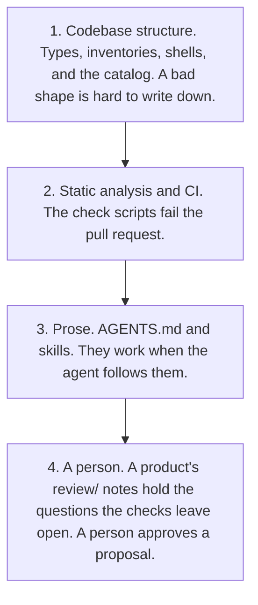
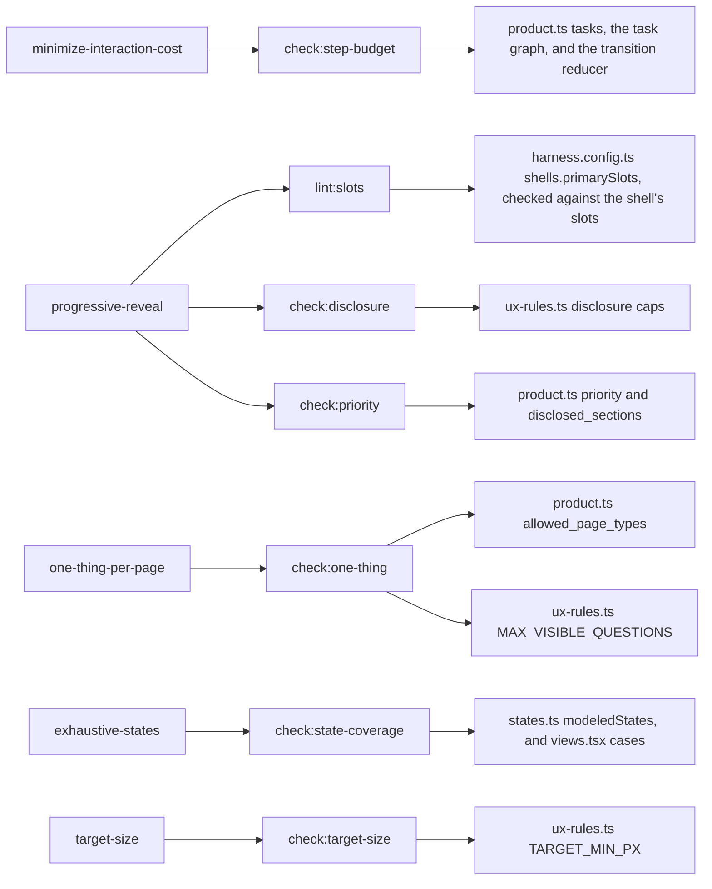
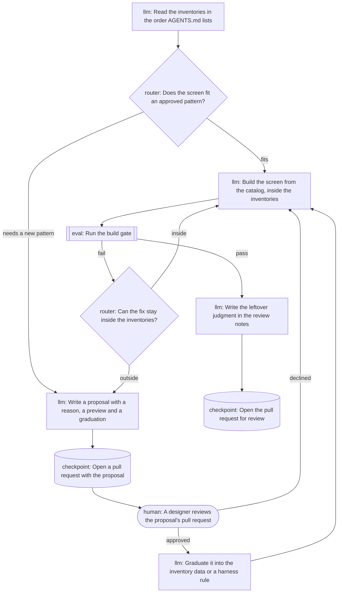
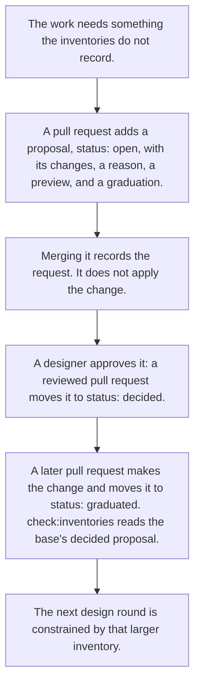
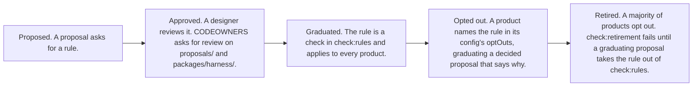
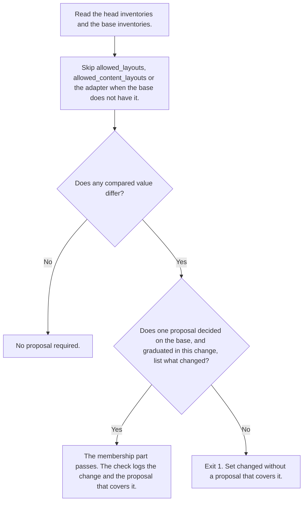
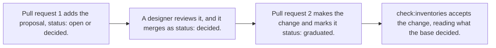

# How this design loop works

This repository is a test of one idea: an agent designs better UI when the constraints live in the project, where a failing check can stop a pull request, than when they live only in a prompt.

The harness is the checks in `packages/harness/`, and a product plugs into it through its own `harness.config.ts`. The worked example on this page is **Meridian**, an accounts-payable workspace under `products/meridian/`. Its task is `approve-vendor-invoice`: review a vendor invoice and approve it. The layers on a Meridian screen, its flow states, and the inputs its rules read are on [How Meridian works](../../../products/meridian/docs/how-it-works.md).

This page is for a designer or engineer who has never opened the repo. It describes main, and it is not pinned to a commit, because a pin goes stale on the next merge. Commit ids below are history, not the current main. If this page and the code disagree, the code and the checks win. [AGENTS.md](../../../AGENTS.md) stays a pointer for the agent. It does not restate the inventories, and this page is not a second inventory.

## The control ladder

The repo is built as a ladder of controls. A higher rung does not need the agent to cooperate. A lower rung does.

Read it from the top. Structure is the strongest control this repo has. Prose is weaker, because text has to be noticed. A person is last, for the decisions the structure cannot make.

Lauren Tan (poteto) states why a check beats an instruction in [Encode lessons in structure](https://www.skills.sh/poteto/plugins/principle-encode-lessons-in-structure). The page says textual instructions are easy to miss: "They require the reader to notice, remember, and comply." Structural mechanisms, "lint rules, metadata flags, runtime checks, automation scripts", enforce the rule without that cooperation. When more than one mechanism would work, the page says to pick the strongest the situation allows: an unrepresentable state that cannot compile, then a lint or banned API that fails CI, then a canonical helper, then a runtime check, "because agents copy whatever the surrounding code already does and a weaker guard becomes the next template."

The diagram is this repo's use of that idea. Codebase structure is the unrepresentable state and the helper the next edit copies. The check scripts are the CI rung. Prose and a person are the case the page leaves for judgment. The page does not call those structural rungs.

Here is how those rungs show up in Meridian:

- **Cannot compile.** `renderedStates` in `products/meridian/features/invoice-approval/views.tsx` is `satisfies readonly ModeledState[]`. Drop a modeled state from that list and `npm run typecheck` fails. The view `switch` ends in `never` for the same reason. `success_state` on a task is typed as `ModeledState`.
- **Fails CI.** `npm run check` is the lint, the UX checks, the inventory check, and the tests. `npm run lint:product-ui` rejects a raw `button`, `input`, `select`, `textarea`, or `a`, a `style` attribute, a direct import of the design system's package outside the product's catalog directory (for Meridian, `@tounsoo/todae` outside `products/meridian/catalog`), a foreign component kit, and a relative import that reaches outside the directories the product's config names, such as Nook importing Meridian's catalog.
- **Canonical helper.** The catalog, the page-type shells, and the content layouts are the code the next edit is supposed to copy. There is no second way to build a button.
- **Runtime check.** `CollectionPage` and `DetailPage` throw while rendering if a required slot is missing or any slot is repeated, and the detail primary slot throws unless it holds one button. CI checks the detail primary slot in `npm run lint:slots`, so a bad primary fails before anyone opens the screen.

The page's pattern, when the same instruction is about to be written a second time: if it can be a lint rule, a metadata flag, a runtime check, or a script, encode it and delete the instruction. If it genuinely requires judgment, make the instruction prominent and add an example of the failure. The corollary on the page: "If the fix is structural, ONLY use the structural fix. The instruction IS the symptom." That is why `AGENTS.md` stays a pointer. Growing the skill text is the weaker move. Growing an inventory, and a check that reads it, is the stronger one.

A check beats an instruction for that reason. The instruction needs the agent's cooperation. The check exits non-zero, and CI on every pull request runs it. There is no LLM judge on CI.

## Which check enforces which rule

Each entry in `uxRules` names a structural check, an input, and a review question. The checks fail the build. The questions stay in the product's `review/` notes.

The `input` column is the field on the rule. The last column is the file the script actually imports or parses. Those differ for progressive reveal: the rule points at `priority`, and `check:disclosure` reads the caps in `ux-rules.ts`. The table shows Meridian's rules, in `products/meridian/rules/ux-rules.ts`.

| Rule | Check named on the rule | Input named on the rule | What the script reads | Review question |
| --- | --- | --- | --- | --- |
| `minimize-interaction-cost` | `npm run check:step-budget -- --config products/meridian/harness.config.ts` | `products/meridian/inputs/product.ts#tasks` | Every entry in `tasks`. For each, the task graph and the `transition` reducer exported by the module `flows[].tasks` in the product's `harness.config.ts` maps it to | Is an extra step earning its cost? |
| `progressive-reveal` | `npm run lint:slots -- --config products/meridian/harness.config.ts && npm run check:disclosure -- --config products/meridian/harness.config.ts && npm run check:priority -- --config products/meridian/harness.config.ts` | `products/meridian/inputs/product.ts#priority` | Slot shape in JSX. Disclosure caps in `products/meridian/rules/ux-rules.ts`. `priority` and `disclosed_sections` in `products/meridian/inputs/product.ts`. | Is the thing shown first actually what people need first? |
| `one-thing-per-page` | `npm run check:one-thing -- --config products/meridian/harness.config.ts` | `products/meridian/inputs/product.ts#allowed_page_types` | `allowed_page_types`, and `MAX_VISIBLE_QUESTIONS` | Does research support grouping these questions? |
| `exhaustive-states` | `npm run check:state-coverage -- --config products/meridian/harness.config.ts` | `products/meridian/flows/invoice-approval/states.ts#modeledStates` | `modeledStates`, and the `case` labels in `products/meridian/features/invoice-approval/views.tsx` | Did we model the states that actually happen? |
| `target-size` | `npm run check:target-size -- --config products/meridian/harness.config.ts` | No product exception is recorded. WCAG 2.5.8 spacing may pass an undersized control. | `TARGET_MIN_PX` | Should an important control aim for the stricter 44 CSS px enhanced size? |

The Todae names below, such as `Button.Root` and its `variant`, `Disclosure.Root`, `Disclosure.Summary` and `Field.Root`, are not in the scripts. Each script reads them from the design system adapter that the product's `harness.config.ts` names. Meridian's and Nook's configs both name `packages/adapter-todae/index.ts`. `packages/harness/fixtures/fake-ds/` is UI for a stand-in design system with other names, and `check:fixtures` requires the checks to pass it under its own adapter.

Write a button's variant as a plain string, as in `variant="secondary"`. A braced literal, `variant={"secondary"}`, is read as the variant too, but `check:priority` also reads it as part of the button's text, so "Request changes" becomes "secondary Request changes" and the check fails. A button with no variant is primary, because the adapter says Todae's default is. A variant computed from an expression, such as `variant={tone}`, counts as neither primary nor secondary, so the checks cannot tell what it renders. `check:priority` fails any action button with a computed variant, on any page, because it could be a second primary: `illegal/computed-variant`. One in the detail primary slot also fails `lint:slots`. On a collection page, `check:one-thing` does not count it as a primary, but `check:priority` fails it there too.

What each script fails, in the words the code implements. Fixture names are relative to `packages/harness/fixtures/`, the way `npm run check:fixtures -- illegal/two-primaries` names a case.

- **Step budget.** Every task maps to one task graph in the product's `harness.config.ts`, every mapped id is a task, and each graph exports that task's id as its `taskId`. For each task, the modeled path and the shipped path must exist, be at most `max_steps`, and be the same steps. The shortest path is not the only way through, so every other route to the same success must fit `max_steps` too, in the graph and in the reducer. A step is an event that a task graph in the same `flows[]` entry names, so with a hold-room task beside book-room, hold then book is a route to booked. A route takes any steps the flow allows, never back to a state it has passed, then finishes the shortest way any user event allows. Events no task names, such as an optional look or Back, count only when the finish needs them. The search stops a route once it passes the budget, measures a state once when no earlier state on the route can come back after it, so steps that can come in any order do not multiply, and fails a task when it would measure more than 10,000 states or look at more than 200,000 states for the shortest finishes. Two states are the same when they hold the same values, whatever order their keys were written in, and a Set or Map is read by what it holds. `longer-route` passes with a 3-step route inside a budget of 3, `illegal/route-over-budget` fails the same route against a budget of 2, and `illegal/modeled-route-over-budget` fails a graph whose shortest path fits but whose longest route does not. `illegal/over-budget` has a longer graph. `illegal/over-budget-flow` has a 3-step graph and a reducer that needs 4. `illegal/graph-flow-drift` has a 3-step graph and a reducer that needs 2. `illegal/task-without-graph` maps a graph for only one of two tasks, and `illegal/second-task-over-budget` puts the second of two tasks over budget. `two-tasks` passes with both tasks measured. The search names each flow state by its `status` field. A product whose states carry their name elsewhere exports `flowStatus(state)` from the graph module: `flow-status` passes with states named by `phase`, and `illegal/flow-state-without-status` fails the same graph without `flowStatus`, instead of measuring nothing.
- **Slots.** Every `DetailPage` has exactly one `DetailPage.Primary`, and that slot has exactly one primary `Button.Root`. `illegal/two-primaries` puts two buttons there. The check does not name `DetailPage`: `shells.primarySlots` in the product's `harness.config.ts` maps a page type to its primary slot, Meridian's `{ detail: "Primary" }`, and the shell's name comes from that page type's module. Every page type named there renders at least one page, a page type that is not in `allowed_page_types` fails, and a config that names none fails, so the rule cannot go quiet. The slot named there must be one the shell defines, as `Object.assign(Root, { ... })` in the page type's module or a module it re-exports from, so a misspelled slot fails instead of matching no element. `illegal/primary-slot-from-config`, `illegal/shell-rule-unknown-page-type`, `illegal/no-primary-slot` and `illegal/misspelled-primary-slot` prove it.
- **Disclosure.** A page is one rendered page-type shell in the config's `paths.features` (Meridian's `products/meridian/features`), plus what renders on it: components its JSX uses (local, or imported from a relative path), its content layouts, the page-type shell module, and the chrome layouts. `packages/harness/src/lib/page-scope.ts` builds that scope. It follows JSX tags and calls to helper functions, and it undoes import aliases such as `Field as F`. It follows a component imported under another name, a default export, and a named export through a barrel's `export { X } from` or `export *`: `imported-page-parts` passes with all three. A `Disclosure.Root` or `Field.Root` in the features directory that no page reaches, such as JSX held in a variable outside the shell, fails both checks, because a per-page cap cannot count it. The checks also fail when no page is found. On each page, the number of `Disclosure.Root` elements is at most `MAX_DISCLOSURES_PER_PAGE`, and nesting, followed across components, is at most `MAX_DISCLOSURE_DEPTH`. `illegal/disclosures-per-page` puts one disclosure in each of two component files on one page. The check also fails if the catalog stops exporting `Disclosure`.
- **Priority.** The rules hold per page, in the same page scope as the disclosure caps, with import aliases undone. On each page there is at most one primary button, its text is the rank-1 action, Approve, and it is not inside a disclosure, including one in a component the page renders. The rank-2 action, Request changes, is shown at most once on a page, as a `variant="secondary"` button. Across the product, at least one page holds the rank-1 primary and the rank-2 action is shown somewhere, and a primary or rank-2 button that no page reaches fails. `two-detail-pages` passes with Approve on two detail pages. `illegal/aliased-second-primary` adds a second primary under `Button as Control`, `illegal/primary-in-imported-disclosure` puts Approve in a component rendered inside a disclosure, and `illegal/page-inside-disclosure` puts the whole page inside one. `illegal/namespace-second-primary` writes the second primary as `UI.Button.Root` through `import * as UI`. Two shapes are still not seen: a button passed as children into a component that wraps its children in a disclosure, and a tag held in a local variable, such as `const Control = Button`. Each entry in `disclosed_sections` is the text of a `Disclosure.Summary`. The sections come from that input, not from the script: `own-sections` discloses "Attachments" and passes, and `illegal/renamed-disclosed-section` runs the same inputs on the fixture product's pages, which disclose only Line items, and fails. `illegal/missing-disclosed-section` shows line items in the open.
- **One thing.** `allowed_page_types` decides which shells exist. The check does not keep a second list of page-type ids. The rules hold per page, not per product: a product may render a page type as often as it needs, from as many files, but no page renders another page inside it, in its own JSX or through a component it renders, including one imported under another name, and each allowed page type renders at least one page. `two-collection-pages` passes with two collection pages in two files, and `illegal/nested-page` renders a collection page inside a detail page. The nesting rule follows the same page scope as the caps, so a page held in a variable and rendered as `{others}` is not seen as nested. A collection page has no primary button, including inside a content layout that page uses. Which page types are collections, and which of their slots are chrome rather than body, comes from `shells.collections` in the product's `harness.config.ts`, Meridian's `{ collection: ["Heading", "Description"] }`. Each chrome slot named there must be one the collection's shell defines, as for `shells.primarySlots`: `illegal/misspelled-chrome-slot` names `Heding` and fails. Every allowed page type is named in exactly one of `shells.primarySlots` and `shells.collections`, so leaving a collection out of the config cannot switch its rules off: `illegal/unclassified-page-type` names no collection and fails, and `illegal/page-type-in-both-rules` names detail in both and fails. A collection's pages must fill at least one slot outside its chrome, so naming the body slot as chrome fails too: `illegal/body-slot-as-chrome`. A question is a `Field.Root`, the catalog part that wraps every Todae input, select and textarea. On each page, in the same scope as the disclosure check, the questions outside a disclosure are at most `MAX_VISIBLE_QUESTIONS`. A field shown only on a branch still counts, because the check reads code, not runtime state. Two arms of one ternary both count, even if only one shows at a time. Menu-based filter facets are not `Field.Root`, so they are not questions. The detail page's one question is the request-changes reason. The collection page's one question is the data table's search field. The check fails if the catalog stops exporting `Field`, so the cap cannot go quiet. `illegal/two-questions`, `illegal/hoisted-question` and `illegal/dead-question-part` prove it.
- **State coverage.** Every string in `modeledStates` is a `case` in the views. `illegal/missing-view` omits `invoice-approved`. Typecheck is a second gate for the same idea: `renderedStates` has to satisfy `ModeledState`.
- **Target size.** The script builds and serves the app in `paths.web`, the directory with the product's `index.html`. Every control in the document, the page and the chrome around it, is at least 24 CSS px on each side, or the WCAG 2.5.8 spacing exception applies. A state that renders no `[data-page]` element is measured too. `target-size-whole-document` passes with 32 CSS px links in its chrome, and `illegal/small-control-outside-page` fails two 12 CSS px links beside the page. `illegal/small-control-in-closed-menu` fails two 12 CSS px links inside a closed menu in the chrome. The script also checks that the Todae button token floor is at least 24. It needs a headless Chrome: `CHROME_PATH`, then the chrome-headless-shell that `npm run setup:chrome` installs into `.cache/chrome`, then a system Chrome under `/usr/bin`. With none, it names each place it looked and both fixes. It opens every state in each flow's `modeledStates`: bare, or once per query string that flow's `previews` in the product's `harness.config.ts` lists for it, such as `page=detail`. A state added later is opened without editing the script, and a `previews` entry for a state that is not modeled, or one that sets `state` itself, fails. It clicks a disclosure summary on the page when one is present and measures. Then it opens every other closed disclosure in the document, such as a menu in the chrome, one at a time, measures what it shows, and closes it again. `--list` prints the previews without Chrome, which is how `two-tasks` and `illegal/stale-preview` test it. The three cases that measure need Chrome, as the check does.

`check:inventories` is not one of the five UX rules. It is the membership gate in the next sections. `check:rules` runs it between `check:one-thing` and `check:state-coverage`.

## What an agent does on a task

The loop is a graph in [`packages/harness/design-loop.ts`](../design-loop.ts). Nodes do the work, edges decide what runs next, and shared state carries what one run leaves for the next. `AGENTS.md` points the agent at it. Nothing executes the graph: the agent follows it, records each step in a [trace](#the-trace), and the checks are the part that does not depend on the agent remembering it. [Proposal 0009](../../../proposals/0009-design-loop-graph.md) records the decision.

<!-- design-loop:start, drawn by npm run check:loop -- --write -->

<!-- design-loop:end -->

Each node has a kind, and the shape in the diagram shows it.

- **llm.** The agent's own work, such as building the screen or writing a proposal. It has one edge out.
- **router.** A question the agent answers. Each edge out is one answer, named by its `when`.
- **eval.** npm scripts. The `pass` edge is taken when every script exits 0, and the `fail` edge otherwise. The eval node here runs the build gate, `npm run check:fixtures` and `npm run check`.
- **human.** The run stops until a person decides. Its `gate` is a `CODEOWNERS` pattern, and the review `CODEOWNERS` requests on that pull request is the approval. Its edges are `approved` and `declined`. `main` has no branch protection, so GitHub requests the review but does not block a merge without it.
- **checkpoint.** The work is saved where the next run and the reviewer read it, as a pull request. A checkpoint with no edge out ends the run. The proposal's checkpoint opens the pull request the human node reviews.

The graph's `state` lists what the nodes read and write: the inventories, the harness rules, the proposals, the product's UI and its review notes. A graduated proposal writes the inventories or the rules, so the next run reads a larger set.

`npm run check:loop` fails the build when the graph is not one an agent can follow:

- an edge names a node that does not exist, or a node is unreachable from the start or cannot reach an end
- an eval node runs a script `package.json` does not have or one that is not `check` or a `check:` script, lacks a `pass` or `fail` edge, or its `fail` edge never comes back to it, so a failing run has no retry
- an edge reaches an eval node from a node that writes none of the state the eval node reads, so the checks would run on unchanged work
- a human node's gate has no `CODEOWNERS` line with an owner, or its last line names none, or it lacks an `approved` or `declined` edge
- a router has fewer than two answers or repeats one, or an llm or checkpoint node has the wrong number of edges
- a node names state the graph does not declare, or declared state is never used
- a node id is not lowercase words joined by hyphens, or a label or `when` holds a double quote or a `|`
- an end is reachable without crossing an eval node from the start, from a node that writes state an eval node reads, or from an eval node's `fail` edge. The last eval node before an end must have passed, with no work since
- the diagram above is not the one the graph draws. `npm run check:loop -- --write` redraws it.

Its Vitest tests, in `packages/harness/src/lib/loop.test.ts`, give a broken graph or doc for each failure above. `check:loop` takes no `--config`, because every product follows the same loop.

The inventories to read, in order, are the product inputs, the UX rules, the catalog, layouts, content layouts, page types, the flow model, and `proposals/README.md`.

`npm run check:fixtures` runs the harness's own tests. `packages/harness/fixtures/product/` is a small Todae product with its own `harness.config.ts`, and every check passes it. Every other folder directly under `packages/harness/fixtures/` or its `illegal/` folder is a case. Its `case.ts` names the config paths it replaces in the fixture product's config, and the checks to run on the result, each with the phrase it must print. `check:fixtures` runs each check the way a product runs it, as its npm script with `--config`, so a case differs from the fixture product only in what it names. It exits 0 only when every illegal case fails its checks with their phrases and every legal case passes its checks with theirs. A folder with no `case.ts` fails the run, so no fixture is left out. So does a case that names a path that does not exist, or whose phrase is part of one of its own paths, since a crash prints the path and could pass a case whose rule never ran. A fixture has no pull request base, so `check:inventories` compares it through `--base`: with the fixture product when its case gives a `base`, and with itself otherwise. A case with a `base` can also give `proposals`, a folder whose `.md` files the check reads, through `--proposals`, as the proposals the pull request adds.

`npm run check` is the build gate, in this order: `typecheck`, `lint` (ESLint), `test`, `check:meridian`, `check:nook`, `check:proposals`, `check:retirement`, and `check:loop`. Each product script runs `check:product` on that product's config, which runs every check in `check:rules`, in its order: `lint:product-ui`, `lint:slots`, `check:step-budget`, `check:disclosure`, `check:priority`, `check:one-thing`, `check:inventories`, `check:state-coverage`, and `check:target-size`. It stops at the first failure.

CI runs on every pull request and on every push to `main`, in two jobs. The `check` job runs `check:fixtures`, `typecheck`, `lint`, `test`, `check:product` on `products/meridian/harness.config.ts`, `check:proposals`, `check:retirement`, `check:loop`, and `check:trace`. The `nook` job runs `check:product` on `products/nook/harness.config.ts`. Each job checks the repo out with full history, installs Node 22, runs `npm ci`, then `npm run setup:chrome`, which installs the chrome-headless-shell build that `puppeteer-core` pins, cached between runs, and sets `INVENTORY_BASE` to the pull request's base SHA, or to `github.event.before` on a push. The inventory and trace checks need that SHA in the clone.

The fixtures the gate has to reject, all under `packages/harness/fixtures/illegal/`:

| Fixture | What is wrong | Phrase the output must contain |
| --- | --- | --- |
| `two-primaries` | Two buttons in the detail primary slot | `accepts exactly one primary button, found 2 primary` |
| `over-budget` | A task graph and shipped flow with an approval-note step | `modeled path length 4 exceeds max_steps` |
| `over-budget-flow` | A 3-step graph, and a reducer that needs Line items and a note before Approve | `shipped flow path length 4 exceeds max_steps` |
| `graph-flow-drift` | A 3-step graph that requires Line items, and a reducer that lets Approve through without them | `does not match the modeled path` |
| `task-without-graph` | Two tasks, and a task graph mapped for only one | `has no task graph` |
| `second-task-over-budget` | Two tasks, and the second one's graph over its budget | `exceeds max_steps 2 for archive-note` |
| `route-over-budget` | A reducer that lets a reminded note be archived: open, remind, archive is 3 steps against a budget of 2 | `takes 3 steps, which exceeds max_steps 2 for archive-note` |
| `modeled-route-over-budget` | A task graph whose shortest path is 2 steps and whose flag-and-note route is 4, against a budget of 3 | `the modeled route open-invoice → flag → add-note → approve takes 4 steps` |
| `graph-without-task-id` | A task mapped to a graph that exports no `taskId` | `does not export a taskId` |
| `stale-preview` | A preview for a state that is not in `modeledStates` | `which is not a modeled state` |
| `preview-sets-state` | A preview query that sets `state` itself | `sets state itself` |
| `nested-page` | A collection page rendered inside a detail page | `page inside it` |
| `aliased-nested-page` | A detail page imported under another name, inside a collection page | `page renders a DetailPage page inside it` |
| `two-questions` | A note field and a reason field outside a disclosure on one detail page | `questions outside a disclosure` |
| `hoisted-question` | Two fields built in variables outside the shell | `is not reached from any page` |
| `dead-question-part` | A catalog without `Field` | `not exported by the catalog` |
| `disclosures-per-page` | Two disclosures on one detail page, one per component file | `more than 1 per page` |
| `missing-disclosed-section` | Line items in a table with no disclosure | `is not behind a disclosure` |
| `renamed-disclosed-section` | Inputs that disclose Attachments, on the fixture product's pages | `"Attachments" is not behind a disclosure` |
| `off-catalog` | A raw `<button>` | `raw <button> is not a catalog control` |
| `missing-view` | `invoice-approved` has no view case | `has no view` |
| `undeclared-layout` | A `side-panel` directory beside `app-shell` | `undeclared layout` |
| `inventory-expansion` | `allowed_layouts` gains `side-panel`, and no proposal | `without a proposal` |
| `proposal-for-another-adapter-change` | The adapter makes `ghost` a primary variant, and the graduating proposal is about a Toast | `a decided proposal must list "adapter.action"` |
| `namespace-second-primary` | A second primary written as `UI.Button.Root` through `import * as UI` | `page has 2 primary buttons` |
| `proposal-for-another-change` | `allowed_layouts` gains `side-panel`, and the graduating proposal is about a Toast | `a decided proposal must list "side-panel" under changes` |
| `proposal-names-path` | `allowed_layouts` gains `side-panel`, and the graduating proposal lists `layouts/side-panel/` | `a decided proposal must list "side-panel" under changes, and none graduating lists` |
| `graduates-with-its-proposal` | `allowed_layouts` gains `side-panel`, with a proposal the change adds | `is added in this change` |
| `graduates-open-request` | `allowed_layouts` gains `side-panel`, graduating a proposal that is open on the base | `is an open request on the base` |
| `graduation-not-marked` | `allowed_layouts` gains `side-panel`, and the decided proposal that lists it stays decided | `Mark it "status: graduated" in this change` |
| `undeclared-content-layout` | A `board` directory beside `data-table` | `undeclared content layout` |
| `content-layout-expansion` | `allowed_content_layouts` gains `board`, and no proposal | `without a proposal` |
| `ad-hoc-content` | A status board and page CSS inside the collection body | `not a registered content layout` |
| `fake-ds-two-primaries` | Two strong actions in the primary slot, under the stand-in adapter | `found 2 primary and 2 Action` |
| `fake-ds-nested-reveal` | A disclosure inside a disclosure, under the stand-in adapter | `disclosure depth 2 exceeds 1` |
| `fake-ds-over-caps` | Two disclosures, two open questions, and the strong action in a disclosure, under the stand-in adapter | `page has 2 disclosures`, `shows 2 questions outside a disclosure`, `a primary button is inside a disclosure` |
| `fake-ds-collection-primary` | A strong action on a collection page, under the stand-in adapter | `puts a primary button on the collection page` |
| `fake-ds-hoisted` | A disclosure and a question held outside any page, under the stand-in adapter | `Reveal.Root is not reached from any page`, `Ask is not reached from any page` |
| `fake-ds-off-catalog` | `@fake/ds` imported outside its catalog | `off-catalog: import "@fake/ds" directly` |
| `primary-slot-from-config` | The config names the detail shell's `Secondary` slot as its primary slot | `found 0 primary and 1 Button.Root` |
| `unclassified-page-type` | The config names no collection, though the product has a collection page type | `in neither primarySlots nor collections` |
| `page-type-in-both-rules` | The config names detail as a primary-slot page and a collection | `in both primarySlots and collections` |
| `body-slot-as-chrome` | The config names the collection's `Body` slot as chrome | `fill no slot outside the chrome slots` |
| `other-product-catalog` | A page imports the fake-ds fixture's catalog by a relative path | `reaches outside this product's directories` |
| `shell-rule-unknown-page-type` | The shells rules name page types the product does not allow | `which is not in allowed_page_types` |
| `no-primary-slot` | The config names no primary slot | `names no page type, so no primary slot is checked` |
| `misspelled-primary-slot` | The config names the detail shell's slot `Primry` | `names slot "Primry" for page type "detail", but DetailPage has no such slot` |
| `misspelled-chrome-slot` | The config names the collection's chrome slot `Heding` | `names slot "Heding" for page type "collection", but CollectionPage has no such slot` |
| `aliased-second-primary` | A second primary, Pay now, under `Button as Control` on the detail page | `page has 2 primary buttons` |
| `primary-in-imported-disclosure` | Approve in a component that the page renders inside a disclosure | `a primary button is inside a disclosure` |
| `flow-state-without-status` | A task graph whose states have no `status` field and no `flowStatus` | `which has no status field` |
| `re-exported-design-system` | `@tounsoo/todae` re-exported outside the catalog | `off-catalog: import "@tounsoo/todae" directly` |
| `dynamic-design-system-import` | `import("@tounsoo/todae")`, and an `import()` of a computed name | `off-catalog: import "@tounsoo/todae" directly`, `with a computed specifier cannot be checked` |
| `computed-variant` | A second button whose variant is `{urgent ? "primary" : "secondary"}` | `has a computed variant, so the check cannot tell whether it is primary` |
| `indirect-require` | `globalThis.require("@tounsoo/todae")` and `(0, require)(...)` | `off-catalog: import "@tounsoo/todae" directly` |
| `small-control-outside-page` | Two 12 CSS px links in the chrome, outside `[data-page]` | `a "Help" is 12×12 CSS px and fails the spacing exception` |
| `small-control-in-closed-menu` | Two 12 CSS px links inside a closed menu in the chrome | `a "Ready" is 12×12 CSS px and fails the spacing exception` |
| `page-inside-disclosure` | The whole detail page, its Approve included, inside a disclosure | `a primary button is inside a disclosure` |

The cases the gate has to pass, directly under `packages/harness/fixtures/`:

| Case | What it shows | Checks |
| --- | --- | --- |
| `product` | The fixture product passes every check, so each case above fails for its own change | All nine rule checks; `check:target-size` with `--list` |
| `fake-ds` | Pages in a stand-in design system with no Todae names. Every check here but the off-catalog lint fails them under the Todae adapter, so passing shows a check reads its names from the adapter | `lint:slots`, `check:priority`, `check:disclosure`, `check:one-thing`, `check:inventories`, `lint:product-ui` |
| `two-tasks` | A notes inbox with two tasks: every mapped task is measured, and every modeled state is previewed | `check:step-budget`, `check:target-size` with `--list` |
| `two-collection-pages` | Two collection pages in two files: a product may render a page type as often as it needs | `check:one-thing` |
| `own-sections` | Inputs that disclose Attachments: the disclosed sections come from the input | `check:priority` |
| `imported-page-parts` | A page whose actions and disclosure come in under an alias, as a default export, and through `export *` | `check:priority`, `check:disclosure` |
| `two-detail-pages` | Approve on two detail pages: priority holds per page, not per product | `check:priority`, `lint:slots` |
| `flow-status` | Flow states named by `phase`, through the graph module's `flowStatus` | `check:step-budget` |
| `longer-route` | A second route to a task's success, through the other task's step, that fits its budget and is printed as the longest | `check:step-budget` |
| `catalog-loads` | A re-export and a dynamic import of the catalog | `lint:product-ui` |
| `shell-imported-then-exported` | The detail page type's `index.ts` imports its shell and exports it | `lint:slots`, `check:one-thing` |
| `proposal-covers-change` | `allowed_layouts` gains `side-panel`, graduating a proposal decided on the base that lists it | `check:inventories` |
| `target-size-whole-document` | Chrome controls of 32 CSS px around the page, and in a closed chrome menu | `check:target-size`, with Chrome |

`check:fixtures` is how the repo knows those gates still fire. A green `check` on the products, with a green `check:fixtures`, means the products passed and the known-bad shapes still fail.

`products/nook/` is a second product, a room booking app called Nook, with its own `harness.config.ts`, inputs, rules, catalog, flow, page types (`booking` and `rooms`), layout and content layout. It is not a copy of Meridian: its record page is `BookingPage`, with its one primary action, Book room, in `BookingPage.Action`, and its list is `RoomsPage`. It passes every rule check without a change to a rule. CI runs it as its own job with `npm run check:product -- --config products/nook/harness.config.ts`, which runs each check in `check:rules` against that config, `check:target-size` included. `npm run check:nook` runs the same command, and `npm run dev:nook` starts the app.

Anything the checks cannot decide goes in the product's `review/` folder as a short note. Meridian's notes are [`approve-vendor-invoice.md`](../../../products/meridian/review/approve-vendor-invoice.md), [`inventories.md`](../../../products/meridian/review/inventories.md), and [`content-layouts.md`](../../../products/meridian/review/content-layouts.md), in `products/meridian/review/`. Each one splits "what the checks already decided" from "what the checks cannot decide."

### The trace

The agent records its walk in a trace, one JSON line per node, in a file under `traces/` at the repository root, one file per change. `npm run loop:step -- traces/<change>.jsonl <node> [when]` appends a step with the time, and refuses a step the graph does not allow, so a wrong edge shows at the step that takes it. [Proposal 0010](../../../proposals/0010-loop-trace.md) records the decision, and [`traces/README.md`](../../../traces/README.md) gives the format.

`npm run check:trace` reads the change against its base, as `check:inventories` does, and fails when:

- the change touches a product's directory, the folder of any `harness.config.ts` outside the harness package, and adds or edits no trace
- a trace the change adds or edits does not start at the graph's `start`, names a node the graph does not have, or steps between two nodes no edge connects
- a router, eval or human step has no `when`, or one its node has no edge for, or the next step is not where that `when` leads. Other steps take no `when`
- the step after a node with no edge out, which ends a run, is not a new run at `start`. After a checkpoint with an edge out, which pauses the run, a new run may start too
- a file the change adds under `traces/` is not a `.jsonl` trace, other than the folder's README
- the trace stops anywhere but a checkpoint
- the trace stops at a node that ends a run, and the last change to state an eval node reads has no passing eval node after it. A run paused at a checkpoint with an edge out, the proposal's pull request, may stop with its work unchecked, because it waits on approval

The trace shows that the agent recorded a walk the graph allows. It does not prove the agent did what each line says: the agent writes its own trace, and nothing executes the graph. A false `checks pass` line does not let unchecked work merge, because CI runs the gate on every pull request anyway. The trace is for the reviewer, who can see whether the run went through a proposal, failed the gate first, or waited on a person, and hold the diff against that.

`check:trace` is not in `npm run check`. The eval node runs `check` in the middle of the walk, when the trace does not yet end at a checkpoint, so the gate would fail itself. CI runs `check:trace` after `check:loop`, and the agent runs it before it pushes. Its Vitest tests are in `packages/harness/src/lib/trace.test.ts`.

## How the repo gets more capable

A gap is a design that needs a catalog export, a layout, a content layout, a page type, a flow state, or a rule input the inventories do not record. The agent does not invent that piece. It writes a proposal.

[`proposals/README.md`](../../../proposals/README.md) gives the format: front matter with `status` and `changes`, the exact inventory names the proposal changes, then `## Reason`, `## Preview` and `## Graduation`, each with text. `npm run check:proposals` fails a file without them, and fails a status that moves more than one step or backwards. `CODEOWNERS` requests review from `@tounsoo` for everything under `proposals/`.

Proposal 0001 is the example on main of a request that has been recorded and not applied. It asks for an approval note and `max_steps` 4. Proposal 0003 corrects its step counts rather than editing it. Until a graduating change lands, the budget stays 3 and the note stays out of the UI.

A proposal that changes no inventory, such as a change to the harness's own code, lists `changes: []` and may start as `graduated`, because it gates nothing. Proposals 0003 and 0007 through 0011 are those. Proposals 0004 to 0006 changed inventories and landed with their changes, before the fields existed; [proposal 0011](../../../proposals/0011-proposal-fields-and-graduation.md) gave them `status: graduated`.

The next round is more capable because the structure grew. The agent reads a longer allowlist and a check that enforces it. The skill text did not have to get longer. The page's words for that move are "encode it. Delete the instruction."

## How a pattern becomes a rule

The harness grows by rules, not only by inventories. A rule is a check that `check:rules` in `package.json` runs, such as `check:disclosure`. A new rule goes straight into the shared harness. It does not live in one product first, because agents design best from one set of rules, and a rule kept in one product leaves the others on a different set with nothing to say when it should move.

That has a cost. One product's quirk can become every product's rule, and rules only pile up. Two guards answer it: a product opts out of a rule only by proposal, and a rule most products opt out of is flagged for retirement. [Proposal 0008](../../../proposals/0008-rule-opt-out-and-retirement.md) records the decision.

1. **Proposed.** A proposal under `proposals/` asks for the rule, with a reason, a preview and a graduation, like any other proposal.
2. **Approved.** A designer approves it. `CODEOWNERS` asks for review on `proposals/` and on `packages/harness/`, where the rule will live.
3. **Graduated.** The rule lands as a check in `packages/harness/src/`, and `check:rules` runs it. From that pull request on, it applies to every product, and `check:product` runs it on each.
4. **Opted out.** A product that should not follow the rule adds it to `optOuts` in its `harness.config.ts`, naming a proposal that says why and lists `<rule> for <paths.source>` under `opts-out`. The proposal merges as `decided` first, and the pull request that adds the opt-out graduates it. `check:retirement` fails a new opt-out whose proposal does not graduate in that pull request, or was decided without that entry. `check:opt-outs` runs first in `check:product`, and fails when the proposal is missing, not `graduated`, outside `paths.proposals`, or names another rule or product. Then `check:product` skips the rule for that product, and says so. `lint:product-ui` and `check:inventories` cannot be opted out: the first is the loop's rule that UI comes only from the catalog, and the second is what makes a proposal necessary at all.
5. **Retired.** `check:retirement` reads every product's config, checks each one's opt-outs the way `check:opt-outs` does, and fails when two configs name the same product. When a majority of products, and at least two, opt out of the same rule, it fails and names the rule and the products. With two products that means both. A rule most products turn off is not a shared rule. The fix is to retire the rule, or to withdraw an opt-out. `check:retirement` also compares `check:rules` with the pull request base: a rule that leaves it fails unless the pull request graduates a proposal, decided on the base, that lists the rule under `retires`. Once a rule is gone from `check:rules`, an opt-out that still names it fails `check:opt-outs`, so the opt-outs are cleaned up with it.

An opt-out is a change to a product's config, so `CODEOWNERS` asks for the same review as any config change. `check:inventories` does not compare `optOuts`. `check:opt-outs` and `check:retirement` are what tie each one to its proposal.

## When a proposal is required

`npm run check:inventories` compares membership with the pull request base. On CI the base is `INVENTORY_BASE`. If that variable is unset, empty, `true`, `false`, or all zeros (what `github.event.before` holds when a push has no previous commit), the script uses `origin/main`, or a local `main` when the clone has no `origin/main`. If `HEAD` is that commit, it compares the tree with itself. Otherwise it uses the merge-base of `HEAD` and main.

A product whose config and inputs the base has neither of, at their paths, may have moved. `gitBase` in `packages/harness/src/check-inventories.ts` then asks git for a rename of the inputs module, from the base to the working tree. When it finds one, it compares with the base config whose `paths.inputs` was the old name. A moved product is compared with its base at its old paths, so every membership is compared, and the changed config paths are changes that need a proposal. Proposal 0006 records the move of Meridian from `src/` to `products/meridian/`. A product with no such rename is new. That is a whole inventory added at once, so it needs a graduating proposal like any other membership change; the check then records its inventories without a comparison, and still runs the directory and content-layout checks below. Nook's first pull request added proposal 0005, before a proposal had to be decided first. A list the base file does not export is skipped. That is the bootstrap that recorded `allowed_layouts`, and the one that recorded `allowed_content_layouts` in pull request 8. Since pull request 8 both lists exist on main, so a later pull request cannot introduce either list again. Adding or removing an id is a membership change.

Compared values, from `membershipChanges` in `packages/harness/src/check-inventories.ts`:

- `allowed_layouts` and `allowed_content_layouts`, only when the base already exports them
- `allowed_page_types`
- catalog export names: named exports and re-exports, including `export type { … }`, and exported variables, functions, classes and type aliases. Exported interfaces and enums, and `export *`, are not read. The check compares names only, so pointing an existing name at another component is not a change
- `modeledStates`
- each task's `max_steps`
- each priority item's action, rank, and level
- `disclosed_sections`, only when the base already exports it
- `MAX_DISCLOSURE_DEPTH`, `MAX_DISCLOSURES_PER_PAGE`, `MAX_VISIBLE_QUESTIONS`, and `TARGET_MIN_PX`
- every path in the product's `harness.config.ts`, its `flows` list, and the adapter path it names, only when the base config already names one. The base is read at the paths its own config names, or at the head's paths when it has none. Its config is the one at the head's config path, or the one a moved product had. A config the base does not have at that path, while the base has the product's inputs, is a change of its own, so renaming a config cannot skip these comparisons
- the design system adapter that `harness.config.ts` names, field by field, only when the base config already names one
- the config's `shells` rules, which page types have a primary slot or are collections, and their slots

String lists are sorted and de-duplicated before the comparison, so reordering `allowed_page_types` without adding or removing an id is not a change. Changing `max_steps` from 3 to 4 is a change, even though the task id stays.

**Editing an existing id is not a membership change.** Rewriting `products/meridian/layouts/app-shell`, `products/meridian/content-layouts/data-table`, or a page-type shell, while the id stays in the allowlist, does not require a proposal. `proposals/README.md` says that in those words. Slot behavior, copy, and invoice fields are outside the membership set.

**A graduating proposal is required.** The check reads the proposals in the config's `paths.proposals` folder (`proposals/` by default) twice: at the base and in the change, matched by file name, `README.md` aside. A proposal covers a change only when it is `status: decided` on the base and `status: graduated` in the change, and its `changes` on the base list what changed, exactly: the member added or removed (`side-panel`), the constant (`TARGET_MIN_PX`), the task id with `max_steps`, the priority action with `priority`, the config field (`paths.inputs`, or its new value; `shells.collections`), `flows` with each string in it that changed, the new adapter path, `adapter.action` or another `adapter.<field>`, or a new product's directory. Every term of a change must be listed by a graduating proposal, and two approved proposals may graduate together, each covering its own term. Each change needs a proposal that lists it, so a proposal for a toast does not let a new layout through: `illegal/proposal-for-another-change`. A path is not a name, so `illegal/proposal-names-path` fails a proposal that lists `layouts/side-panel/`. When nothing covers a change, the check says why for each proposal that lists it: added in this change (`illegal/graduates-with-its-proposal`), open on the base (`illegal/graduates-open-request`), already graduated, or still decided and not marked graduated (`illegal/graduation-not-marked`). The check reads names and statuses, not whether the sections describe the diff well.

Two other checks in the same script always run, and a proposal does not waive them:

- Directory names under the config's `paths.layouts`, `paths.contentLayouts`, and `paths.pageTypes` match the allowlists in both directions. For Meridian those are `products/meridian/layouts`, `products/meridian/content-layouts`, and `products/meridian/page-types`. Any other file directly in those directories, besides `index.ts`, fails too. Imports of those ids anywhere under `paths.source` must be on the lists. The `pageTypes` export matches `allowed_page_types`, and the page-type barrel, `index.ts` in `paths.pageTypes`, may not re-export an id that is not on it.
- In the ready state, a collection body is one registered content layout, and the feature does not pass ad-hoc children into it. Loading, empty, and error may stay in the shell. Page CSS for a class the feature uses fails when no content layout, chrome layout, or page type uses that class.

So a new content layout needs three things that are different jobs: the id in `allowed_content_layouts`, a matching directory, and a graduating proposal if that id is a membership change against the base. The directory check fails an extra folder even when a proposal is present. The membership check fails a new id when no graduating proposal lists it.

## What this shows, and what it does not

The checks on main pass, and the fixture script requires the known-bad shapes to fail. CI runs both on pull requests. The check run on pull request 8 passed before it merged. The check run on pull request 7's first commit, `20a3de3`, succeeded while the board was still loose markup. The check run on its later head, `544f73e`, succeeded again after the board was registered with proposal 0002. Pull request 7 was then closed without merging. [How Meridian works](../../../products/meridian/docs/how-it-works.md#worked-example-the-tracking-board) tells that history.

That is a small number of runs. The agents that opened these pull requests were working in a repo that already tells them the theory, in `AGENTS.md` and in the task. A green check shows that these gates fire on the fixtures and on these branches. It does not show what an agent would do if nobody had told it the loop.

Two earlier limits are closed by [proposal 0011](../../../proposals/0011-proposal-fields-and-graduation.md). A proposal used to pass on the words reason, preview and graduation and a name found anywhere in it; now it needs its fields and sections, and an exact name under `changes`. And a pull request could add a proposal and graduate it in the same change, as pull request 7 did with proposal 0002, the `Card` export and `status-board`, before it closed; now the proposal has to be decided on the base. A designer's approval is a reviewed pull request the check can see, so a graduation takes two pull requests:

What stays open is in the code and in Meridian's [`review/inventories.md`](../../../products/meridian/review/inventories.md):

**Approval is a status, not a person.** The check reads `status: decided` on the base. It cannot see that the person who approved it was a designer, and `main` has no branch protection, so `CODEOWNERS` review is requested, not required. A proposal that changes no inventory may start as `graduated`, so a harness change rests on that review alone.

**Approval is shared across products.** `changes` names an inventory member, not a product, so one proposal in `proposals/` that lists `Toast` graduates `Toast` in every product's catalog that adds it in the same change. Opt-outs name their product; changes do not.

**Names are pinned, not values.** A graduating change must list each name it changes, but the check does not compare a new value with the preview: a proposal approved to raise `TARGET_MIN_PX` to 25 still graduates a change that sets it to 1. `check:retirement` likewise compares the rule names in `check:rules`, not what each one runs, so a rule's script pointed at other code is a harness change that only `CODEOWNERS` review catches.

**Judgment stays in `review/`.** The five review questions are unanswered by the checks: whether a step earns its cost, whether the first thing on screen is the right first thing, whether research supports the page split, whether the modeled states are the ones that happen, and whether an important control should aim for 44 CSS px instead of the 24 CSS px floor. The inventory notes add more that the check cannot see. A proposal's reason can be weak and still have its section. An implementation edit that keeps the same ids can change the product enough to deserve a proposal, and the membership set will not notice. A redesigned table inside `products/meridian/content-layouts/data-table` keeps the id `data-table`, and the check cannot tell that redesign from a different composition that reused the directory. Whether a future board should be a content layout or a page type is a choice the check accepts either way, once a proposal exists.

Those limits are the next gaps. The way the repo is built to close one is the same loop: a check or an inventory entry for a lesson that keeps recurring, and a review note where a person still has to decide.

## If you are about to change the UI

Read [AGENTS.md](../../../AGENTS.md), then the files it lists. Run `npm run check:fixtures && npm run check`. Fix exit codes inside the inventories. Write a review note for what the checks cannot decide. If the work needs a recorded thing that is missing, add a file under `proposals/` and leave the inventory alone until a person approves the graduation.
