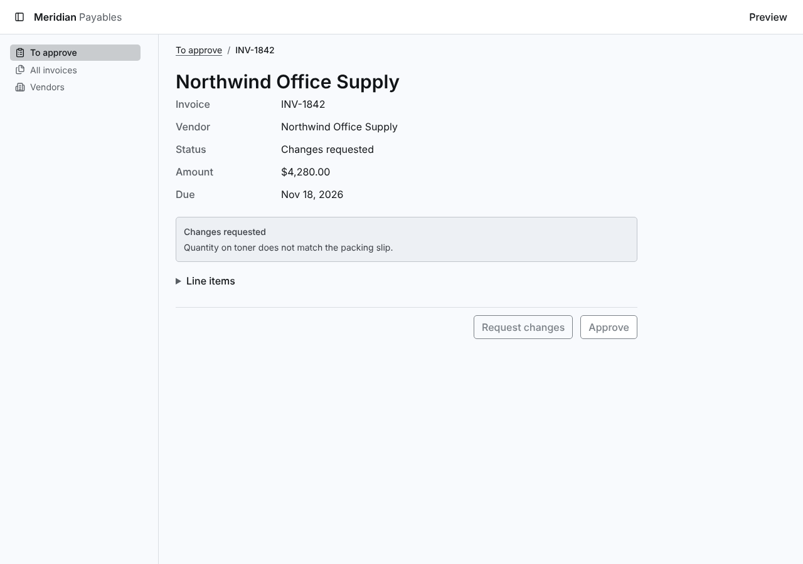
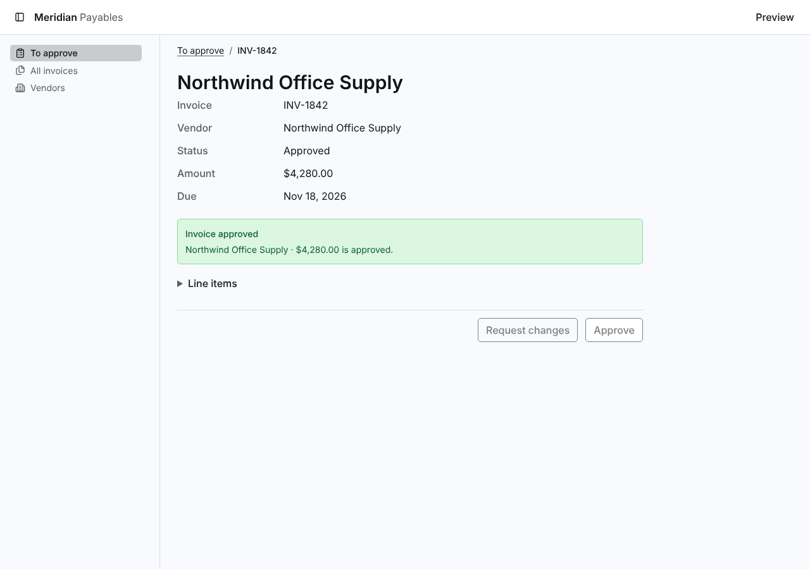

# Screenshots

Taken by `npm run screenshots` with `products/meridian/harness.config.ts`, at 1280 by 900 CSS px in headless Chrome, one per preview. Click an image to open it full size.

## changes-requested--page-detail

## invoice-approved--page-detail

