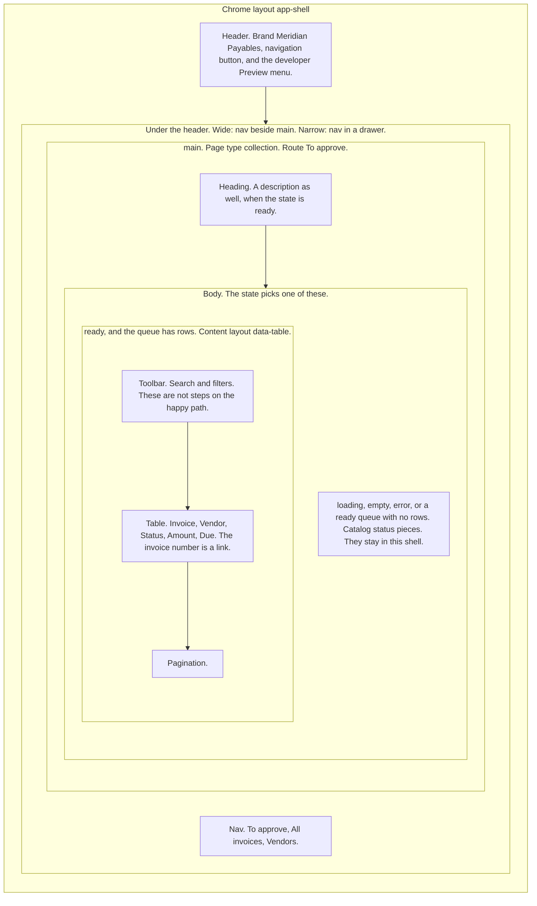
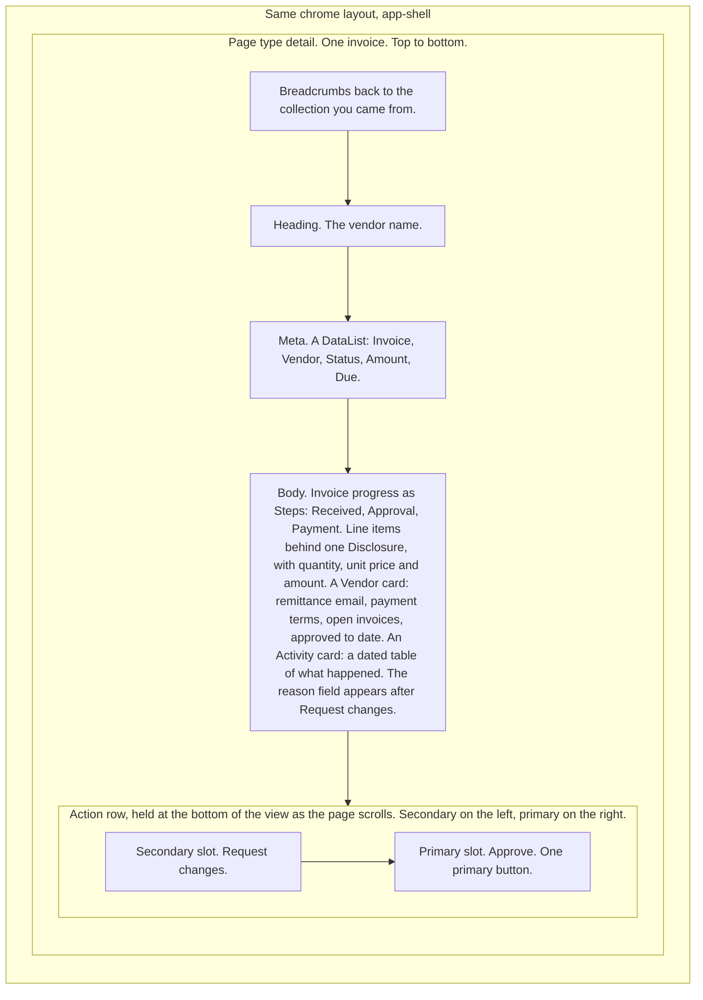
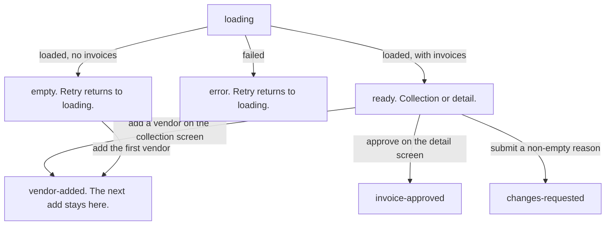
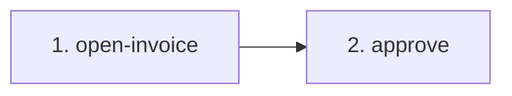
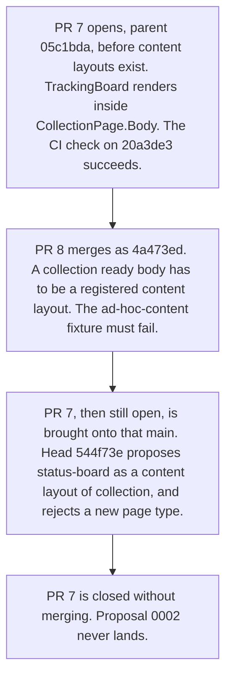

# How Meridian works

Meridian is the sample product the design loop is tested on, an accounts-payable workspace. The task the code already names is `approve-vendor-invoice`: review a vendor invoice and approve it. The screen a newcomer should picture is the **To approve** queue, and the invoice that opens from it.

This page covers what is Meridian's own: the layers on its screens, its flow, the inputs its rules read, and one gap the loop caught on it. The checks, the fixtures, and the proposal gate are the harness's, and [How this design loop works](../../../packages/harness/docs/how-it-works.md) explains them. Like that page, this one describes main and is not pinned to a commit. If this page and the code disagree, the code and the checks win.

## The layers on a Meridian screen

An agent designs inside layers the repo already recorded. From the outside of the screen inward:

| Layer | What it is on main | Where |
| --- | --- | --- |
| Component catalog | The only UI entry. Product code imports these names. | `products/meridian/catalog/index.ts` re-exports `@tounsoo/todae` |
| Chrome layout | The frame around the page. One id, `app-shell`. | `allowed_layouts` in `products/meridian/inputs/product.ts`, directory `products/meridian/layouts/app-shell` |
| Page type | The job of one page. `collection` and `detail`. | `allowed_page_types`, directories under `products/meridian/page-types` |
| Content layout | The composition that fills a page type's body. Two ids, `data-table` and `directory`. | `allowed_content_layouts`, directories under `products/meridian/content-layouts` |
| Flow | The modeled states of the task, and the legal moves between them. | `products/meridian/flows/invoice-approval` |
| UX rules | A check, a product-owned input, and a review question for each rule. | `products/meridian/rules/ux-rules.ts`, inputs in `products/meridian/inputs/product.ts` and the caps beside the rules |

Chrome layouts and content layouts are different lists. `allowed_layouts` is the frame. `allowed_content_layouts` is the body. A different body is a new content layout. It is not a new entry in `allowed_layouts`, and the app shell is not a third page type.

The shells are product-owned glue, encoded from [Todae](https://github.com/tounsoo/todae) recipes. Recipes are copyable glue, not package namespaces. `@tounsoo/todae` has no `AppShell`, `DataTable` or `Directory` export, and this repo does not fork Todae. The app shell follows the [app shell recipe](https://todae.omsoo.design/recipes/app-shell). The data table follows the [filter bar](https://todae.omsoo.design/recipes/filter-bar) and [data table](https://todae.omsoo.design/recipes/data-table) recipes. Icons come from Lucide. Todae ships no icons.

### To approve, the default screen

Opening the app with no query string lands on **To approve**. Three routes share the collection page: To approve (`/`), All invoices (`?route=invoices`), and Vendors (`?route=vendors`). A route is not a page type. `collectionRoutes` in `products/meridian/flows/invoice-approval/location.ts` says so.

Arrows in that diagram follow the regions down the page. `loading`, `empty`, and `error` replace the data table. They are not a step that happens before it.

The collection shell's slots are `Heading`, an optional `Description`, and `Body`. It has no primary-action slot. Approve is not on the queue. On To approve and All invoices the invoice number is a `Link` into the detail page.

Vendors is the same shell with another content layout, `directory`, and its own `CollectionPage` element in the views, so its one visible question and its one disclosure count against its own page. The body is a search field, an **Add a vendor** disclosure that holds the whole form, and a grid of cards: remittance email, payment terms, open invoices, and the last invoice with its due date, with no link. The form's three fields sit inside the disclosure, so the search stays the page's one visible question. Add vendor is secondary. Validation rules and their copy live in `checkVendorDraft` in `products/meridian/flows/invoice-approval/vendors.ts`. Loading and error render in the shell, as on the other routes. Empty is the directory's own, with the form open, because the next step is in it. A successful add clears the search, so the new card shows. Vendors' load error reads "Couldn't load vendors.".

Search, filters, sort, and paging live in the data table, and search in the directory. The task graph does not count them as steps. The default invoice sort is due date, ascending.

`loading`, `empty`, and `error` render in the collection body and are not content layouts. The ready body, when the filtered queue has rows, is `<DataTable />` with a toolbar, a table, and pagination. An empty ready queue uses `EmptyState` in the shell instead.

### One invoice

Choosing an invoice number opens the detail page inside the same app shell. The URL is `?invoice=inv-1842` from To approve, and it keeps `route=invoices` when you came from All invoices. Vendor cards have no link.

The arrows follow the regions down the page. The action row places secondary to the left of primary, which is how `DetailPage` renders them.

Detail slots are optional breadcrumbs, a heading, optional meta, a body, one primary, and optional secondary. The primary slot accepts one button. Request changes is `variant="secondary"`.

### Flow states

Seven names are modeled, in `modeledStates`:

`loading`, `empty`, `error`, `ready`, `invoice-approved`, `changes-requested`, `vendor-added`.

`ready` covers both screens. Opening an invoice stays in `ready` and sets `screen` to `detail`. The shell stays up in every modeled state. Loading, empty, and error render inside `main`. `vendor-added` is the vendor list after an add, and it belongs to Vendors: `routeOfState` in `location.ts` gives it that route, so `?state=vendor-added` opens Vendors whatever `?route=` says. A `?state=` value that is not one of those seven names is ignored. An unknown `?route=` falls through to To approve. The **Preview** menu in the header is a developer aid for opening the modeled states. The default URL does not depend on it.

`transition` ignores `approve` on the collection screen and in `error`. An empty reason cannot reach `changes-requested`. `invoice-approved` and `changes-requested` have no further moves. Leaving `vendor-added` is a change of route, which starts again from the URL. `add-vendor` is a person's event, so the task graph lists it among its user events, but no task names it, so the step budget never counts it. Approve in the transition function does not require the line-item disclosure to be open, by decision. The step budget measures both this reducer and a separate task graph, below.

### Product-owned inputs

The rules read numbers and names the product owns, so a check can fail without a person re-deciding the number every time.

| Input | Value on main | Where |
| --- | --- | --- |
| Step budget | `approve-vendor-invoice` has `max_steps` 3 and `success_state` `invoice-approved` | `tasks` in `products/meridian/inputs/product.ts` |
| Priority | Approve, rank 1, primary. Request changes, rank 2, secondary. | `priority` in `products/meridian/inputs/product.ts` |
| Page types | `collection`, `detail` | `allowed_page_types` |
| Disclosure depth | 1. Line items are the one disclosure. Nothing nests under them. | `MAX_DISCLOSURE_DEPTH` in `products/meridian/rules/ux-rules.ts` |
| Disclosed sections | `Line items` sit behind a disclosure | `disclosed_sections` in `products/meridian/inputs/product.ts` |
| Disclosures per page | 1 | `MAX_DISCLOSURES_PER_PAGE` |
| Visible questions | 1 per page outside a disclosure. A field on a branch, like the request-changes reason, still counts. | `MAX_VISIBLE_QUESTIONS` |
| Target size | 24 CSS px. No product exception is recorded. | `TARGET_MIN_PX` |

The budget check measures two paths, and then every route, for every task in `tasks`. Each task maps to one task graph module under `flows[].tasks` in `products/meridian/harness.config.ts`. Meridian's one task maps to `products/meridian/flows/invoice-approval/graph.ts`.

- **Modeled path.** The shortest path through the task graph in `products/meridian/flows/invoice-approval/graph.ts`. This is the reviewed path the budget is set for. Request changes is not an edge. Opening Line items is optional, so it is not an edge either. There is no approval-note step.
- **Shipped path.** The shortest path through the real `transition` reducer, from `flowStart` (the loaded To approve queue) over `userEvents` (the events a person can cause) to `success_state`. Today it is `open-invoice → approve`, 2 steps.

Both must fit `max_steps`, and they must be the same steps. Graph step names are the event types they stand for. A reducer that grows a step fails the build even if nobody updates the graph. A reducer that drops or swaps a step, or a graph that keeps one the reducer never needed, fails too.

- **Every other route.** The shortest path is not the only way through. A route takes any steps a task graph names, in any order, each once, then finishes the shortest way. Every route to `invoice-approved`, in the task graph and in the reducer, must also fit `max_steps`. Opening Line items and starting a change request are events no task names, so they count only when the finish needs them, and it does not. Search, filters and paging are not flow events at all. Today the longest route is `open-invoice → approve`, the same 2 steps. [Proposal 0013](../../../proposals/0013-every-route-in-the-step-budget.md) records the rule.

The modeled path length is 2, and `max_steps` is 3. Success is the state `invoice-approved`, which is not an extra counted step. [Proposal 0001](../../../proposals/0001-approval-note.md) asks to require an approval note and raise the budget to 4. It is open. It is not applied. The shipped invoice does not ask for a note. [Proposal 0003](../../../proposals/0003-two-step-approve.md) records the 2-step path and corrects 0001: with the note, the path is 3, inside the current budget.

## Worked example: the tracking board

This is the loop under a real gap, as it stood when [pull request 8](https://github.com/tounsoo/agent-design-loop/pull/8) merged as `4a473ed`. [Pull request 7](https://github.com/tounsoo/agent-design-loop/pull/7) was open then. It was closed on November 11, 2026 (UTC) without merging, so the board never shipped and proposal 0002 is not on main. The example is history: it shows the gate firing, not something main contains. Meridian lived under `src/` then, and the fixtures under `fixtures/`, so the paths below are the paths of that time.

**Before content layouts.** The first commit on pull request 7, `20a3de3`, is based on `05c1bda` (pull request 6, the inventory gate, before content layouts). Its tree has no `src/content-layouts` directory. The Tracking route renders `<TrackingBoard />` inside `CollectionPage.Body`. That component lives in `src/features/invoice-approval/tracking.tsx`: columns of cards, not a registered layout id. The GitHub check run on `20a3de3` completed with success. Nothing in the checks of that parent looked at the shape of a collection body. A distinct composition could ship inside `collection` without touching `allowed_layouts` or `allowed_page_types`. That is the gap pull request 8 records in its description.

**The gate.** Pull request 8 records content layouts. `allowed_content_layouts` is `data-table`, the filter bar, table, and pagination already used by To approve, All invoices, and Vendors. The base of that pull request did not export the list, so recording the existing composition was the bootstrap. It adds `fixtures/illegal/ad-hoc-content`: a `CollectionPage` whose ready body is a stack of cards with the page class `tracking-board`. `check:fixtures` requires the inventory check to reject it with `not a registered content layout`. After this landed, dropping a board into the collection body fails. That fixture is `packages/harness/fixtures/illegal/ad-hoc-content` on main.

**After the rebase.** Pull request 7's head `544f73e` is updated onto main `4a473ed`. Tracking stays a nav item in the app shell. It is not a step on `approve-vendor-invoice`. The ready body is a new content layout, id `status-board`, used as `<StatusBoard />` with no ad-hoc children. `allowed_page_types` stays `collection` and `detail`. `allowed_layouts` stays `app-shell`. `max_steps` stays 3.

The proposal on that branch, `proposals/0002-tracking-board-card.md`, explained why the other inventory was the wrong one to grow. A page type is a new shell. Tracking still uses the collection shell: one heading, a description, a body, and no primary action. Loading, empty, and error stay in that shell. The reader picks one invoice and opens the existing detail. The difference from To approve, All invoices, and Vendors is the body, columns of cards instead of a filter bar and a table. Content layouts are the compositions that fill a page type's body. Adding a page type would duplicate the collection shell for a body the content-layout inventory was added to hold. `check:one-thing` reads `allowed_page_types` for the shells a page can use.

The same proposal also asked to export `Card` from the catalog, because the card was not in the catalog on main. The check then accepted either a new content layout or a new page type once a proposal file explained it. It did not choose, and it still does not. That judgment is written down in [`products/meridian/review/content-layouts.md`](../review/content-layouts.md) on main. Pull request 7 had its own note, `review/invoice-tracking.md`, which closed with it.

What this example shows about the checks, and what it does not, is in [What this shows, and what it does not](../../../packages/harness/docs/how-it-works.md#what-this-shows-and-what-it-does-not) on the harness page.
