# Screenshots

Taken by `npm run screenshots` with `products/meridian/harness.config.ts`, at 1280 by 900 CSS px in headless Chrome, one per preview. Click an image to open it full size.

Before is `origin/main (4bc84da)`. After is the change.

| Preview | Before | After |
| --- | --- | --- |
| changes-requested--page-detail | [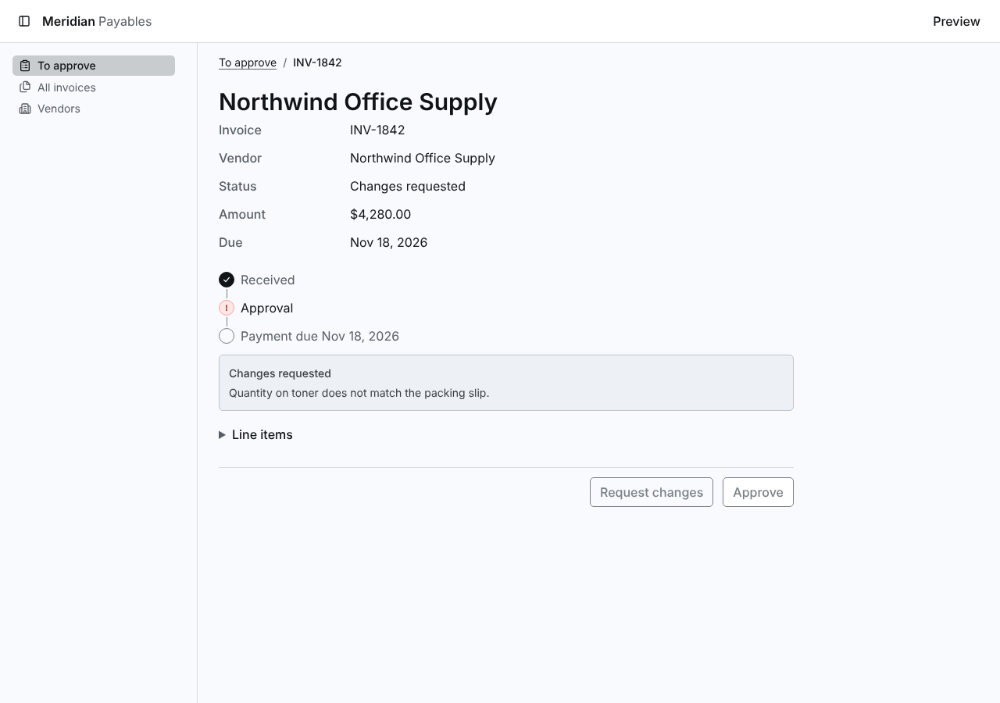](https://raw.githubusercontent.com/tounsoo/agent-design-loop/4477f412b248fdc56b011db35c7b5a97f75eee9a/products/meridian/review/screenshots/invoice-detail-sections/before/changes-requested--page-detail.png) | [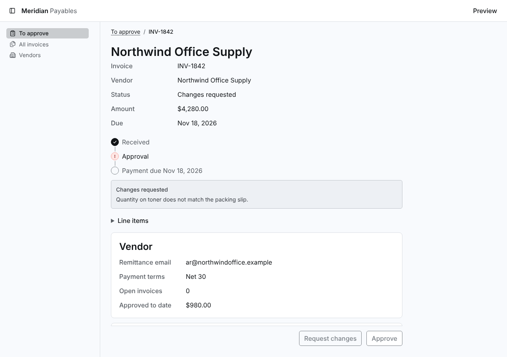](https://raw.githubusercontent.com/tounsoo/agent-design-loop/4477f412b248fdc56b011db35c7b5a97f75eee9a/products/meridian/review/screenshots/invoice-detail-sections/after/changes-requested--page-detail.png) |
| invoice-approved--page-detail | [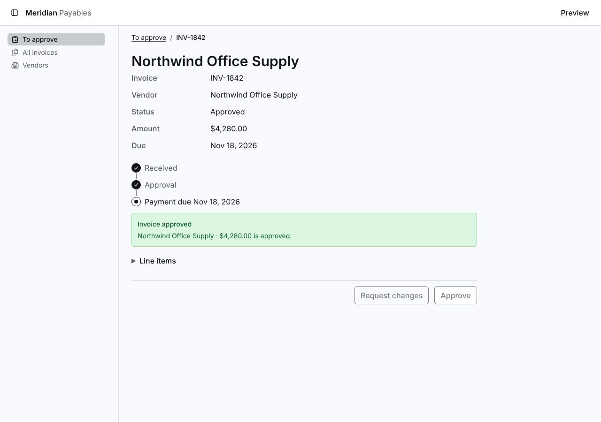](https://raw.githubusercontent.com/tounsoo/agent-design-loop/4477f412b248fdc56b011db35c7b5a97f75eee9a/products/meridian/review/screenshots/invoice-detail-sections/before/invoice-approved--page-detail.png) | [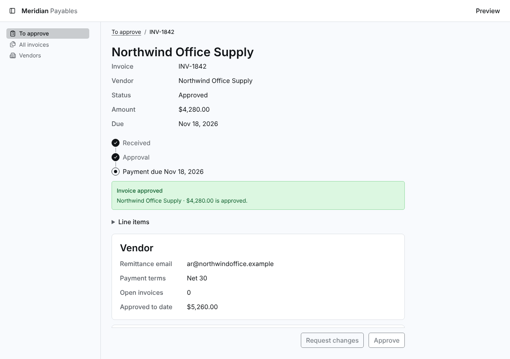](https://raw.githubusercontent.com/tounsoo/agent-design-loop/4477f412b248fdc56b011db35c7b5a97f75eee9a/products/meridian/review/screenshots/invoice-detail-sections/after/invoice-approved--page-detail.png) |
| ready--page-collection | [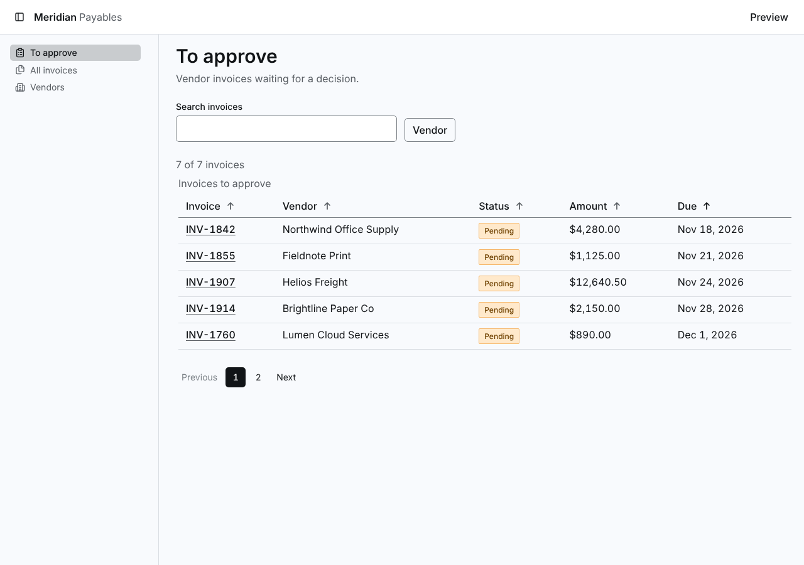](https://raw.githubusercontent.com/tounsoo/agent-design-loop/4477f412b248fdc56b011db35c7b5a97f75eee9a/products/meridian/review/screenshots/invoice-detail-sections/before/ready--page-collection.png) |  |
| ready--page-detail--branch-request | [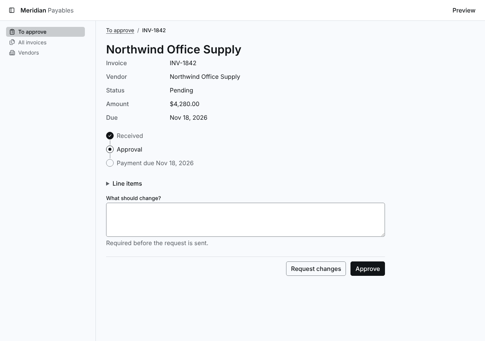](https://raw.githubusercontent.com/tounsoo/agent-design-loop/4477f412b248fdc56b011db35c7b5a97f75eee9a/products/meridian/review/screenshots/invoice-detail-sections/before/ready--page-detail--branch-request.png) |  |
| ready--page-detail | [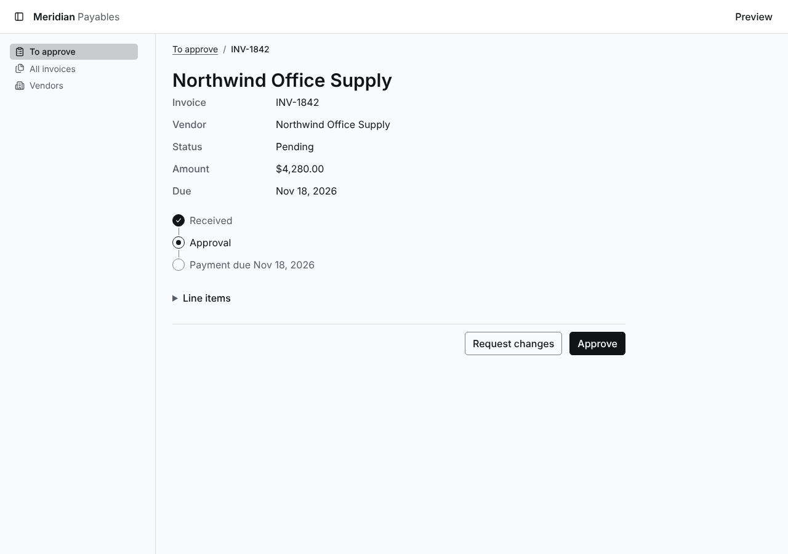](https://raw.githubusercontent.com/tounsoo/agent-design-loop/4477f412b248fdc56b011db35c7b5a97f75eee9a/products/meridian/review/screenshots/invoice-detail-sections/before/ready--page-detail.png) | [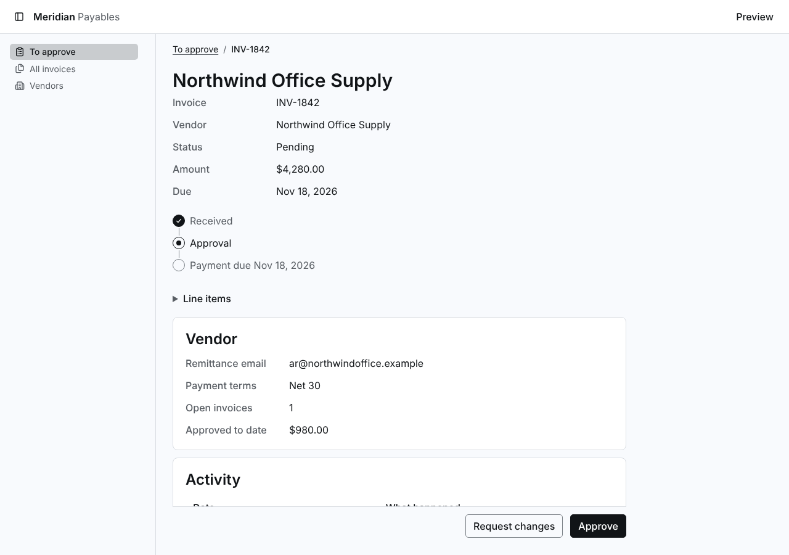](https://raw.githubusercontent.com/tounsoo/agent-design-loop/4477f412b248fdc56b011db35c7b5a97f75eee9a/products/meridian/review/screenshots/invoice-detail-sections/after/ready--page-detail.png) |
| ready--route-invoices | [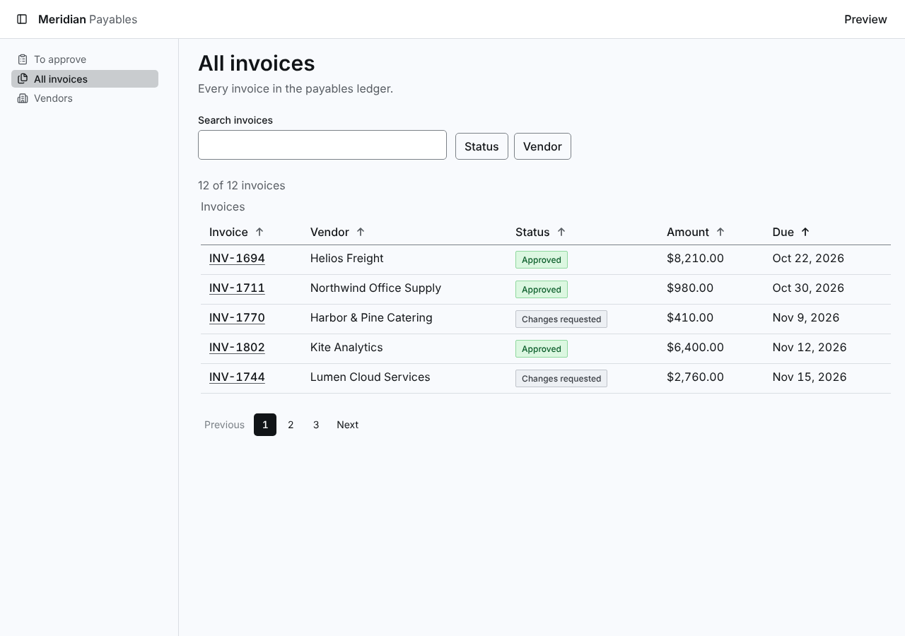](https://raw.githubusercontent.com/tounsoo/agent-design-loop/4477f412b248fdc56b011db35c7b5a97f75eee9a/products/meridian/review/screenshots/invoice-detail-sections/before/ready--route-invoices.png) |  |
| ready--route-vendors | [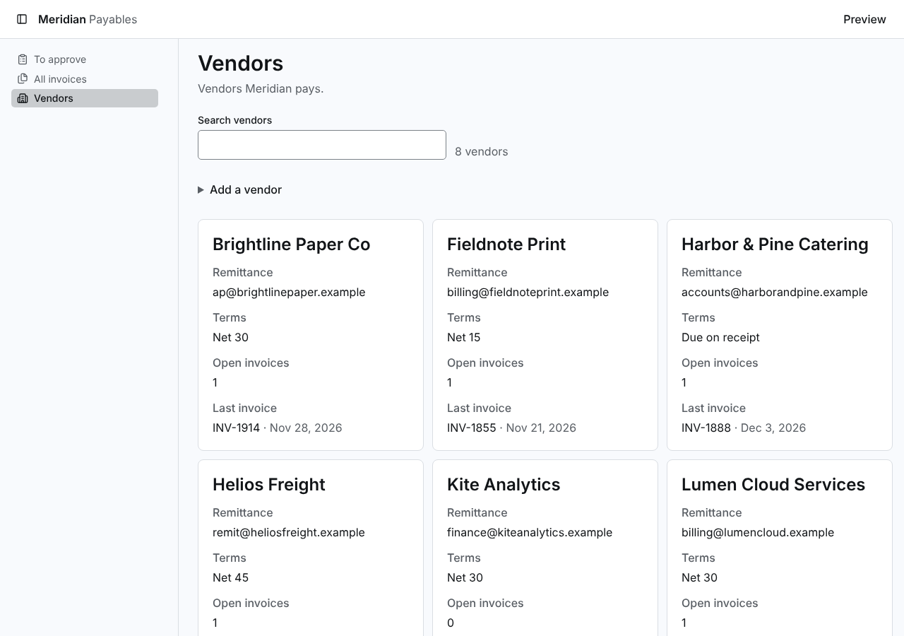](https://raw.githubusercontent.com/tounsoo/agent-design-loop/4477f412b248fdc56b011db35c7b5a97f75eee9a/products/meridian/review/screenshots/invoice-detail-sections/before/ready--route-vendors.png) | [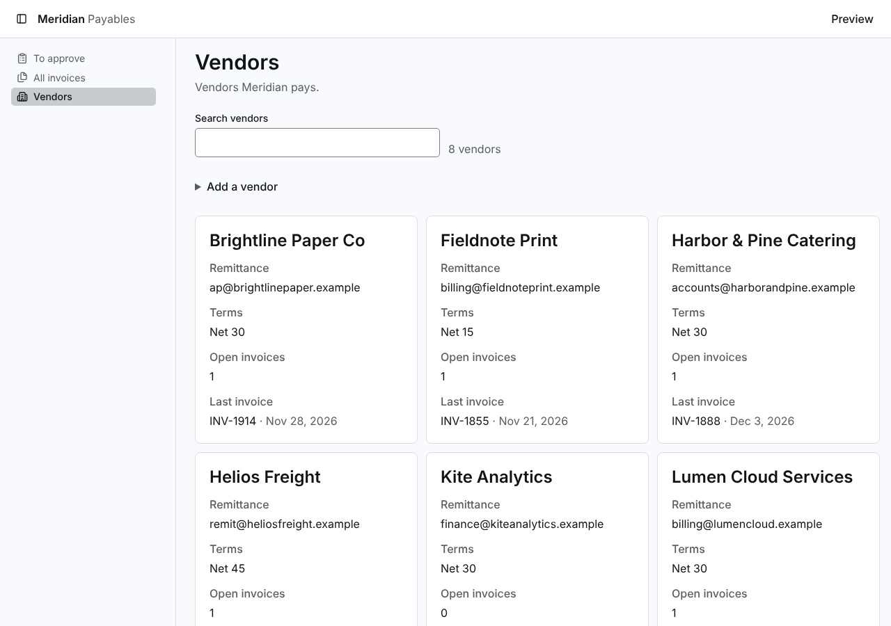](https://raw.githubusercontent.com/tounsoo/agent-design-loop/4477f412b248fdc56b011db35c7b5a97f75eee9a/products/meridian/review/screenshots/invoice-detail-sections/after/ready--route-vendors.png) |
