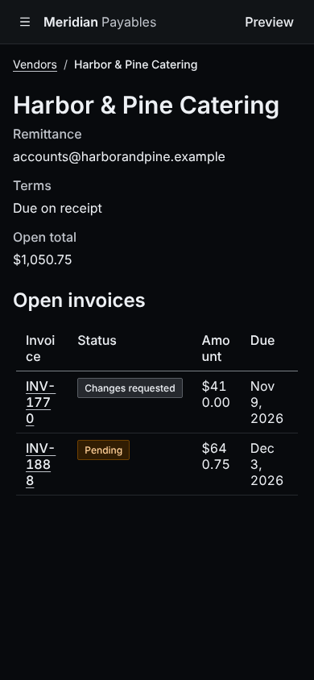
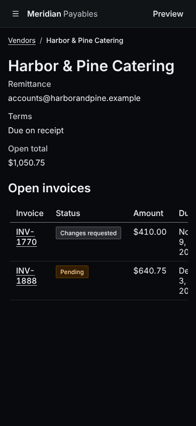
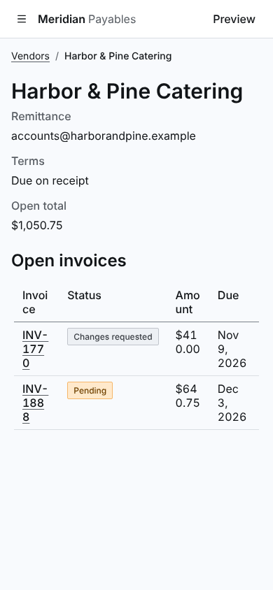
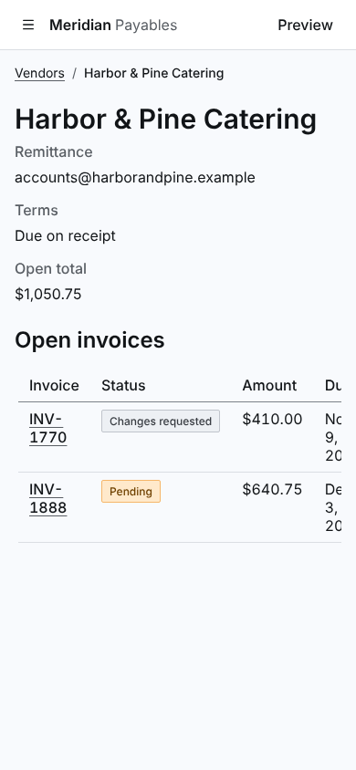
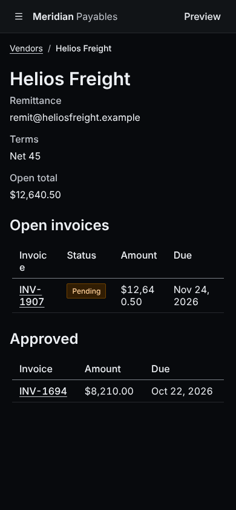
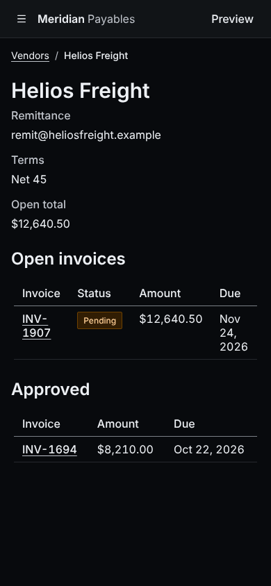
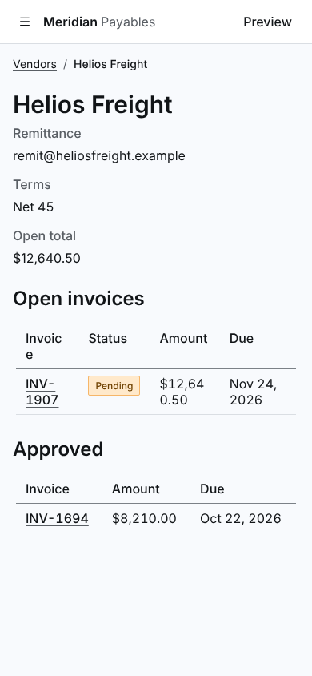
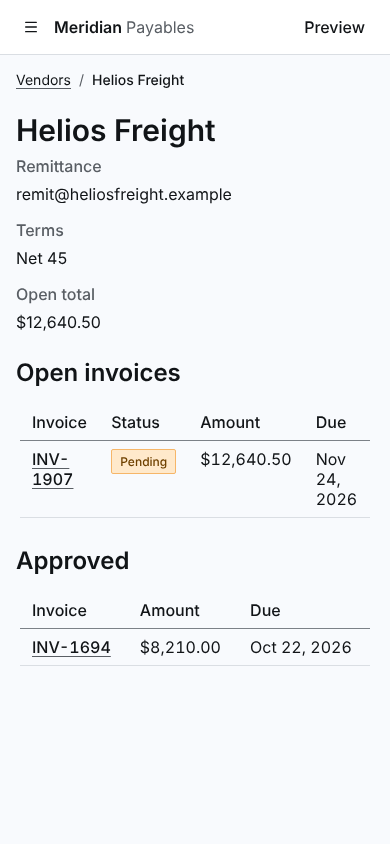
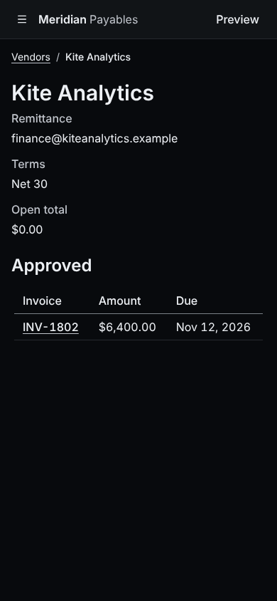
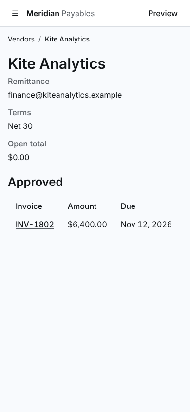

# Screenshots

Taken by `npm run screenshots` with `products/meridian/harness.config.ts` in headless Chrome, a full page per scenario in each view it was asked for: `desktop-light` (1280 by 900, light), `desktop-dark` (1280 by 900, dark), `phone-light` (390 by 844, light), `phone-dark` (390 by 844, dark), in CSS px. A name is the scenario, then the view. Click an image to open its file.

Before is `9116686`. After is the change.

| Screenshot | Before | After |
| --- | --- | --- |
| vendor-harbor-and-pine--phone-dark |  |  |
| vendor-harbor-and-pine--phone-light |  |  |
| vendor-helios-freight--phone-dark |  |  |
| vendor-helios-freight--phone-light |  |  |
| vendor-nothing-open--phone-dark |  |  |
| vendor-nothing-open--phone-light |  |  |
