# Screenshots

Taken by `npm run screenshots` with `products/meridian/harness.config.ts` in headless Chrome, a full page per scenario in each view it was asked for: `desktop-light` (1280 by 900, light), `desktop-dark` (1280 by 900, dark), `phone-light` (390 by 844, light), `phone-dark` (390 by 844, dark), in CSS px. A name is the scenario, then the view. Click an image to open its file.

Before is `origin/main (3b7af33)`. After is the change.

| Screenshot | Before | After |
| --- | --- | --- |
| changes-requested--desktop-dark | [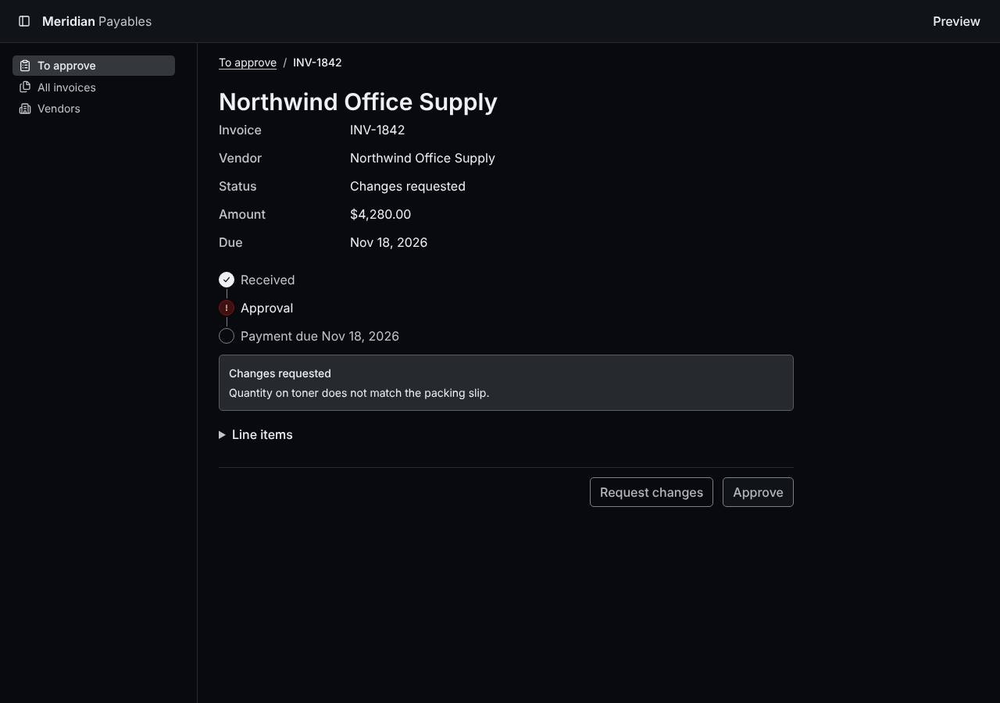](before/changes-requested--desktop-dark.png) |  |
| changes-requested--desktop-light | [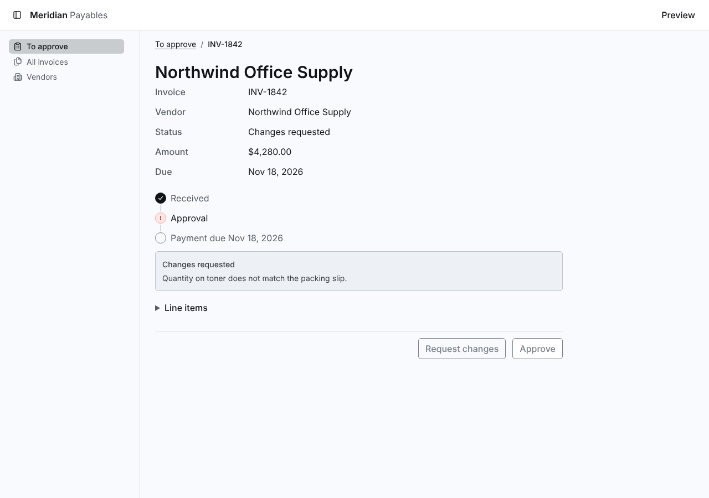](before/changes-requested--desktop-light.png) |  |
| changes-requested--phone-dark |  | [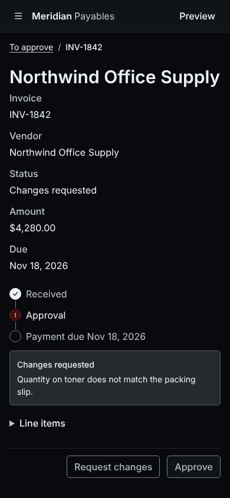](after/changes-requested--phone-dark.png) |
| changes-requested--phone-light | [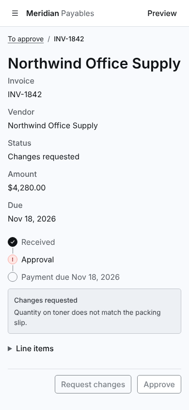](before/changes-requested--phone-light.png) |  |
| invoice-approved--desktop-dark |  | [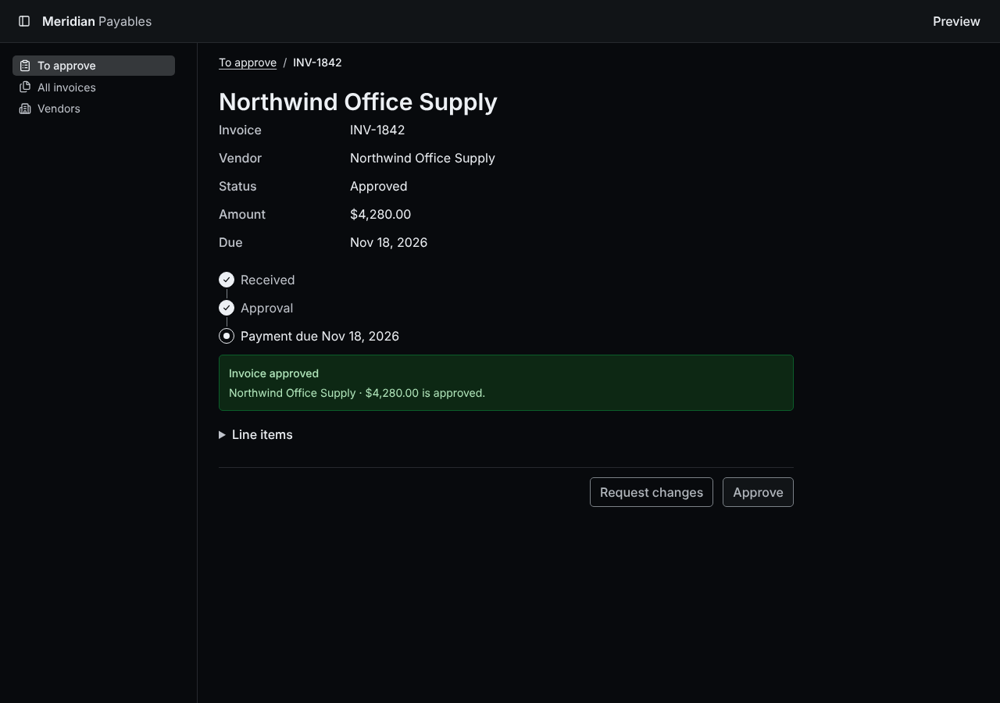](after/invoice-approved--desktop-dark.png) |
| invoice-approved--desktop-light | [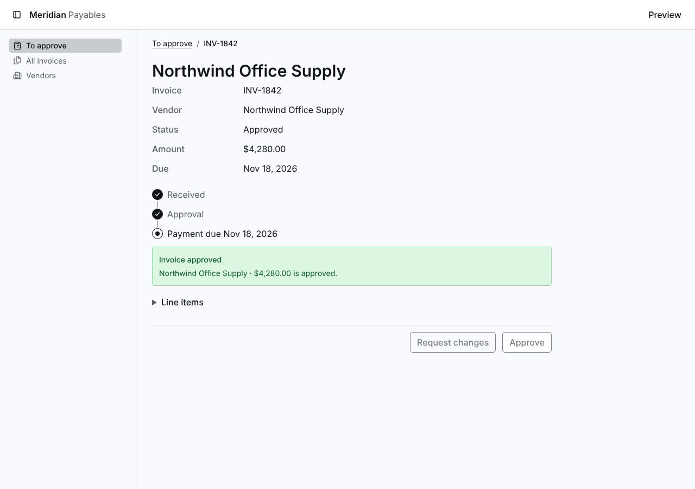](before/invoice-approved--desktop-light.png) |  |
| invoice-approved--phone-dark |  | [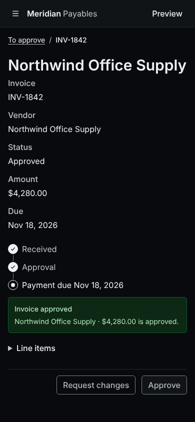](after/invoice-approved--phone-dark.png) |
| invoice-approved--phone-light |  | [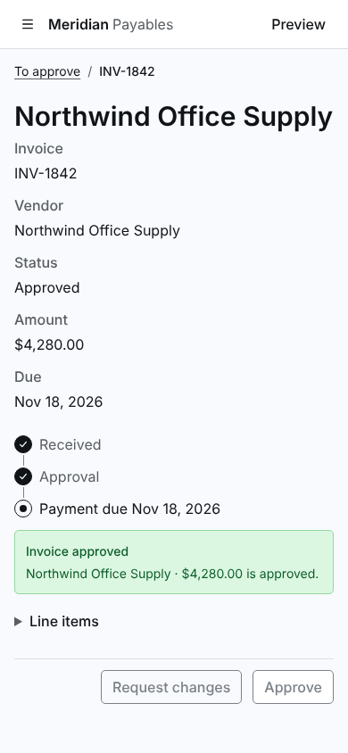](after/invoice-approved--phone-light.png) |
| invoice-detail--desktop-dark |  | [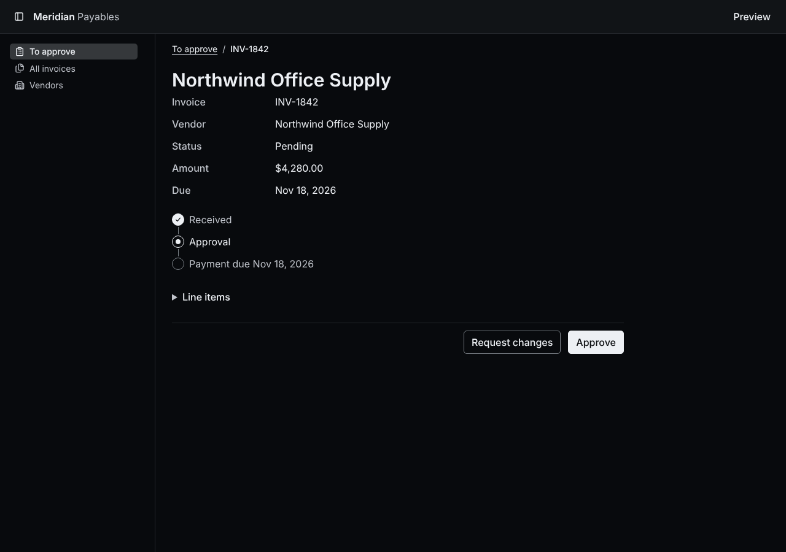](after/invoice-detail--desktop-dark.png) |
| invoice-detail--desktop-light |  | [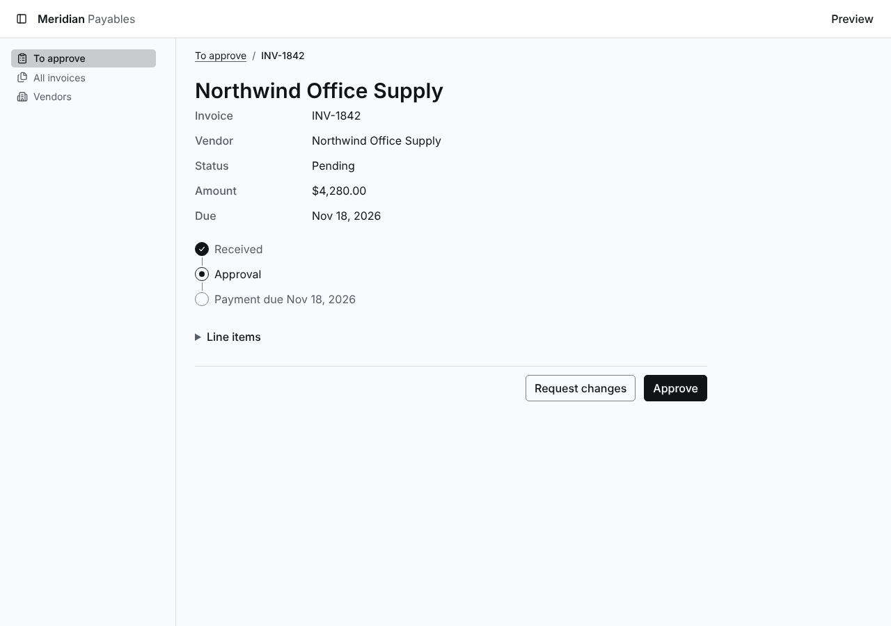](after/invoice-detail--desktop-light.png) |
| invoice-detail--phone-dark | [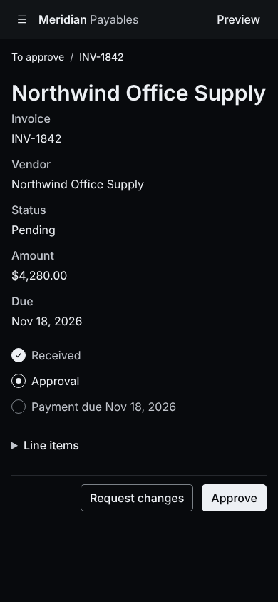](before/invoice-detail--phone-dark.png) |  |
| invoice-detail--phone-light |  | [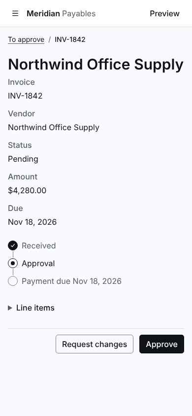](after/invoice-detail--phone-light.png) |
| invoice-requesting-changes--desktop-dark | [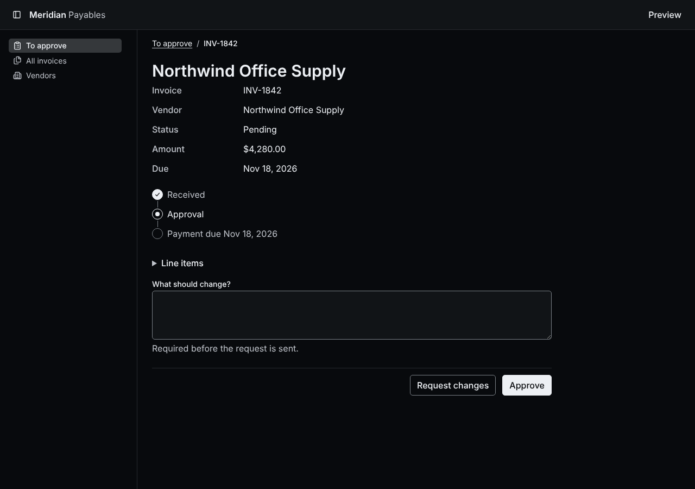](before/invoice-requesting-changes--desktop-dark.png) |  |
| invoice-requesting-changes--desktop-light | [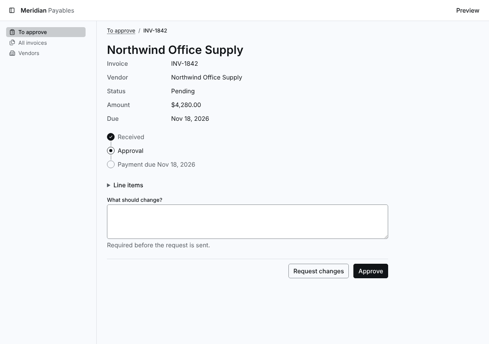](before/invoice-requesting-changes--desktop-light.png) |  |
| invoice-requesting-changes--phone-dark | [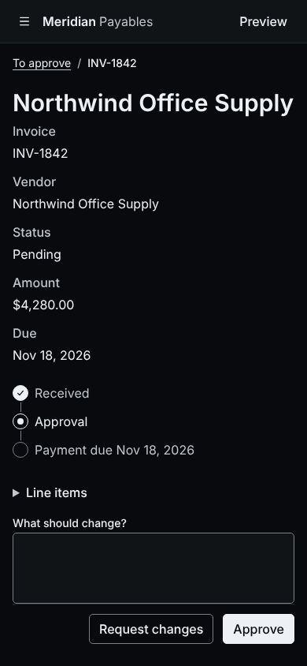](before/invoice-requesting-changes--phone-dark.png) |  |
| invoice-requesting-changes--phone-light |  | [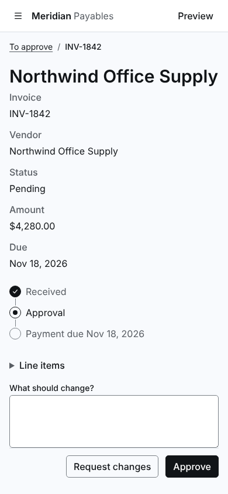](after/invoice-requesting-changes--phone-light.png) |
