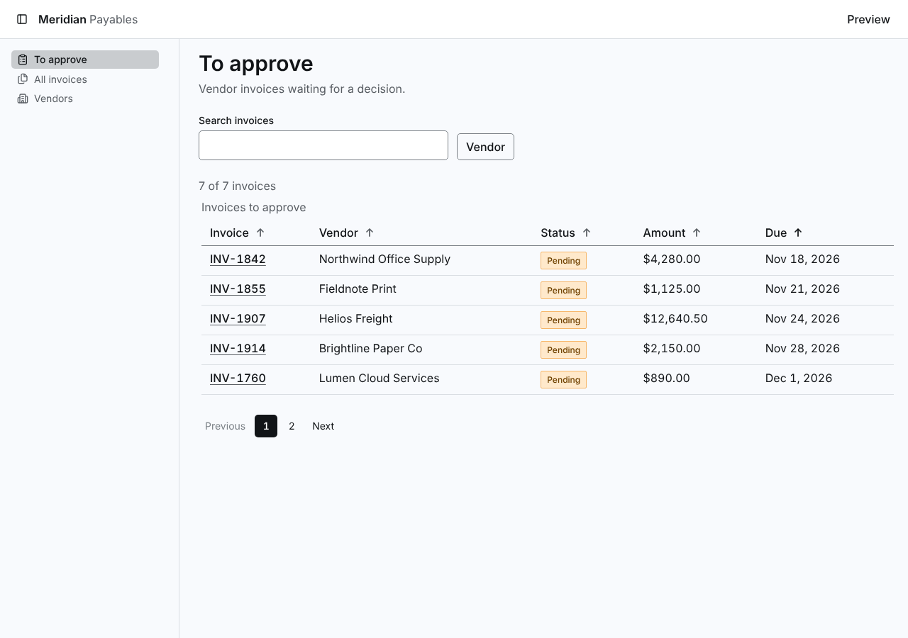
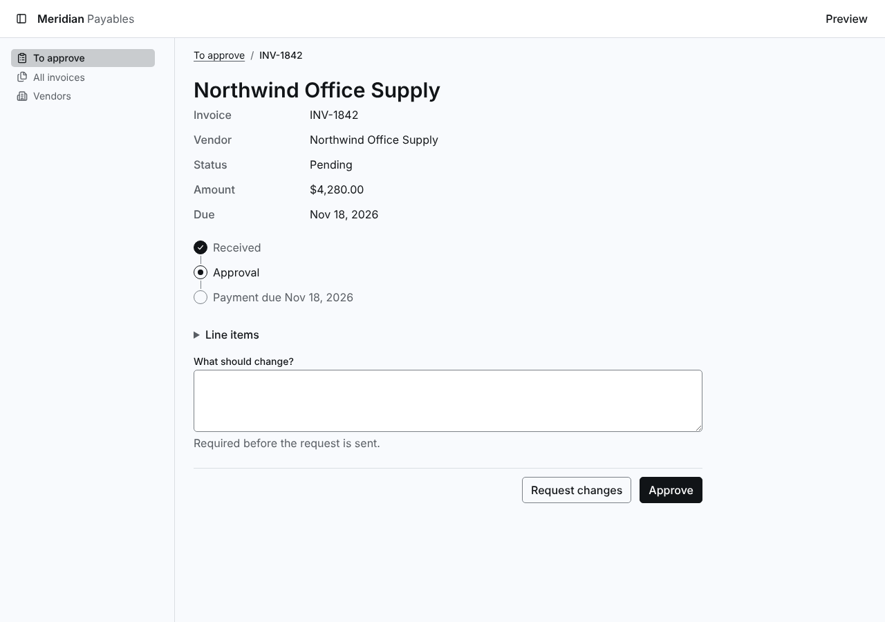
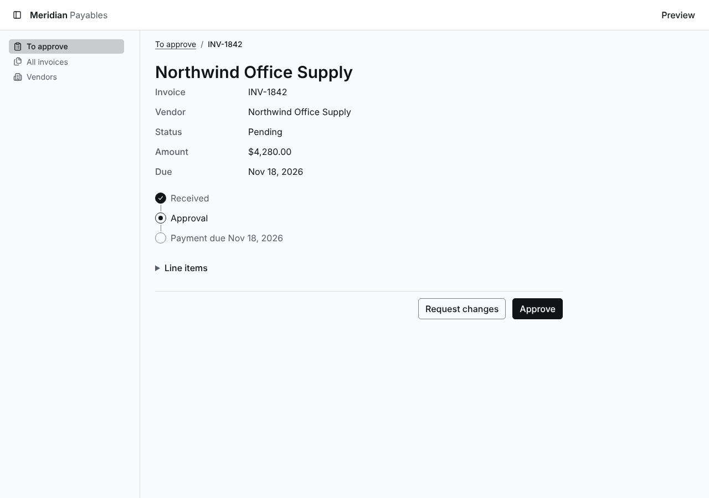
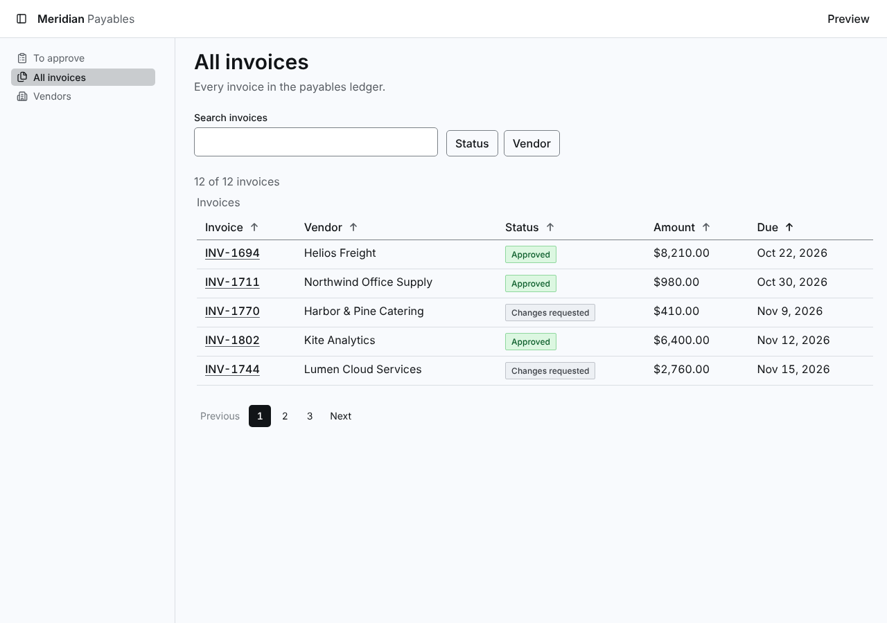
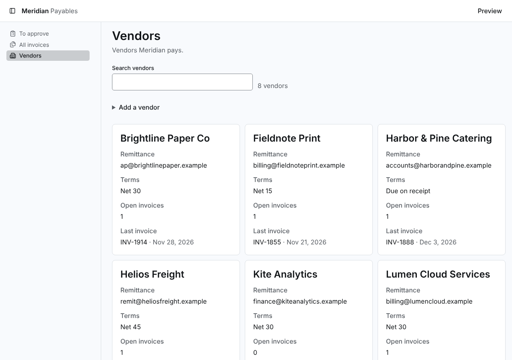

# Screenshots

Taken by `npm run screenshots` with `products/meridian/harness.config.ts`, at 1280 by 900 CSS px in headless Chrome, one per preview. Click an image to open its file.

Before is `origin/main (8ce1979)`. After is the change.

| Preview | Before | After |
| --- | --- | --- |
| ready--page-collection |  |  |
| ready--page-detail--branch-request |  |  |
| ready--page-detail |  |  |
| ready--route-invoices |  |  |
| ready--route-vendors |  |  |
