# Screenshots

Taken by `npm run screenshots` with `products/meridian/harness.config.ts`, at 1280 by 900 CSS px in headless Chrome, one per preview. Click an image to open it full size.

Before is `origin/main (1a59c47)`. After is the change.

| Preview | Before | After |
| --- | --- | --- |
| changes-requested--page-detail | [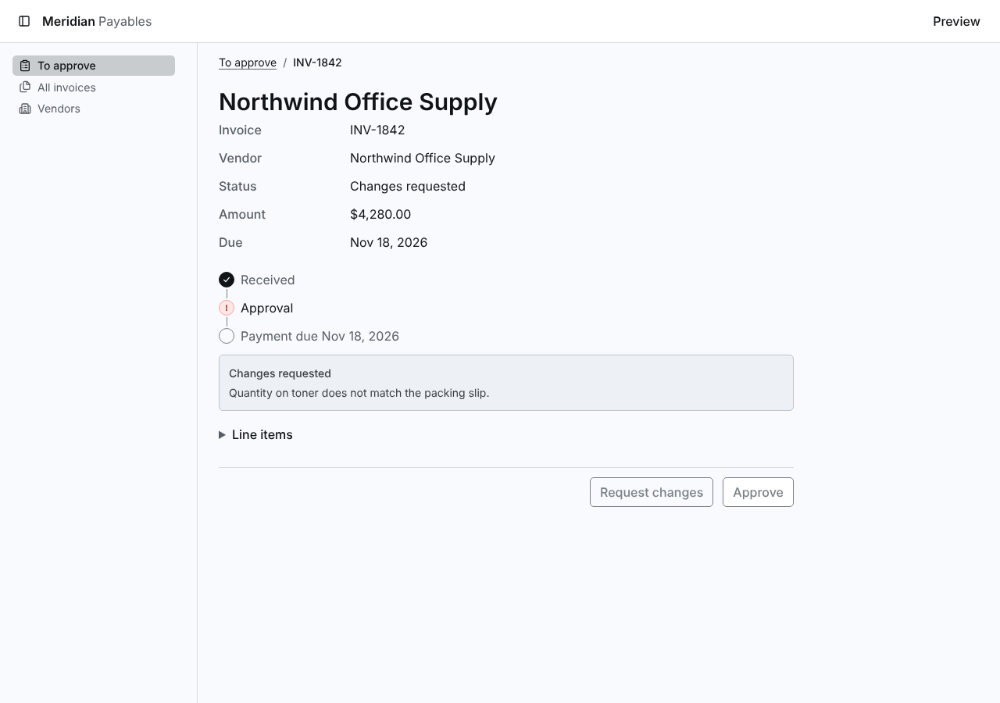](https://raw.githubusercontent.com/tounsoo/agent-design-loop/63db7bca2242a91616f1bd105ecbc61a5cb8e873/products/meridian/review/screenshots/vendor-directory/before/changes-requested--page-detail.png) |  |
| empty | [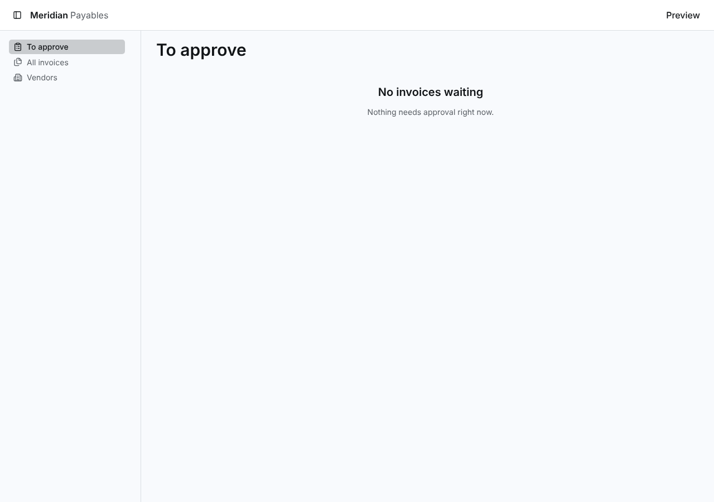](https://raw.githubusercontent.com/tounsoo/agent-design-loop/63db7bca2242a91616f1bd105ecbc61a5cb8e873/products/meridian/review/screenshots/vendor-directory/before/empty.png) |  |
| error |  | [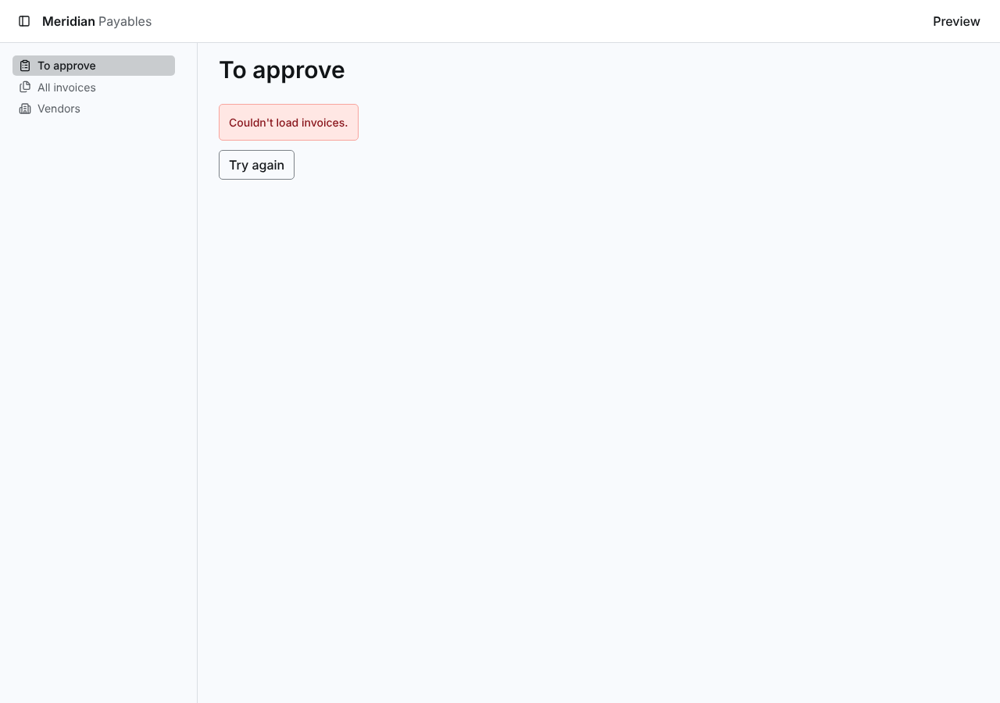](https://raw.githubusercontent.com/tounsoo/agent-design-loop/63db7bca2242a91616f1bd105ecbc61a5cb8e873/products/meridian/review/screenshots/vendor-directory/after/error.png) |
| invoice-approved--page-detail | [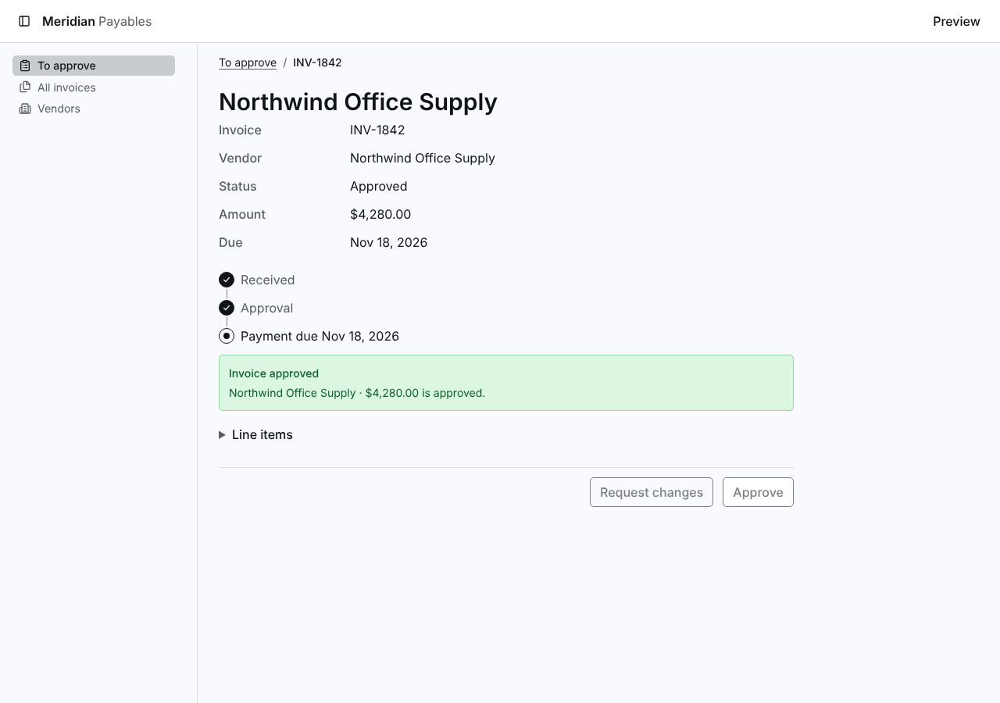](https://raw.githubusercontent.com/tounsoo/agent-design-loop/63db7bca2242a91616f1bd105ecbc61a5cb8e873/products/meridian/review/screenshots/vendor-directory/before/invoice-approved--page-detail.png) |  |
| loading | [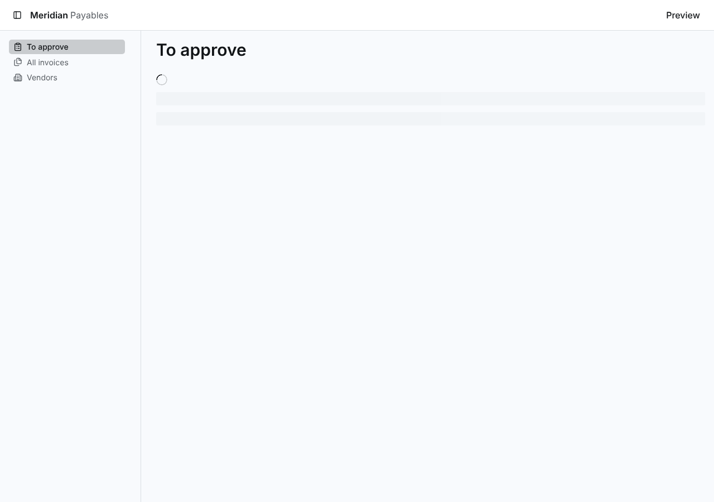](https://raw.githubusercontent.com/tounsoo/agent-design-loop/63db7bca2242a91616f1bd105ecbc61a5cb8e873/products/meridian/review/screenshots/vendor-directory/before/loading.png) |  |
| ready--page-collection | [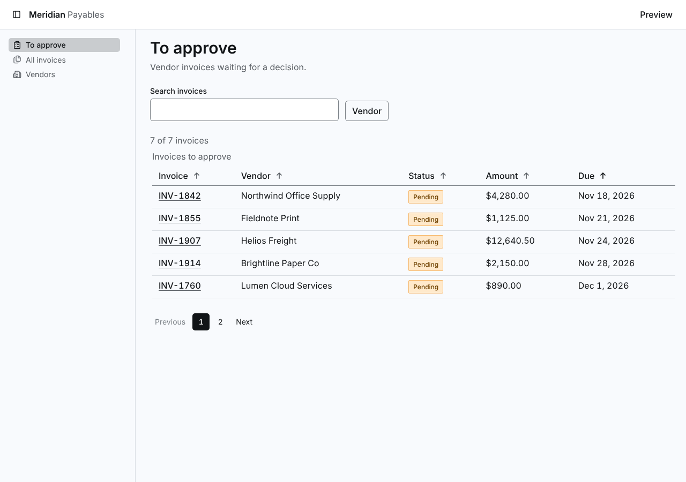](https://raw.githubusercontent.com/tounsoo/agent-design-loop/63db7bca2242a91616f1bd105ecbc61a5cb8e873/products/meridian/review/screenshots/vendor-directory/before/ready--page-collection.png) |  |
| ready--page-detail--branch-request | [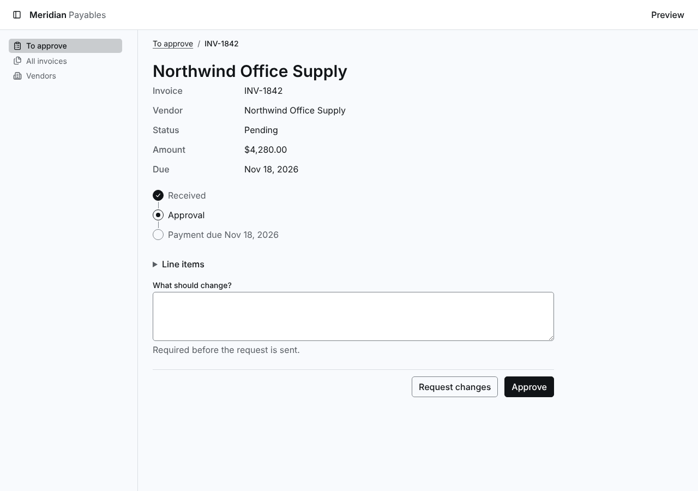](https://raw.githubusercontent.com/tounsoo/agent-design-loop/63db7bca2242a91616f1bd105ecbc61a5cb8e873/products/meridian/review/screenshots/vendor-directory/before/ready--page-detail--branch-request.png) |  |
| ready--page-detail | [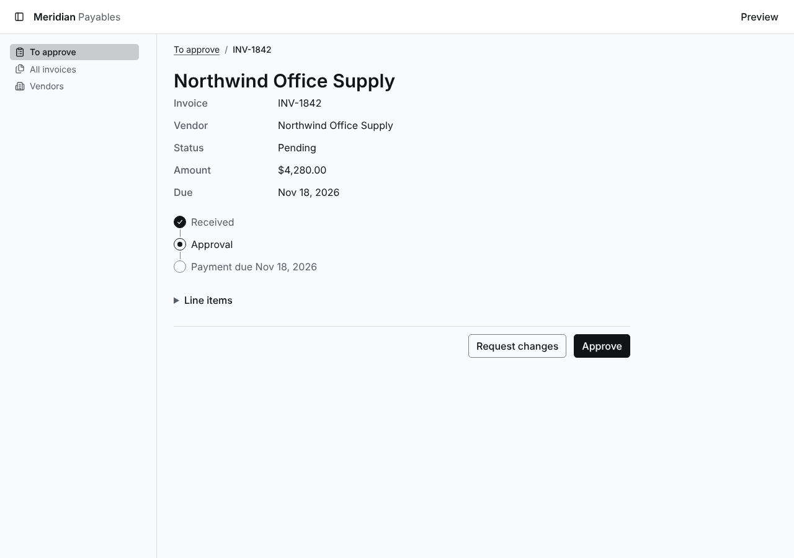](https://raw.githubusercontent.com/tounsoo/agent-design-loop/63db7bca2242a91616f1bd105ecbc61a5cb8e873/products/meridian/review/screenshots/vendor-directory/before/ready--page-detail.png) |  |
| ready--route-invoices | [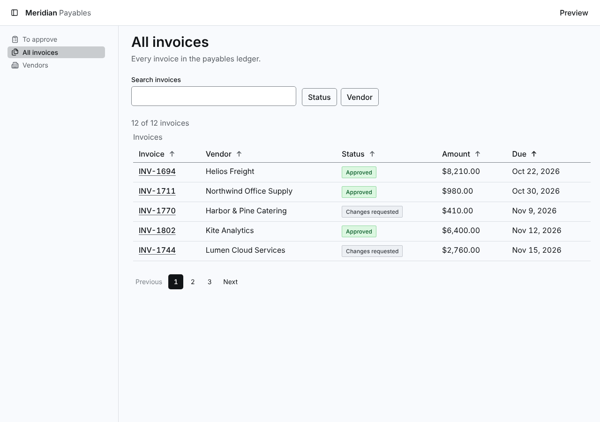](https://raw.githubusercontent.com/tounsoo/agent-design-loop/63db7bca2242a91616f1bd105ecbc61a5cb8e873/products/meridian/review/screenshots/vendor-directory/before/ready--route-invoices.png) |  |
| ready--route-vendors | [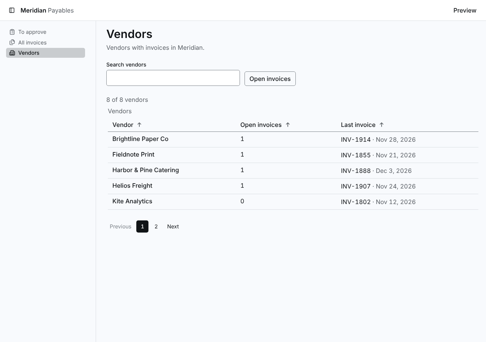](https://raw.githubusercontent.com/tounsoo/agent-design-loop/63db7bca2242a91616f1bd105ecbc61a5cb8e873/products/meridian/review/screenshots/vendor-directory/before/ready--route-vendors.png) | [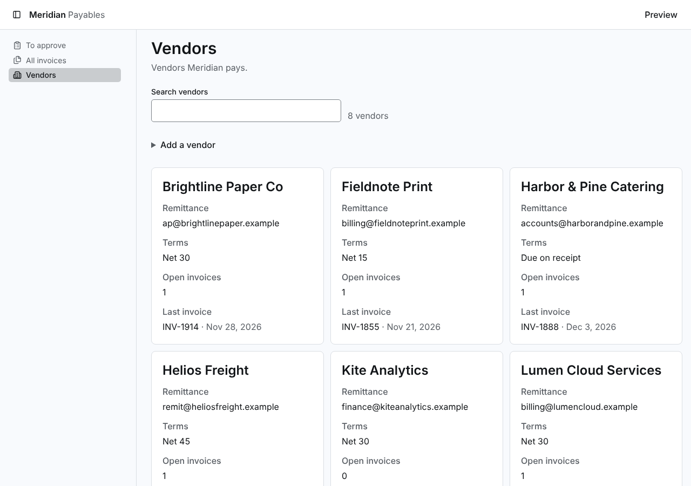](https://raw.githubusercontent.com/tounsoo/agent-design-loop/63db7bca2242a91616f1bd105ecbc61a5cb8e873/products/meridian/review/screenshots/vendor-directory/after/ready--route-vendors.png) |
| vendor-added | none | [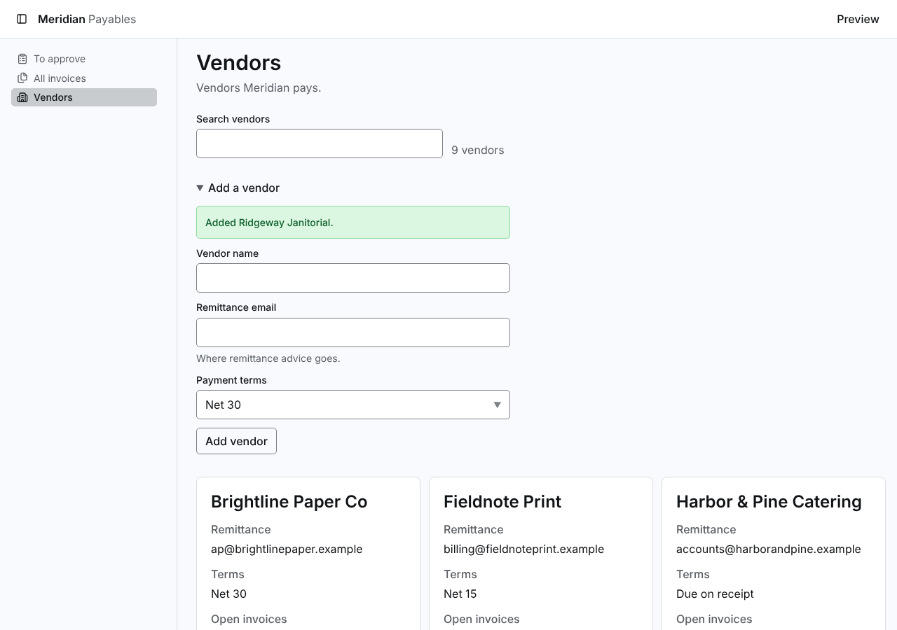](https://raw.githubusercontent.com/tounsoo/agent-design-loop/63db7bca2242a91616f1bd105ecbc61a5cb8e873/products/meridian/review/screenshots/vendor-directory/after/vendor-added.png) |
