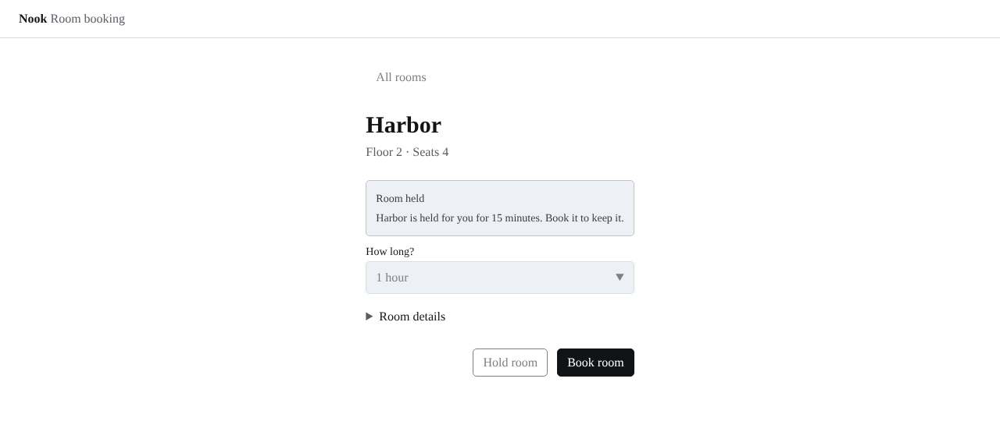
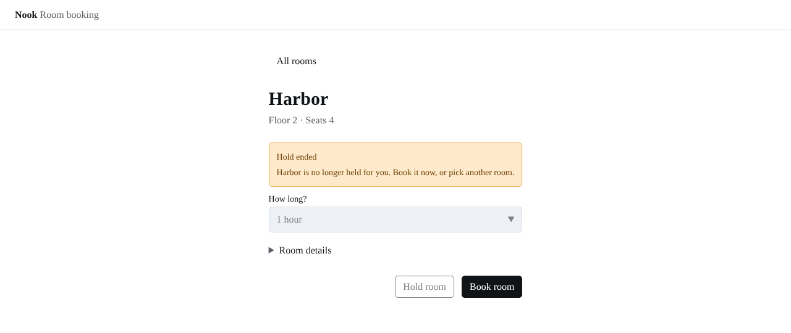

# Review: a hold that ends

A hold lasts 15 minutes, and the held alert says so, but until this change a hold never ended on screen. Nook now models one more flow state, `expired`, graduated in the same pull request by [proposal 2026-11-11-nook-hold-ends](../../../proposals/2026-11-11-nook-hold-ends.md). When a hold has lasted `HOLD_MINUTES`, the clock sends `hold-ended`, and the booking page shows a warning alert, "Hold ended". Book room books the room for the length chosen before the hold, All rooms is enabled again, and Hold room and the length field stay locked. A held preview opened from the URL, `?state=held`, stays as it is and never ends its hold, just as a preview never loads. A hold the person makes ends, even after opening a preview.

## What the checks already decided

- The flow states gained exactly one member, `expired`, and lost none. `check:inventories` passes it only because a proposal new in this pull request lists `expired` under `adds` and is `graduated`.
- `expired` has a view and a preview, `?state=expired`. `check:state-coverage` reads the view's cases, and `check:target-size` measures the preview's controls, All rooms and Book room now enabled, against the 24 CSS px floor.
- Book room is still the one primary button on the booking page, and Hold room is still secondary. `check:priority` and `lint:slots` read that.
- Neither task's route got longer. `hold-ended` comes from the clock, not from the person, so it is a system event, like `loaded` and `failed`, and `check:step-budget` does not count it as a step.

## What the checks cannot decide

- Whether a room whose hold ended is still free. Nook's sample rooms never get taken, so Book room always succeeds after a hold ends. A real booking service would need to answer, and the page would need a state for a room someone else took.
- Whether a person may hold the same room again after a hold ends. Hold room is disabled on the "Hold ended" screen, but All rooms, then Choose and Hold room, starts a new 15-minute hold on the same room, at the default length, as often as they like. Nook keeps no record of past holds, so limiting that needs a design decision and likely a new rule input.
- Whether the page should move when the hold ends. The booking column is as wide as its content, and "Hold ended" is longer than "Room held", so at 1280 px Book room moves about 34 px to the right with no action from the person. Every state change on this page can do the same; the hold ending is the first one the person does not cause.
- Whether the hold should end on screen while the tab is in the background. The timer is the browser's, so a sleeping laptop may show the hold for longer than 15 minutes, and nothing warns before the hold ends.
- Whether "Hold ended" and "Book it now, or pick another room." are the right copy, and whether a warning, not an info alert, is the right tone.

## Screenshots

The booking page at 1280 px, light theme. Before, a held room 15 minutes in still read "Room held". After, the same moment reads "Hold ended". The held preview itself renders pixel for pixel as before.

