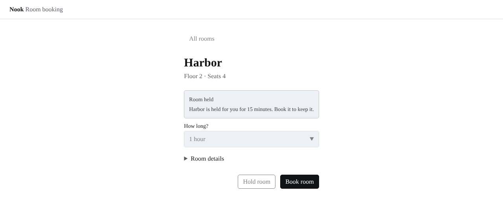
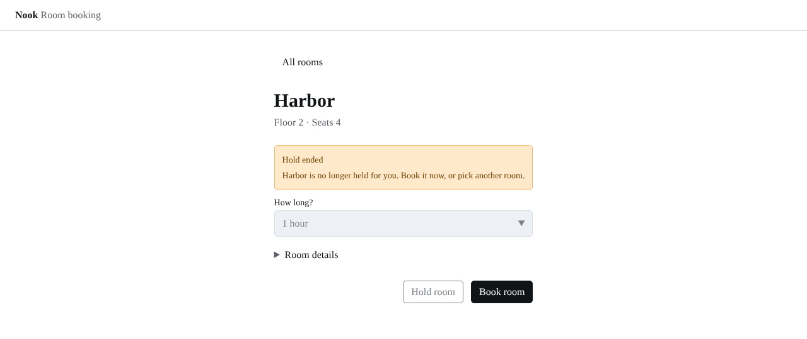

# Screenshots: a hold that ends

The booking page for [proposal 0015](../../../../proposals/0015-nook-hold-ends.md), one image per state, at 1280 px in the light theme. Click an image to open it full size. The review note is [a hold that ends](../hold-ends.md).

## Held, unchanged by this change

`?state=held`. Before this change, the page still read like this 15 minutes into a hold.

## Hold ended, new in this change

`?state=expired`. What the page reads once the hold has lasted 15 minutes.

