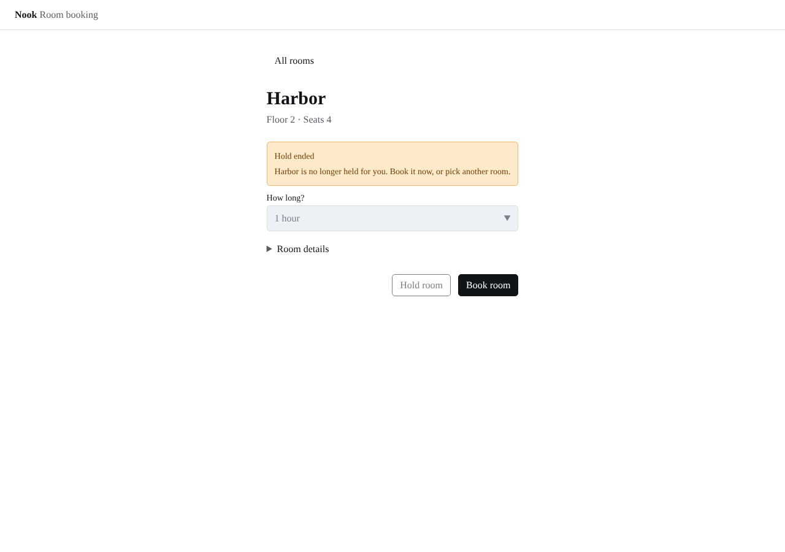
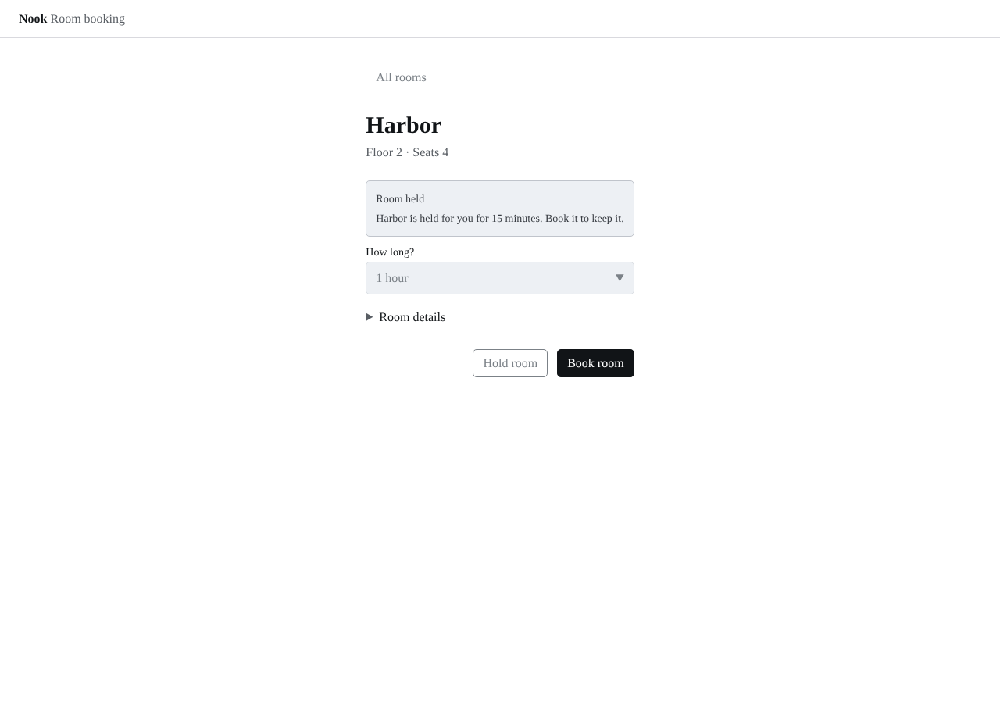

# Screenshots

Taken by `npm run screenshots` with `products/nook/harness.config.ts`, at 1280 by 900 CSS px in headless Chrome, one per preview. Click an image to open it full size.

Before is `origin/main (d6dcf1e)`. After is the change.

| Preview | Before | After |
| --- | --- | --- |
| expired | none |  |
| held |  |  |
