# Screenshots

Taken by `npm run screenshots` with `products/nook/harness.config.ts` in headless Chrome, a full page per scenario in each view it was asked for: `desktop-light` (1280 by 900, light), `desktop-dark` (1280 by 900, dark), `phone-light` (390 by 844, light), `phone-dark` (390 by 844, dark), in CSS px. A name is the scenario, then the view. Click an image to open it full size.

Before is `origin/main (3b7af33)`. After is the change.

| Screenshot | Before | After |
| --- | --- | --- |
| booked--desktop-dark |  | [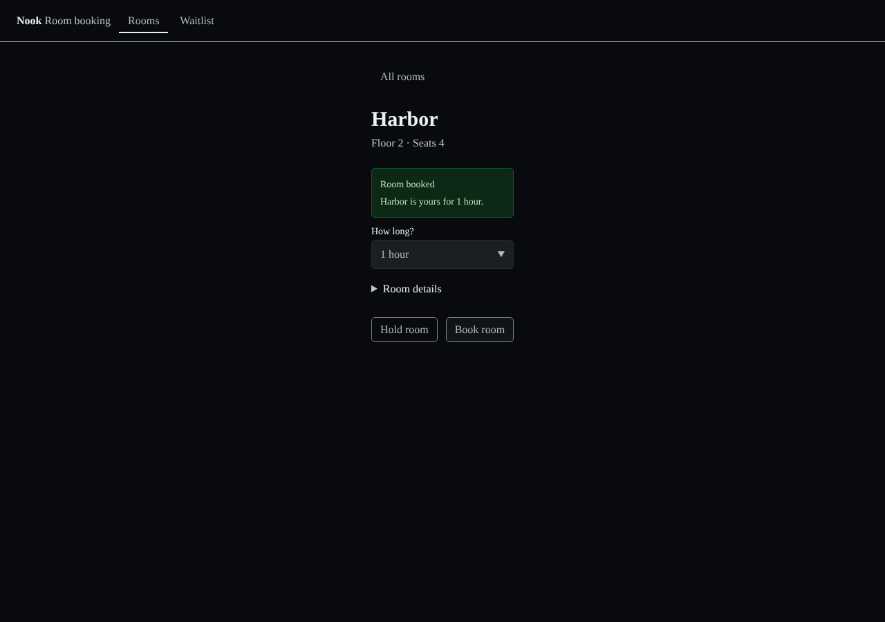](https://raw.githubusercontent.com/tounsoo/agent-design-loop/76e8bc1c0bc6fb34d0448b03e0818879c052ded4/products/nook/review/screenshots/page-bodies-from-content-layouts/after/booked--desktop-dark.png) |
| booked--desktop-light | [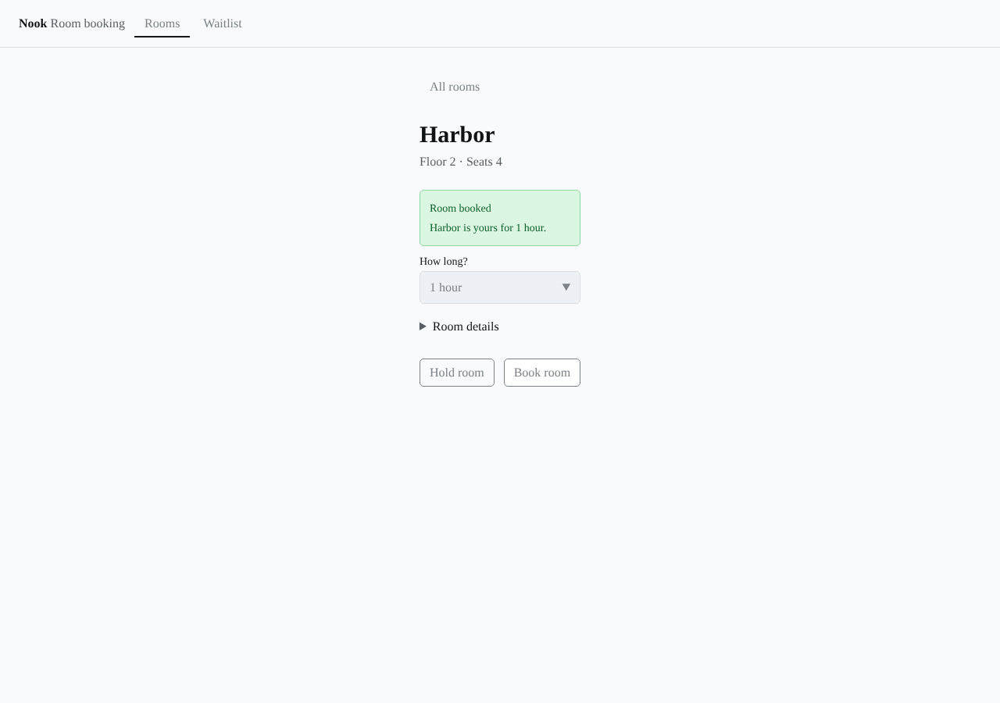](https://raw.githubusercontent.com/tounsoo/agent-design-loop/76e8bc1c0bc6fb34d0448b03e0818879c052ded4/products/nook/review/screenshots/page-bodies-from-content-layouts/before/booked--desktop-light.png) |  |
| booked--phone-dark | [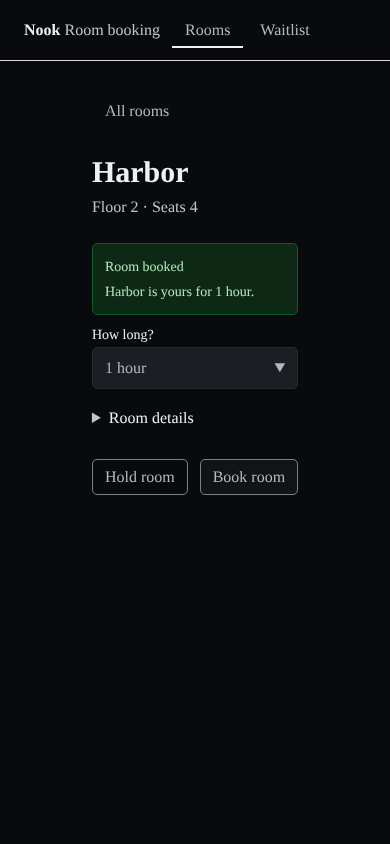](https://raw.githubusercontent.com/tounsoo/agent-design-loop/76e8bc1c0bc6fb34d0448b03e0818879c052ded4/products/nook/review/screenshots/page-bodies-from-content-layouts/before/booked--phone-dark.png) |  |
| booked--phone-light | [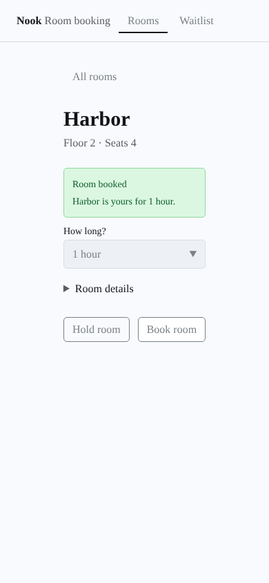](https://raw.githubusercontent.com/tounsoo/agent-design-loop/76e8bc1c0bc6fb34d0448b03e0818879c052ded4/products/nook/review/screenshots/page-bodies-from-content-layouts/before/booked--phone-light.png) |  |
| booking-harbor--desktop-dark | [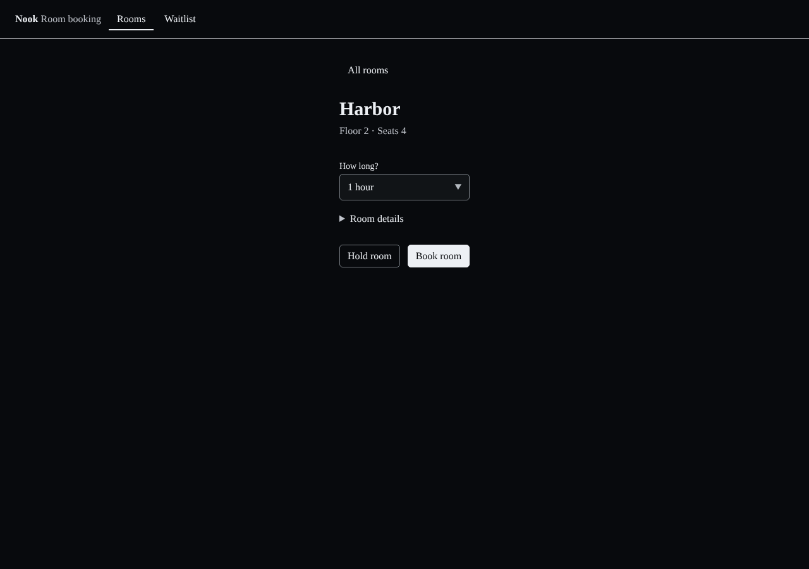](https://raw.githubusercontent.com/tounsoo/agent-design-loop/76e8bc1c0bc6fb34d0448b03e0818879c052ded4/products/nook/review/screenshots/page-bodies-from-content-layouts/before/booking-harbor--desktop-dark.png) |  |
| booking-harbor--desktop-light | [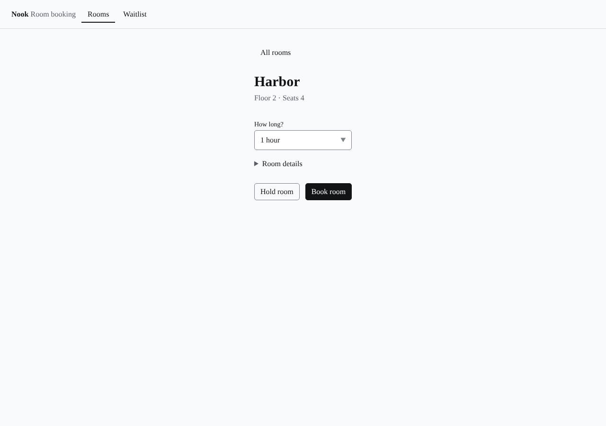](https://raw.githubusercontent.com/tounsoo/agent-design-loop/76e8bc1c0bc6fb34d0448b03e0818879c052ded4/products/nook/review/screenshots/page-bodies-from-content-layouts/before/booking-harbor--desktop-light.png) |  |
| booking-harbor--phone-dark |  |  |
| booking-harbor--phone-light | [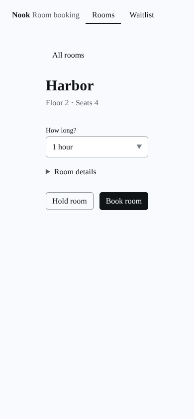](https://raw.githubusercontent.com/tounsoo/agent-design-loop/76e8bc1c0bc6fb34d0448b03e0818879c052ded4/products/nook/review/screenshots/page-bodies-from-content-layouts/before/booking-harbor--phone-light.png) |  |
| expired--desktop-dark | [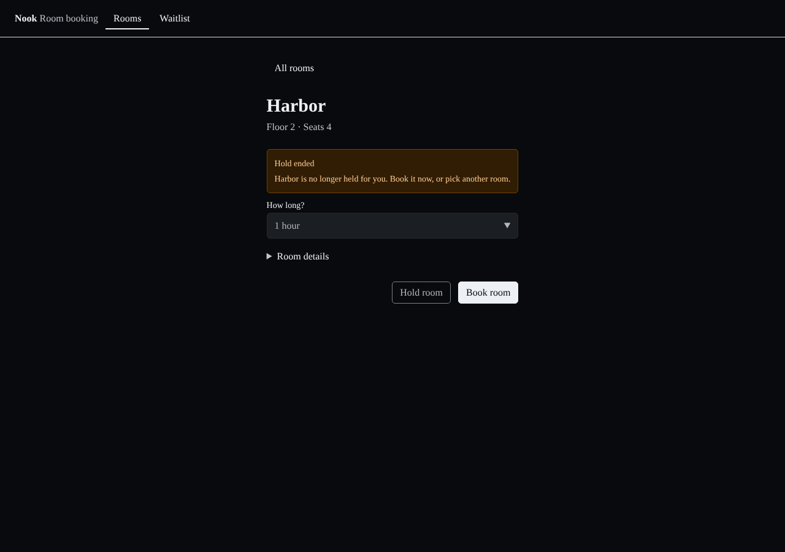](https://raw.githubusercontent.com/tounsoo/agent-design-loop/76e8bc1c0bc6fb34d0448b03e0818879c052ded4/products/nook/review/screenshots/page-bodies-from-content-layouts/before/expired--desktop-dark.png) |  |
| expired--desktop-light | [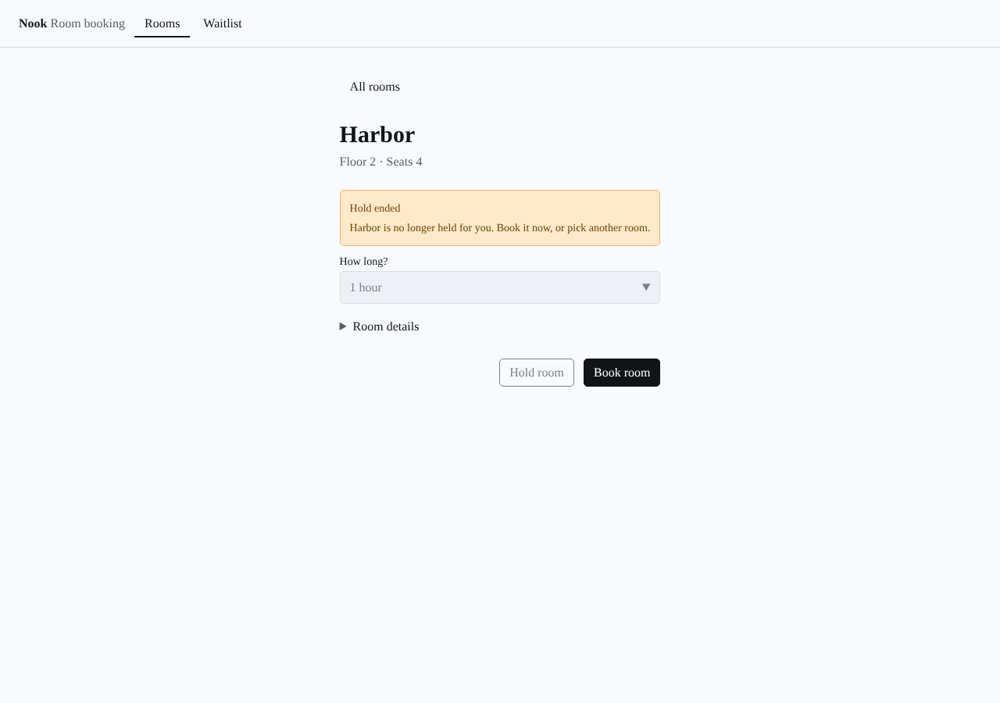](https://raw.githubusercontent.com/tounsoo/agent-design-loop/76e8bc1c0bc6fb34d0448b03e0818879c052ded4/products/nook/review/screenshots/page-bodies-from-content-layouts/before/expired--desktop-light.png) |  |
| expired--phone-dark | [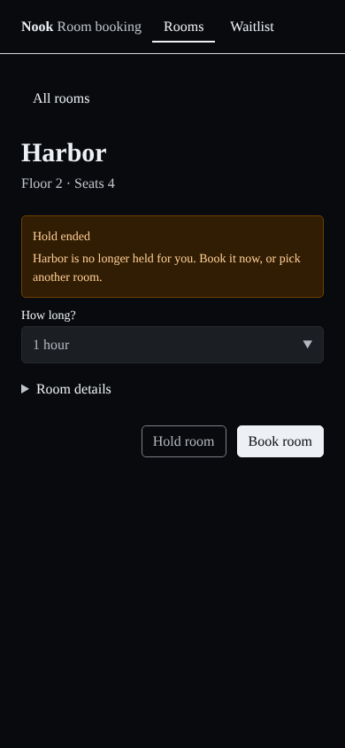](https://raw.githubusercontent.com/tounsoo/agent-design-loop/76e8bc1c0bc6fb34d0448b03e0818879c052ded4/products/nook/review/screenshots/page-bodies-from-content-layouts/before/expired--phone-dark.png) |  |
| expired--phone-light |  | [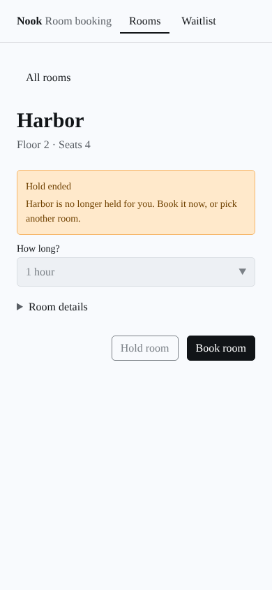](https://raw.githubusercontent.com/tounsoo/agent-design-loop/76e8bc1c0bc6fb34d0448b03e0818879c052ded4/products/nook/review/screenshots/page-bodies-from-content-layouts/after/expired--phone-light.png) |
