# Screenshots

Taken by `npm run screenshots` with `products/nook/harness.config.ts`, at 1280 by 900 CSS px in headless Chrome, one per preview. Click an image to open it full size.

Before is `main (6e8280c)`. After is the change.

| Preview | Before | After |
| --- | --- | --- |
| booked | [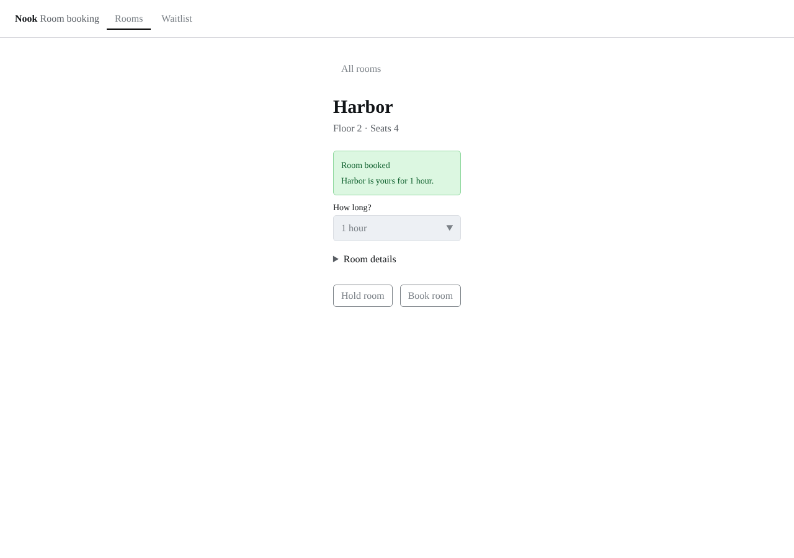](https://raw.githubusercontent.com/tounsoo/agent-design-loop/f38d7456e750332482182d49de5806282f90d079/products/nook/review/screenshots/proof-quarry-preview/before/booked.png) |  |
| choosing--page-booking--room-quarry | none |  |
| choosing--page-booking | [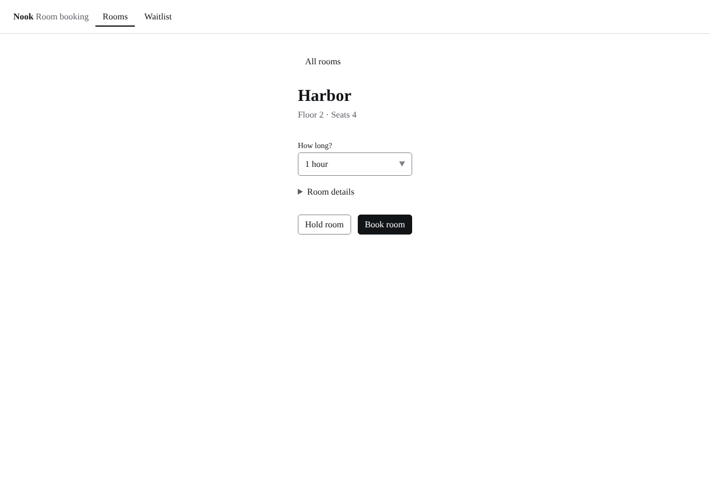](https://raw.githubusercontent.com/tounsoo/agent-design-loop/f38d7456e750332482182d49de5806282f90d079/products/nook/review/screenshots/proof-quarry-preview/before/choosing--page-booking.png) |  |
| choosing--page-rooms | [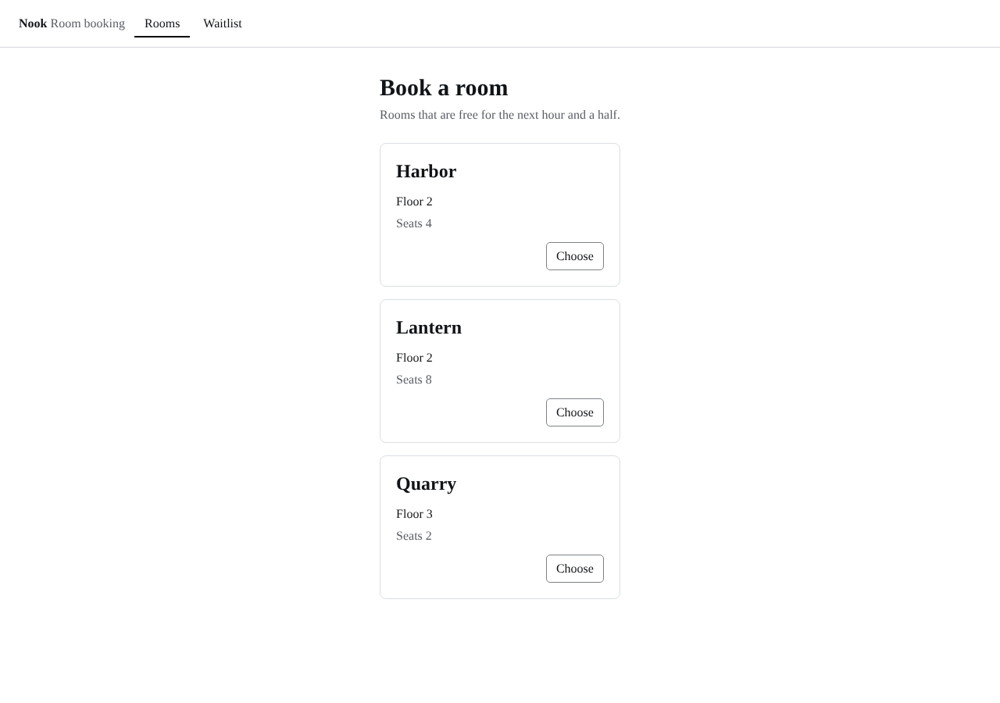](https://raw.githubusercontent.com/tounsoo/agent-design-loop/f38d7456e750332482182d49de5806282f90d079/products/nook/review/screenshots/proof-quarry-preview/before/choosing--page-rooms.png) |  |
| error | [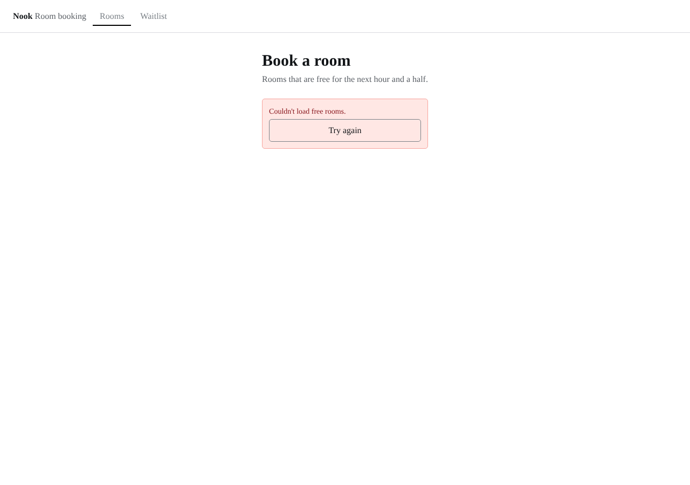](https://raw.githubusercontent.com/tounsoo/agent-design-loop/f38d7456e750332482182d49de5806282f90d079/products/nook/review/screenshots/proof-quarry-preview/before/error.png) |  |
| expired |  | [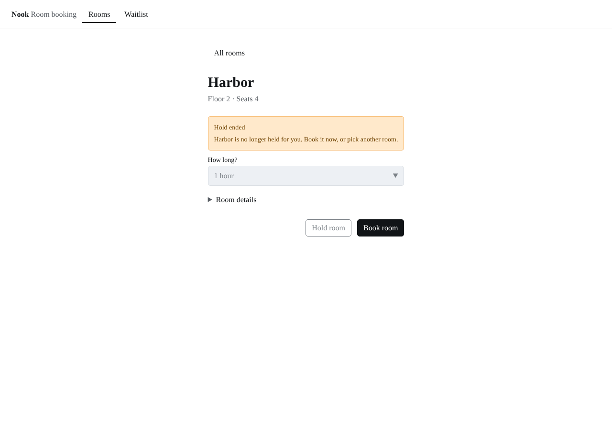](https://raw.githubusercontent.com/tounsoo/agent-design-loop/f38d7456e750332482182d49de5806282f90d079/products/nook/review/screenshots/proof-quarry-preview/after/expired.png) |
| freed |  | [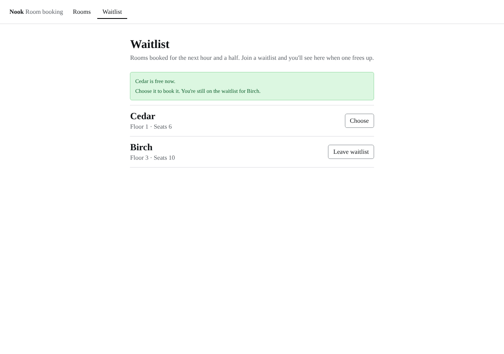](https://raw.githubusercontent.com/tounsoo/agent-design-loop/f38d7456e750332482182d49de5806282f90d079/products/nook/review/screenshots/proof-quarry-preview/after/freed.png) |
| held | [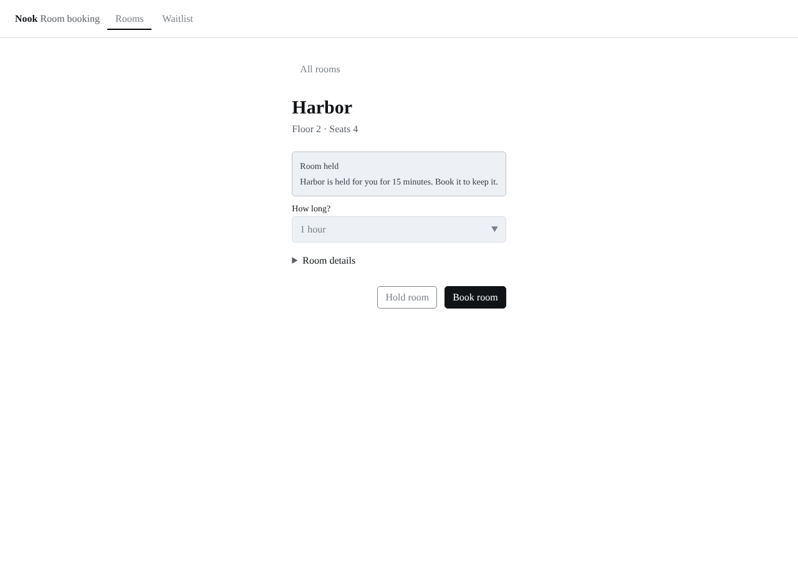](https://raw.githubusercontent.com/tounsoo/agent-design-loop/f38d7456e750332482182d49de5806282f90d079/products/nook/review/screenshots/proof-quarry-preview/before/held.png) |  |
| loading |  | [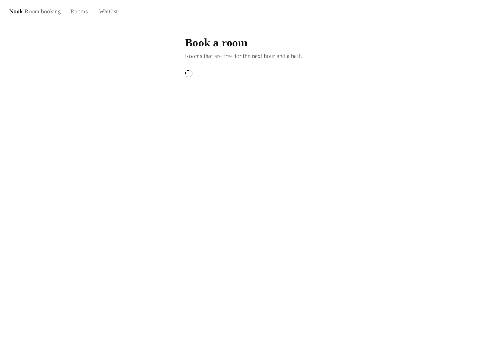](https://raw.githubusercontent.com/tounsoo/agent-design-loop/f38d7456e750332482182d49de5806282f90d079/products/nook/review/screenshots/proof-quarry-preview/after/loading.png) |
| no-rooms | [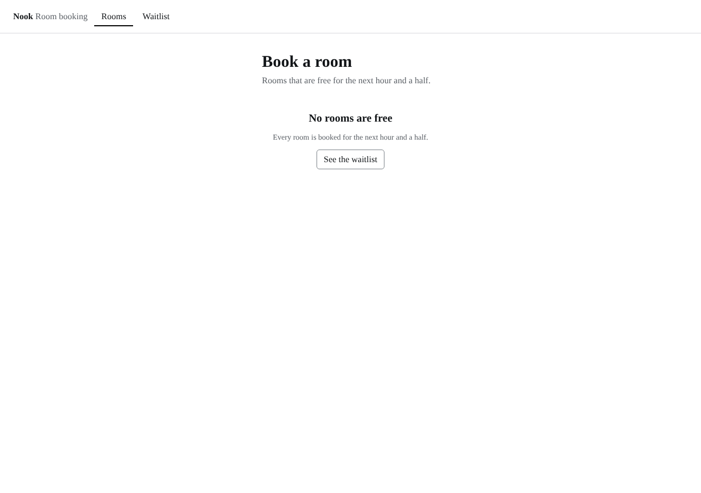](https://raw.githubusercontent.com/tounsoo/agent-design-loop/f38d7456e750332482182d49de5806282f90d079/products/nook/review/screenshots/proof-quarry-preview/before/no-rooms.png) |  |
| waiting | [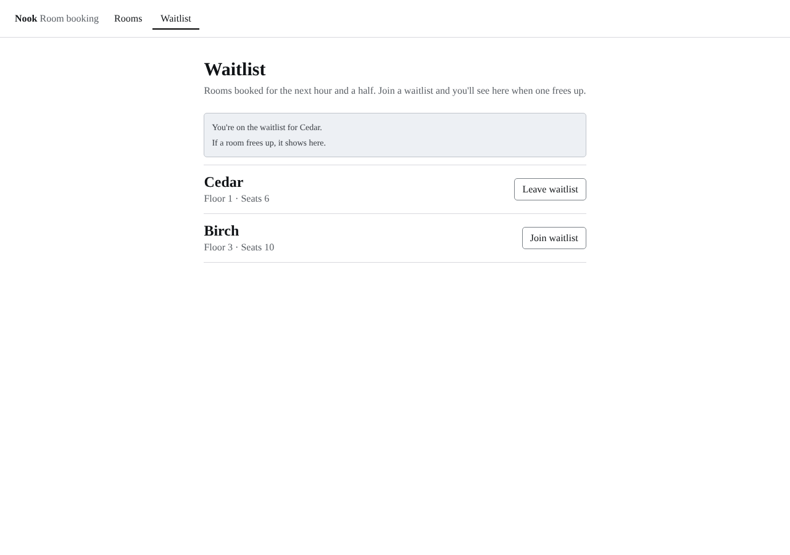](https://raw.githubusercontent.com/tounsoo/agent-design-loop/f38d7456e750332482182d49de5806282f90d079/products/nook/review/screenshots/proof-quarry-preview/before/waiting.png) |  |
| waitlist | [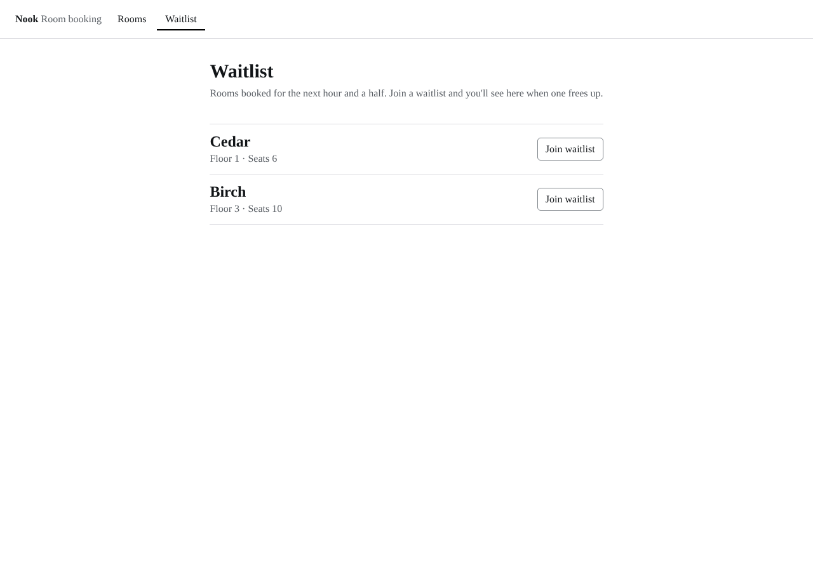](https://raw.githubusercontent.com/tounsoo/agent-design-loop/f38d7456e750332482182d49de5806282f90d079/products/nook/review/screenshots/proof-quarry-preview/before/waitlist.png) |  |
