# Screenshots

Taken by `npm run screenshots` with `products/nook/harness.config.ts` in headless Chrome, a full page per scenario in each view it was asked for: `desktop-light` (1280 by 900, light), `desktop-dark` (1280 by 900, dark), `phone-light` (390 by 844, light), `phone-dark` (390 by 844, dark), in CSS px. A name is the scenario, then the view. Click an image to open it full size.

## booked--desktop-dark

[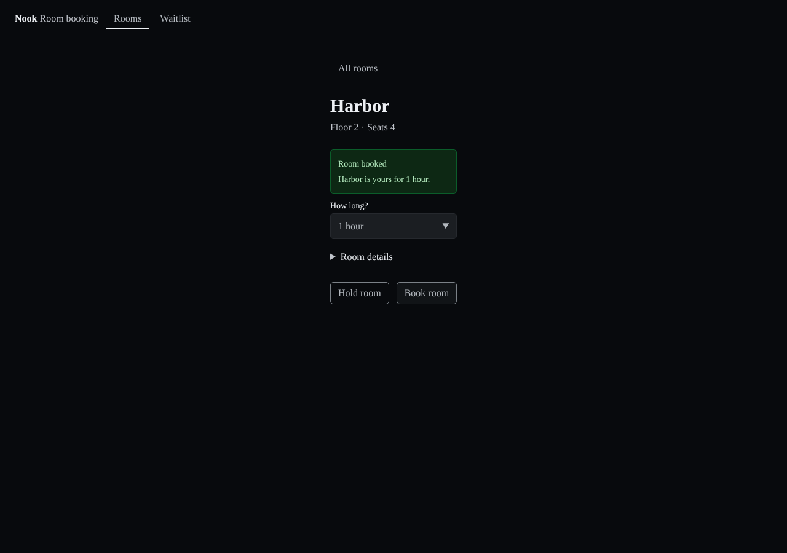](https://raw.githubusercontent.com/tounsoo/agent-design-loop/ba95684532ddf98ab616d24166001944c0459f6c/products/nook/review/screenshots/scenarios/booked--desktop-dark.png)

## booked--desktop-light

[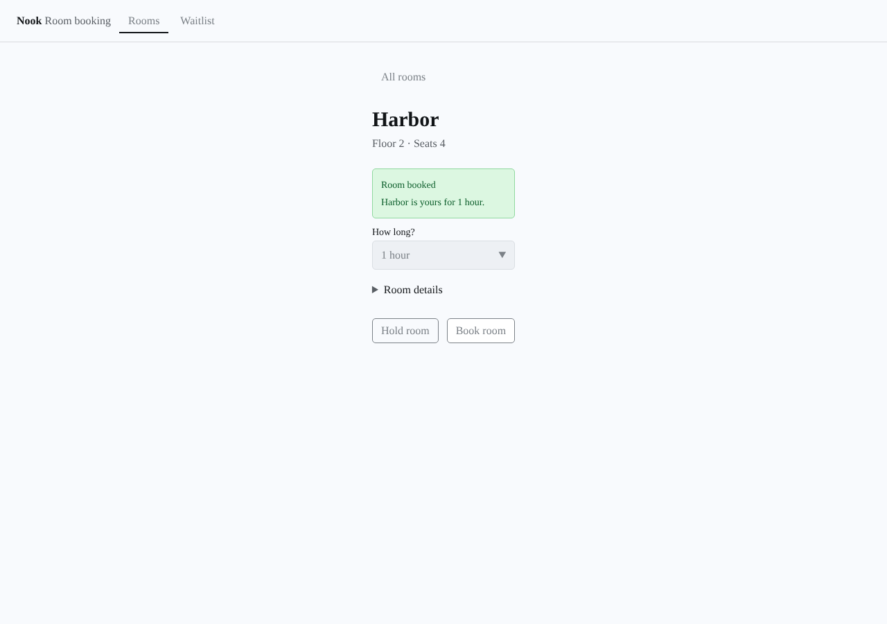](https://raw.githubusercontent.com/tounsoo/agent-design-loop/ba95684532ddf98ab616d24166001944c0459f6c/products/nook/review/screenshots/scenarios/booked--desktop-light.png)

## booked--phone-dark

[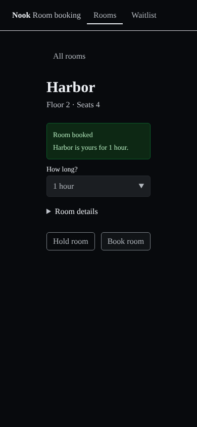](https://raw.githubusercontent.com/tounsoo/agent-design-loop/ba95684532ddf98ab616d24166001944c0459f6c/products/nook/review/screenshots/scenarios/booked--phone-dark.png)

## booked--phone-light

[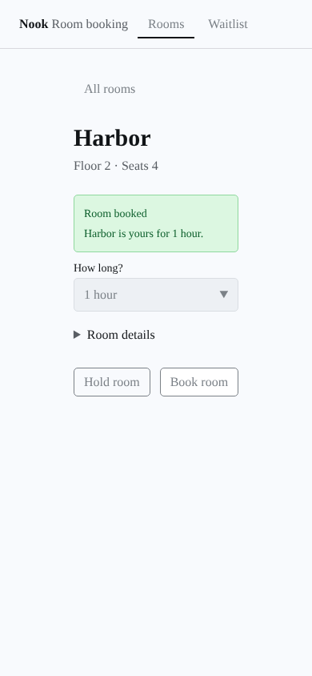](https://raw.githubusercontent.com/tounsoo/agent-design-loop/ba95684532ddf98ab616d24166001944c0459f6c/products/nook/review/screenshots/scenarios/booked--phone-light.png)

## booking-harbor--desktop-dark

[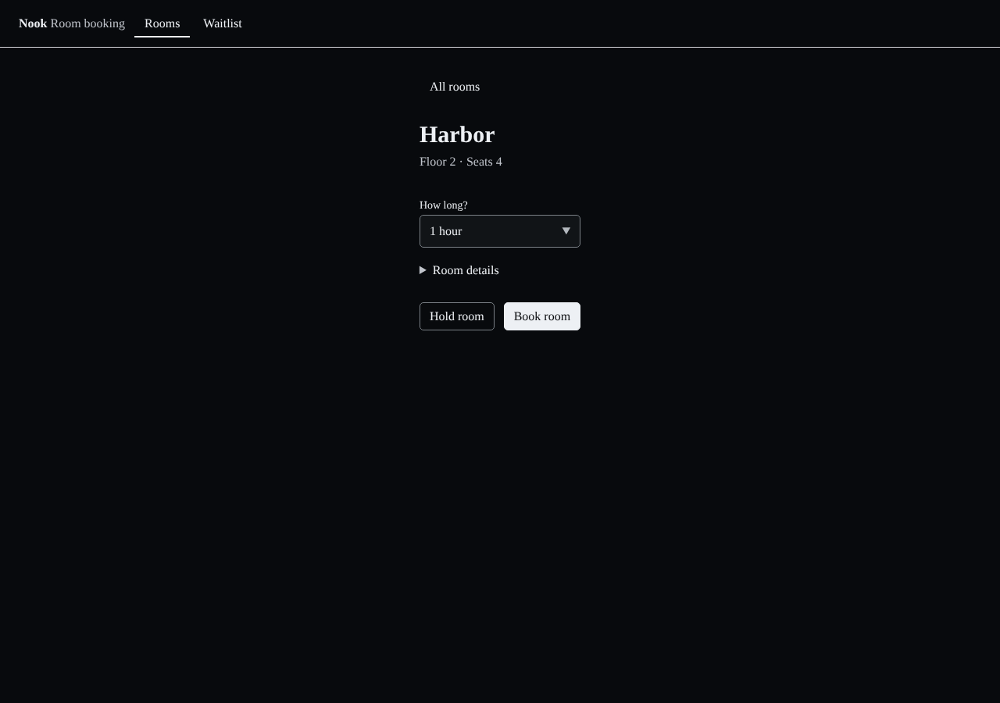](https://raw.githubusercontent.com/tounsoo/agent-design-loop/ba95684532ddf98ab616d24166001944c0459f6c/products/nook/review/screenshots/scenarios/booking-harbor--desktop-dark.png)

## booking-harbor--desktop-light

## booking-harbor--phone-dark

## booking-harbor--phone-light

## booking-lantern--desktop-dark

## booking-lantern--desktop-light

[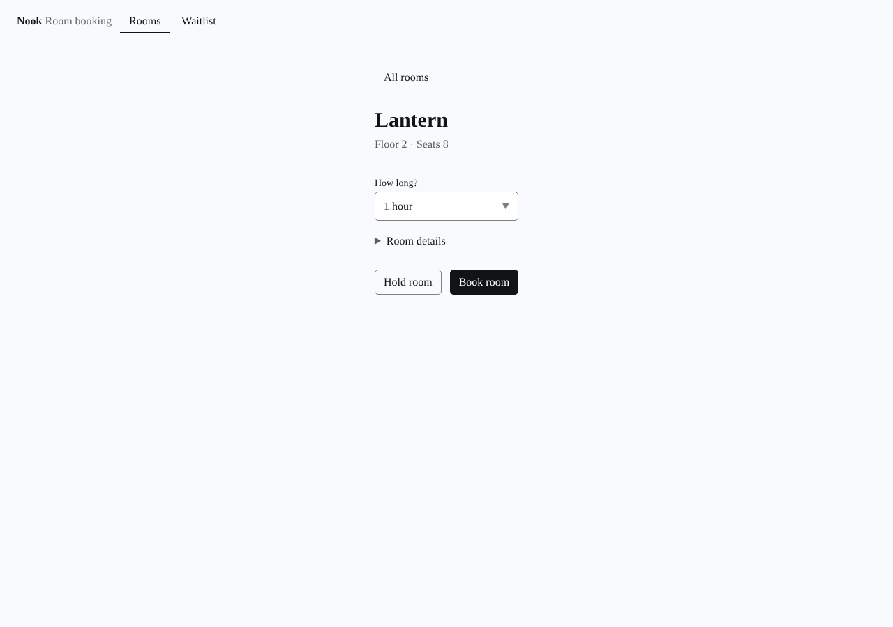](https://raw.githubusercontent.com/tounsoo/agent-design-loop/ba95684532ddf98ab616d24166001944c0459f6c/products/nook/review/screenshots/scenarios/booking-lantern--desktop-light.png)

## booking-lantern--phone-dark

[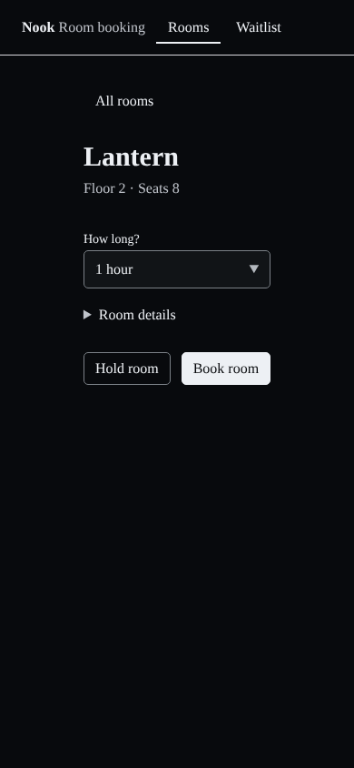](https://raw.githubusercontent.com/tounsoo/agent-design-loop/ba95684532ddf98ab616d24166001944c0459f6c/products/nook/review/screenshots/scenarios/booking-lantern--phone-dark.png)

## booking-lantern--phone-light

[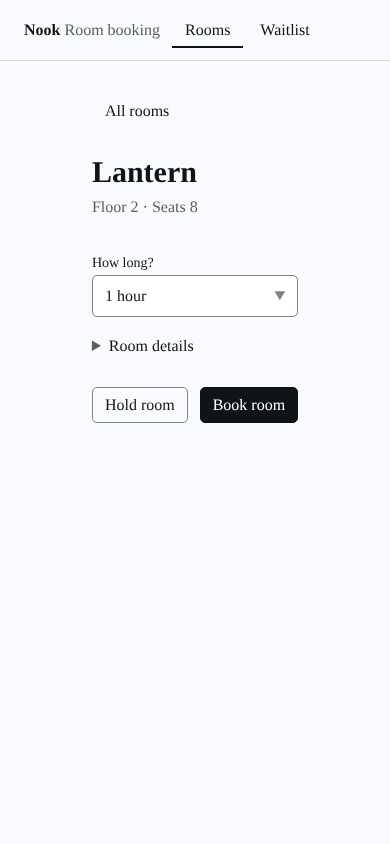](https://raw.githubusercontent.com/tounsoo/agent-design-loop/ba95684532ddf98ab616d24166001944c0459f6c/products/nook/review/screenshots/scenarios/booking-lantern--phone-light.png)

## booking-quarry--desktop-dark

## booking-quarry--desktop-light

## booking-quarry--phone-dark

## booking-quarry--phone-light

[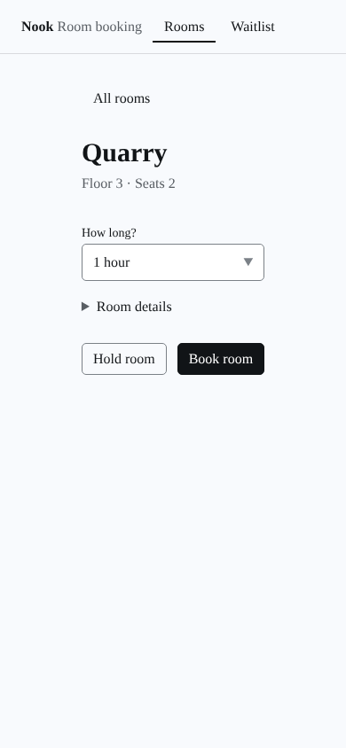](https://raw.githubusercontent.com/tounsoo/agent-design-loop/ba95684532ddf98ab616d24166001944c0459f6c/products/nook/review/screenshots/scenarios/booking-quarry--phone-light.png)

## error--desktop-dark

[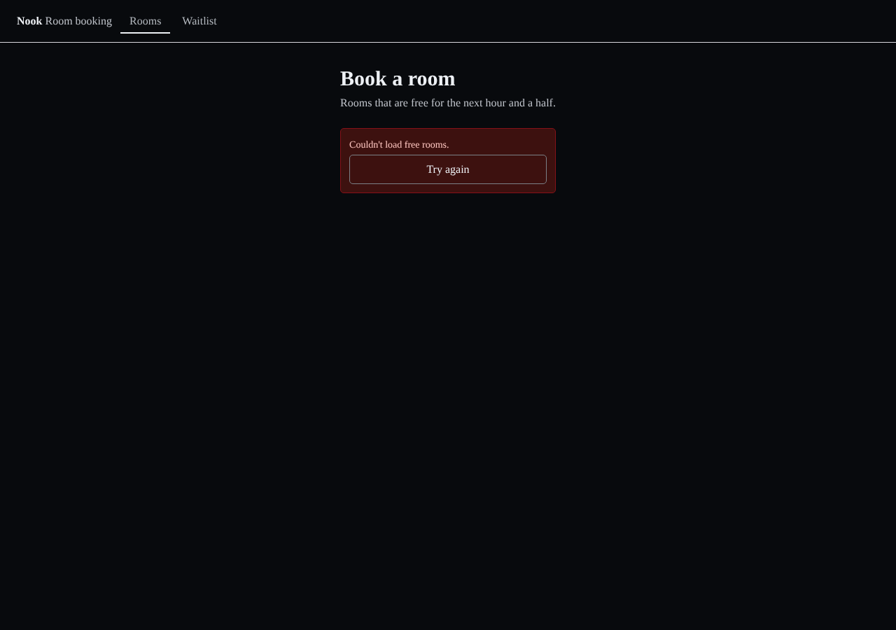](https://raw.githubusercontent.com/tounsoo/agent-design-loop/ba95684532ddf98ab616d24166001944c0459f6c/products/nook/review/screenshots/scenarios/error--desktop-dark.png)

## error--desktop-light

[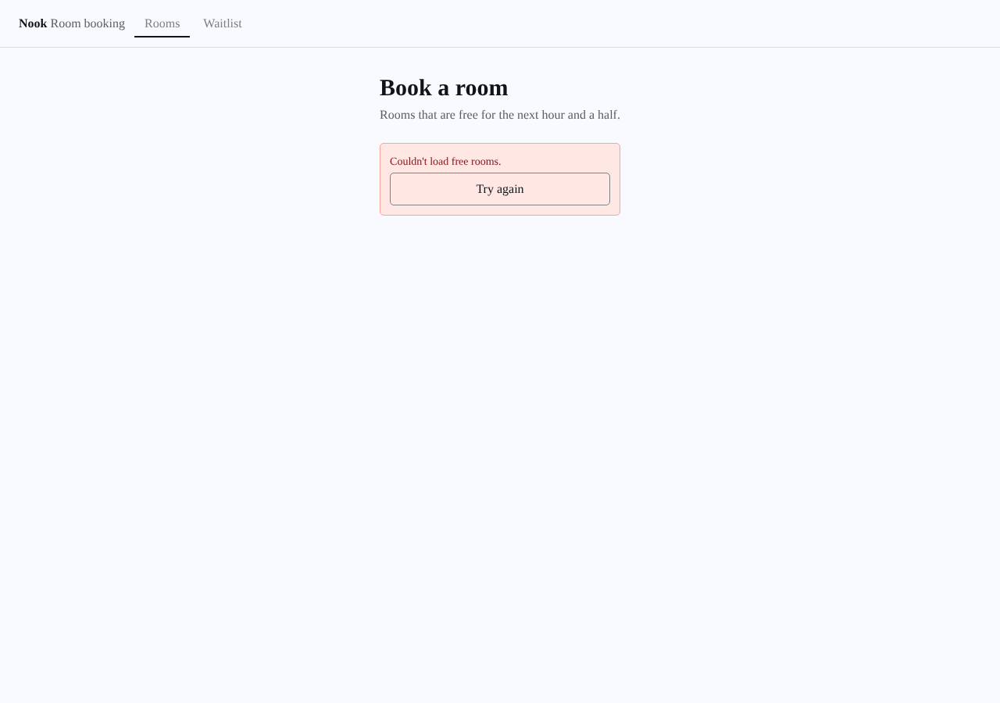](https://raw.githubusercontent.com/tounsoo/agent-design-loop/ba95684532ddf98ab616d24166001944c0459f6c/products/nook/review/screenshots/scenarios/error--desktop-light.png)

## error--phone-dark

## error--phone-light

## expired--desktop-dark

[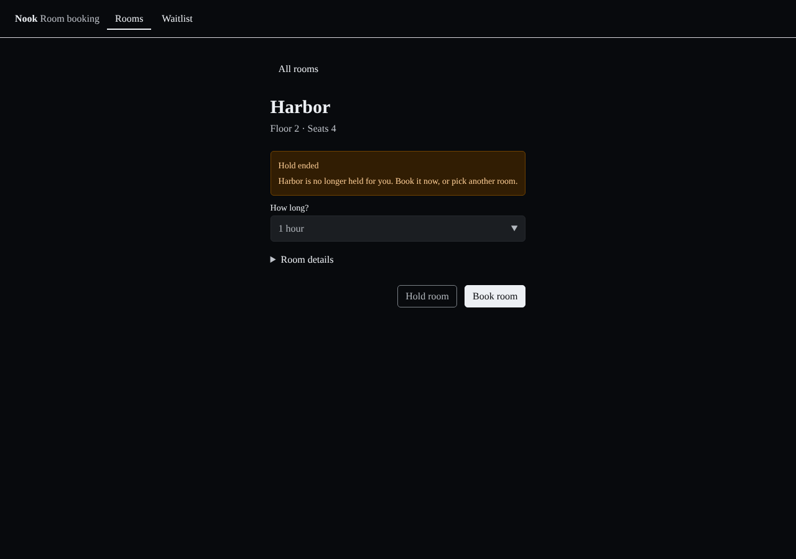](https://raw.githubusercontent.com/tounsoo/agent-design-loop/ba95684532ddf98ab616d24166001944c0459f6c/products/nook/review/screenshots/scenarios/expired--desktop-dark.png)

## expired--desktop-light

[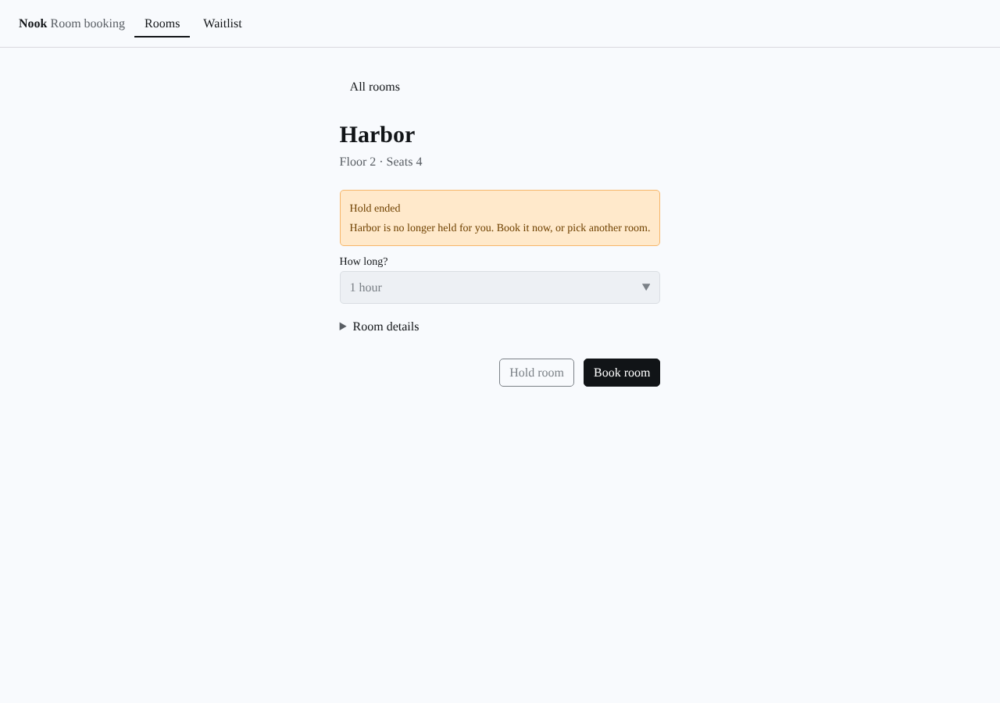](https://raw.githubusercontent.com/tounsoo/agent-design-loop/ba95684532ddf98ab616d24166001944c0459f6c/products/nook/review/screenshots/scenarios/expired--desktop-light.png)

## expired--phone-dark

[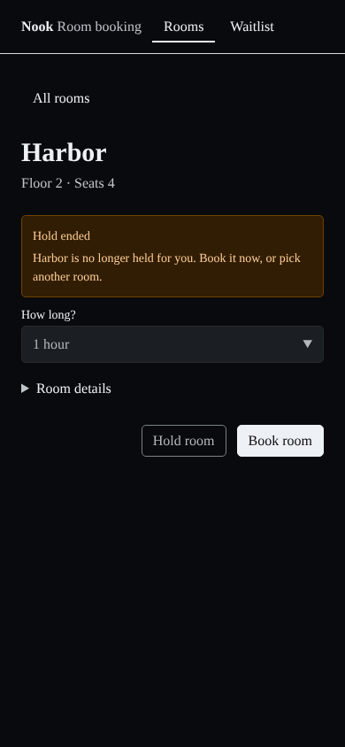](https://raw.githubusercontent.com/tounsoo/agent-design-loop/ba95684532ddf98ab616d24166001944c0459f6c/products/nook/review/screenshots/scenarios/expired--phone-dark.png)

## expired--phone-light

[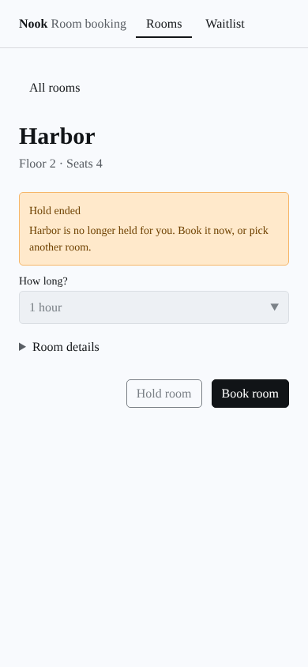](https://raw.githubusercontent.com/tounsoo/agent-design-loop/ba95684532ddf98ab616d24166001944c0459f6c/products/nook/review/screenshots/scenarios/expired--phone-light.png)

## freed--desktop-dark

[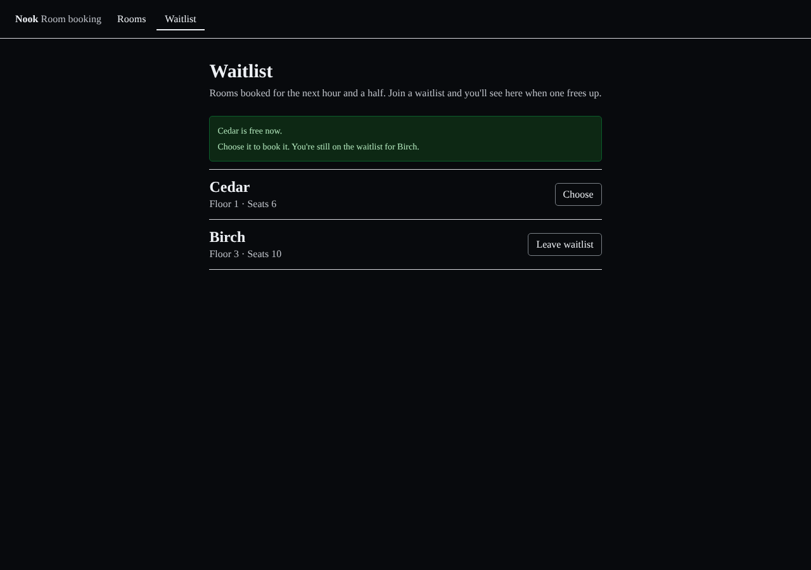](https://raw.githubusercontent.com/tounsoo/agent-design-loop/ba95684532ddf98ab616d24166001944c0459f6c/products/nook/review/screenshots/scenarios/freed--desktop-dark.png)

## freed--desktop-light

[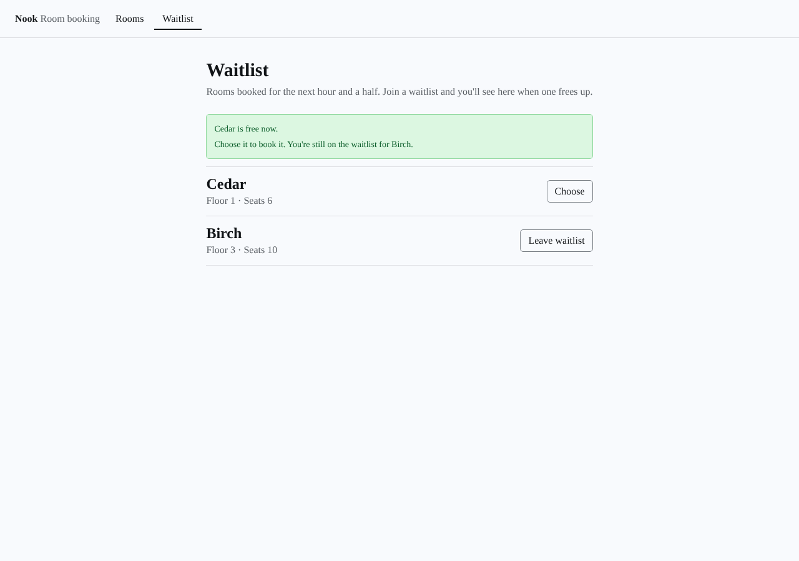](https://raw.githubusercontent.com/tounsoo/agent-design-loop/ba95684532ddf98ab616d24166001944c0459f6c/products/nook/review/screenshots/scenarios/freed--desktop-light.png)

## freed--phone-dark

[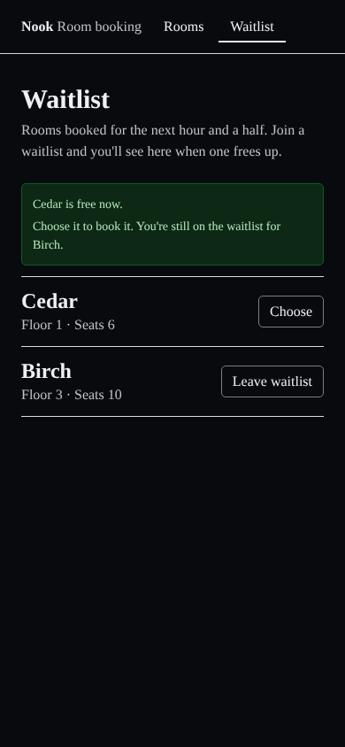](https://raw.githubusercontent.com/tounsoo/agent-design-loop/ba95684532ddf98ab616d24166001944c0459f6c/products/nook/review/screenshots/scenarios/freed--phone-dark.png)

## freed--phone-light

[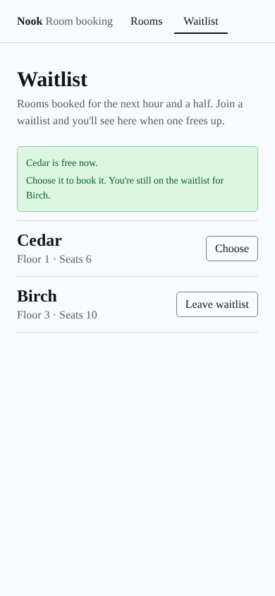](https://raw.githubusercontent.com/tounsoo/agent-design-loop/ba95684532ddf98ab616d24166001944c0459f6c/products/nook/review/screenshots/scenarios/freed--phone-light.png)

## held--desktop-dark

[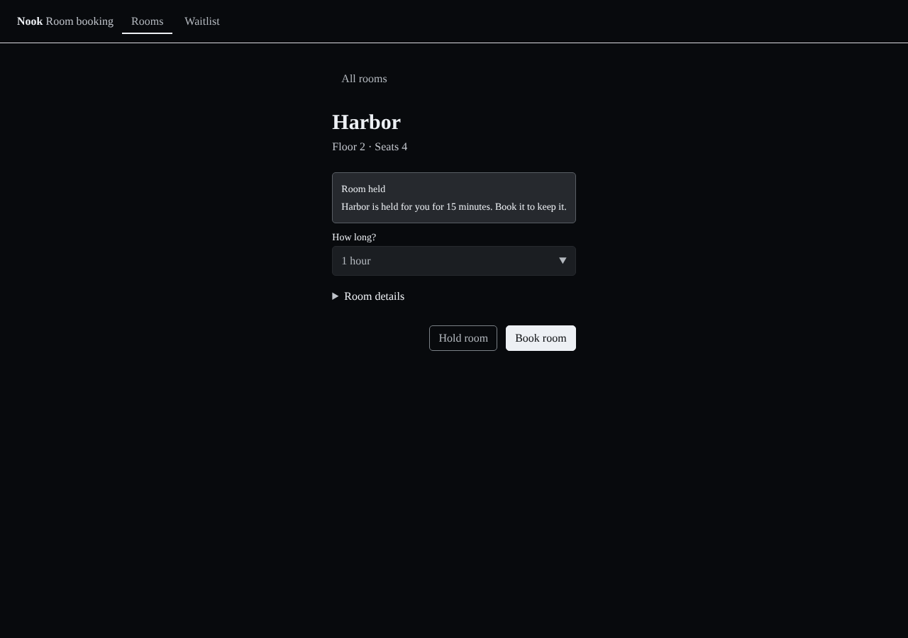](https://raw.githubusercontent.com/tounsoo/agent-design-loop/ba95684532ddf98ab616d24166001944c0459f6c/products/nook/review/screenshots/scenarios/held--desktop-dark.png)

## held--desktop-light

[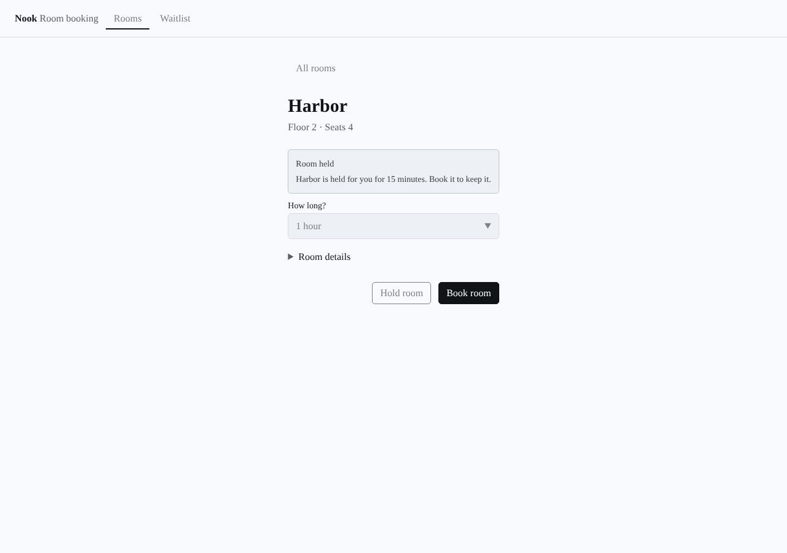](https://raw.githubusercontent.com/tounsoo/agent-design-loop/ba95684532ddf98ab616d24166001944c0459f6c/products/nook/review/screenshots/scenarios/held--desktop-light.png)

## held--phone-dark

[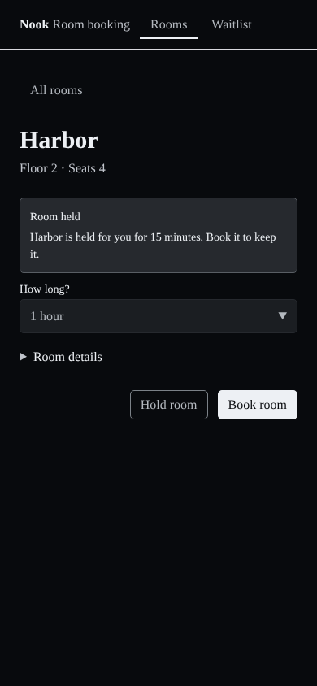](https://raw.githubusercontent.com/tounsoo/agent-design-loop/ba95684532ddf98ab616d24166001944c0459f6c/products/nook/review/screenshots/scenarios/held--phone-dark.png)

## held--phone-light

[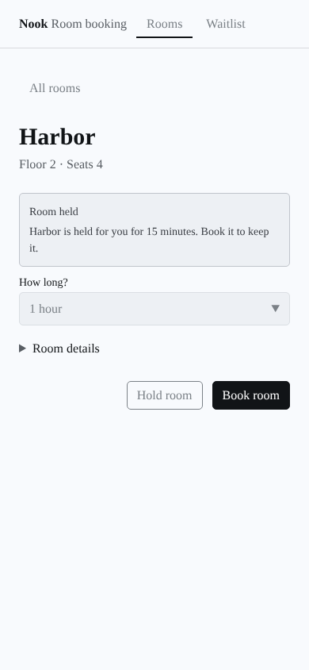](https://raw.githubusercontent.com/tounsoo/agent-design-loop/ba95684532ddf98ab616d24166001944c0459f6c/products/nook/review/screenshots/scenarios/held--phone-light.png)

## loading--desktop-dark

[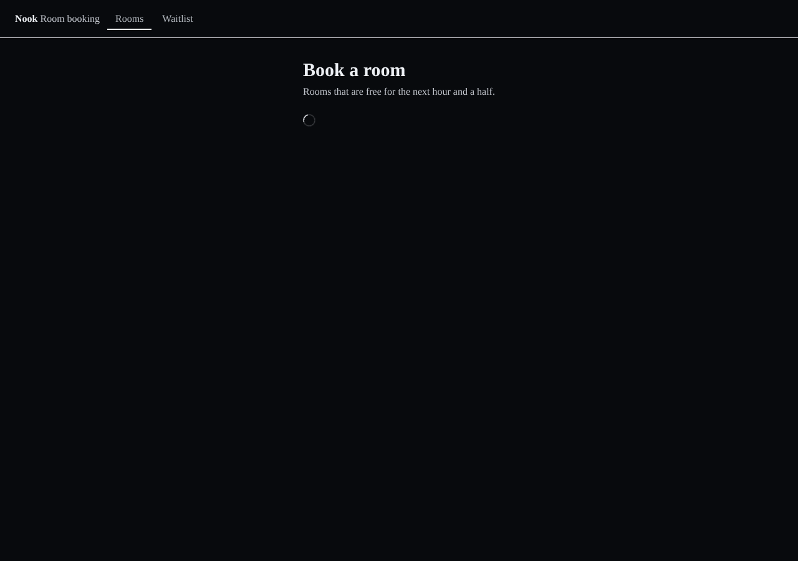](https://raw.githubusercontent.com/tounsoo/agent-design-loop/ba95684532ddf98ab616d24166001944c0459f6c/products/nook/review/screenshots/scenarios/loading--desktop-dark.png)

## loading--desktop-light

[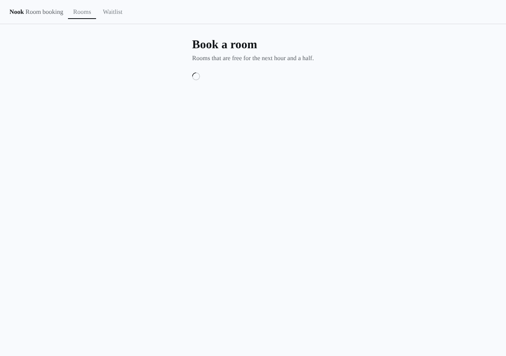](https://raw.githubusercontent.com/tounsoo/agent-design-loop/ba95684532ddf98ab616d24166001944c0459f6c/products/nook/review/screenshots/scenarios/loading--desktop-light.png)

## loading--phone-dark

## loading--phone-light

[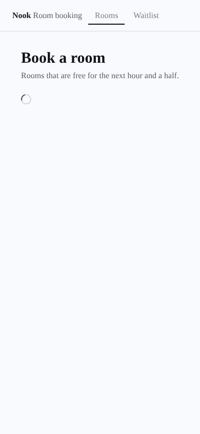](https://raw.githubusercontent.com/tounsoo/agent-design-loop/ba95684532ddf98ab616d24166001944c0459f6c/products/nook/review/screenshots/scenarios/loading--phone-light.png)

## no-rooms--desktop-dark

[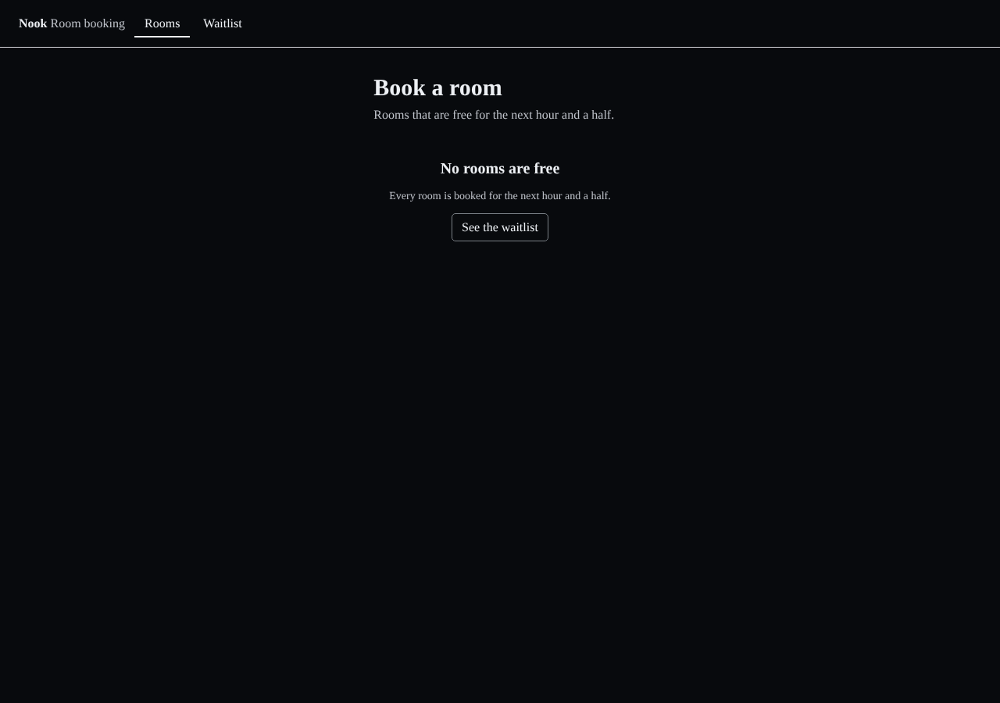](https://raw.githubusercontent.com/tounsoo/agent-design-loop/ba95684532ddf98ab616d24166001944c0459f6c/products/nook/review/screenshots/scenarios/no-rooms--desktop-dark.png)

## no-rooms--desktop-light

[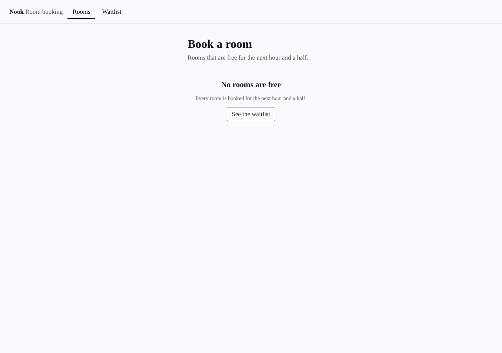](https://raw.githubusercontent.com/tounsoo/agent-design-loop/ba95684532ddf98ab616d24166001944c0459f6c/products/nook/review/screenshots/scenarios/no-rooms--desktop-light.png)

## no-rooms--phone-dark

## no-rooms--phone-light

## rooms--desktop-dark

[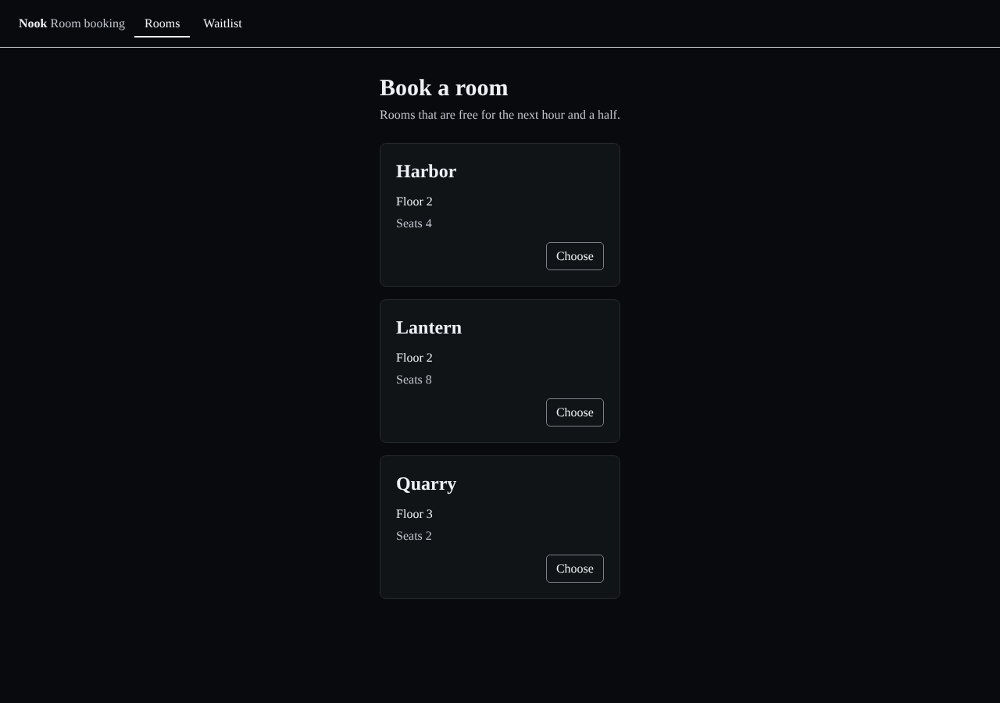](https://raw.githubusercontent.com/tounsoo/agent-design-loop/ba95684532ddf98ab616d24166001944c0459f6c/products/nook/review/screenshots/scenarios/rooms--desktop-dark.png)

## rooms--desktop-light

[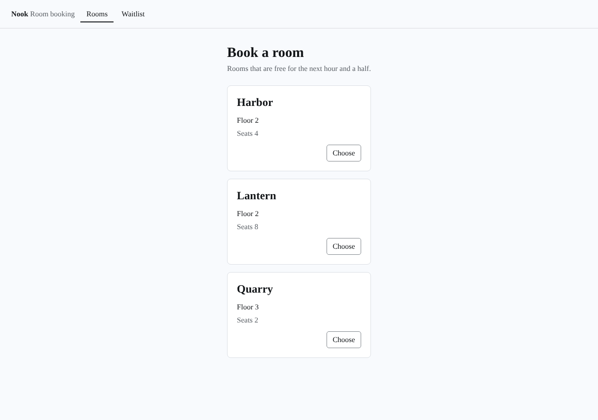](https://raw.githubusercontent.com/tounsoo/agent-design-loop/ba95684532ddf98ab616d24166001944c0459f6c/products/nook/review/screenshots/scenarios/rooms--desktop-light.png)

## rooms--phone-dark

[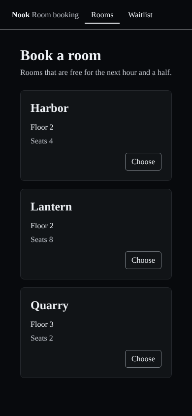](https://raw.githubusercontent.com/tounsoo/agent-design-loop/ba95684532ddf98ab616d24166001944c0459f6c/products/nook/review/screenshots/scenarios/rooms--phone-dark.png)

## rooms--phone-light

[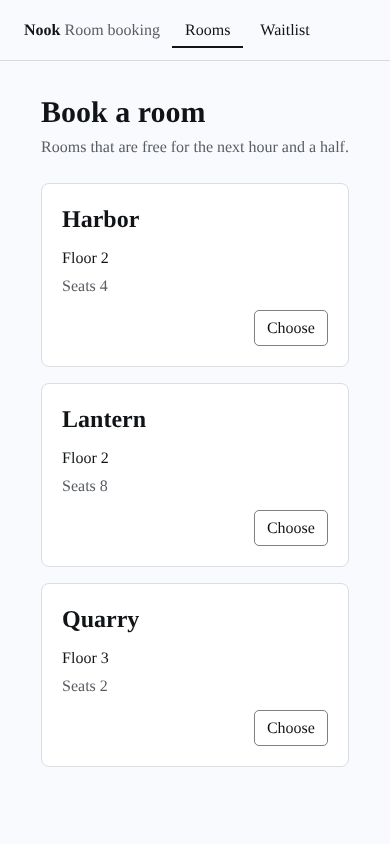](https://raw.githubusercontent.com/tounsoo/agent-design-loop/ba95684532ddf98ab616d24166001944c0459f6c/products/nook/review/screenshots/scenarios/rooms--phone-light.png)

## waiting--desktop-dark

[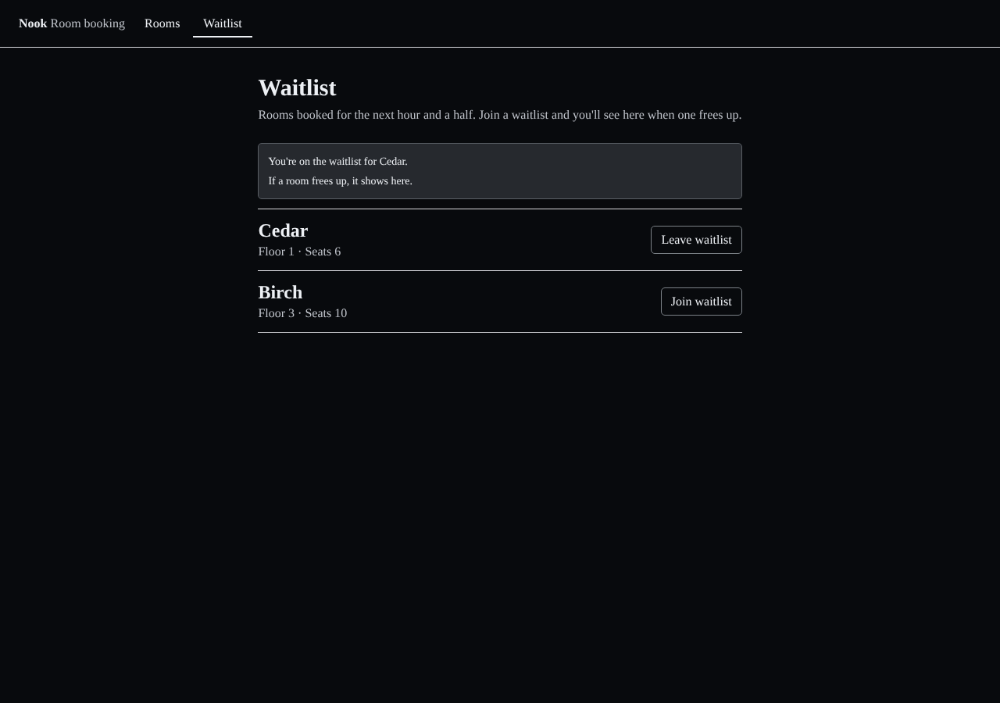](https://raw.githubusercontent.com/tounsoo/agent-design-loop/ba95684532ddf98ab616d24166001944c0459f6c/products/nook/review/screenshots/scenarios/waiting--desktop-dark.png)

## waiting--desktop-light

[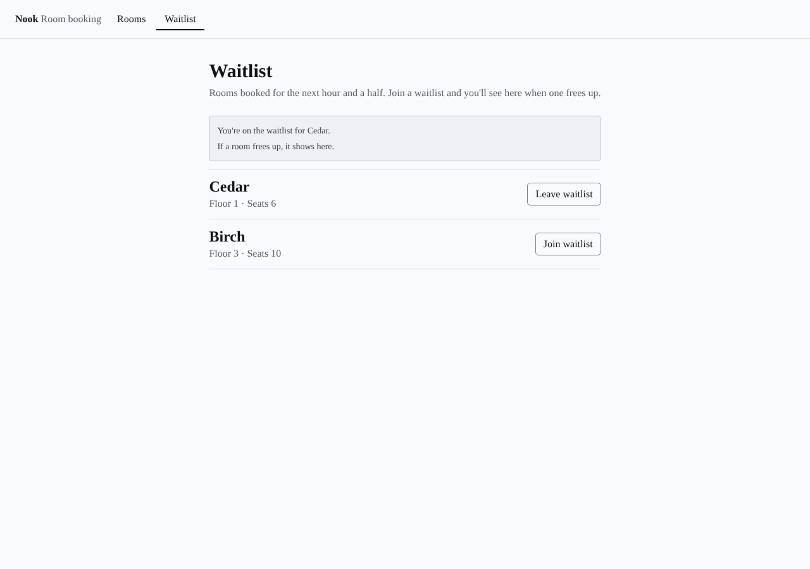](https://raw.githubusercontent.com/tounsoo/agent-design-loop/ba95684532ddf98ab616d24166001944c0459f6c/products/nook/review/screenshots/scenarios/waiting--desktop-light.png)

## waiting--phone-dark

[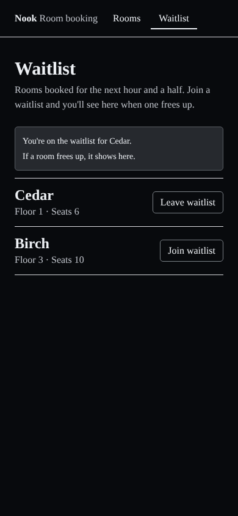](https://raw.githubusercontent.com/tounsoo/agent-design-loop/ba95684532ddf98ab616d24166001944c0459f6c/products/nook/review/screenshots/scenarios/waiting--phone-dark.png)

## waiting--phone-light

[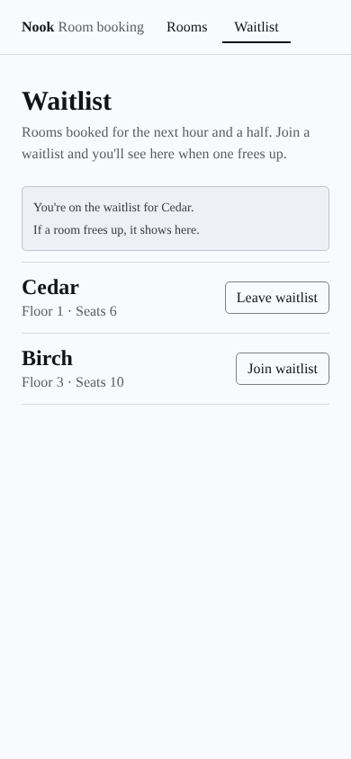](https://raw.githubusercontent.com/tounsoo/agent-design-loop/ba95684532ddf98ab616d24166001944c0459f6c/products/nook/review/screenshots/scenarios/waiting--phone-light.png)

## waitlist--desktop-dark

[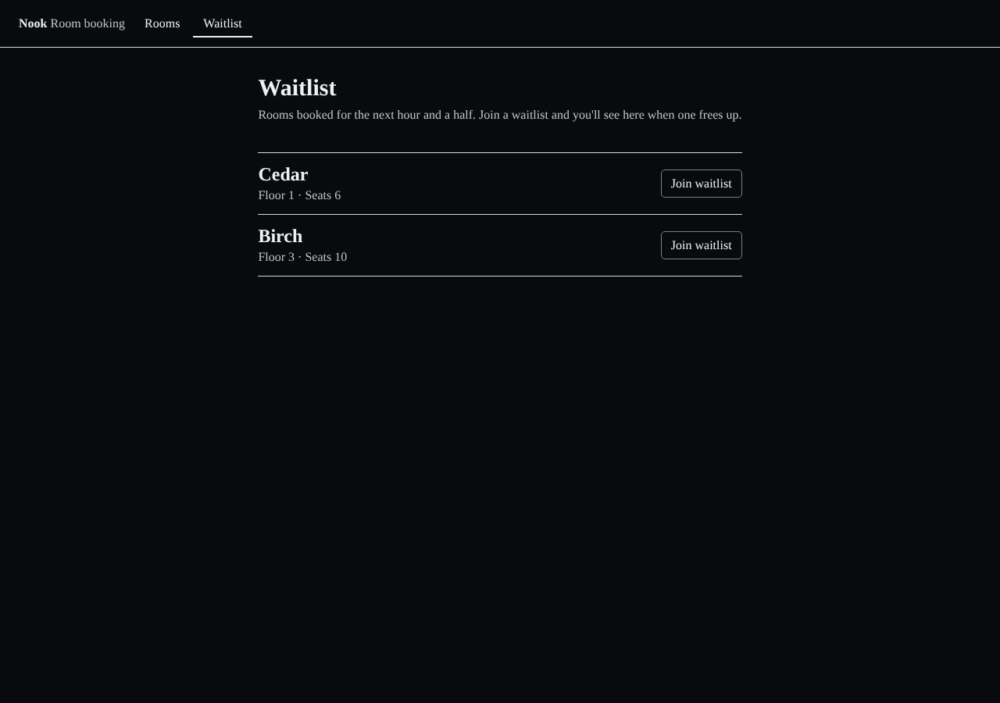](https://raw.githubusercontent.com/tounsoo/agent-design-loop/ba95684532ddf98ab616d24166001944c0459f6c/products/nook/review/screenshots/scenarios/waitlist--desktop-dark.png)

## waitlist--desktop-light

[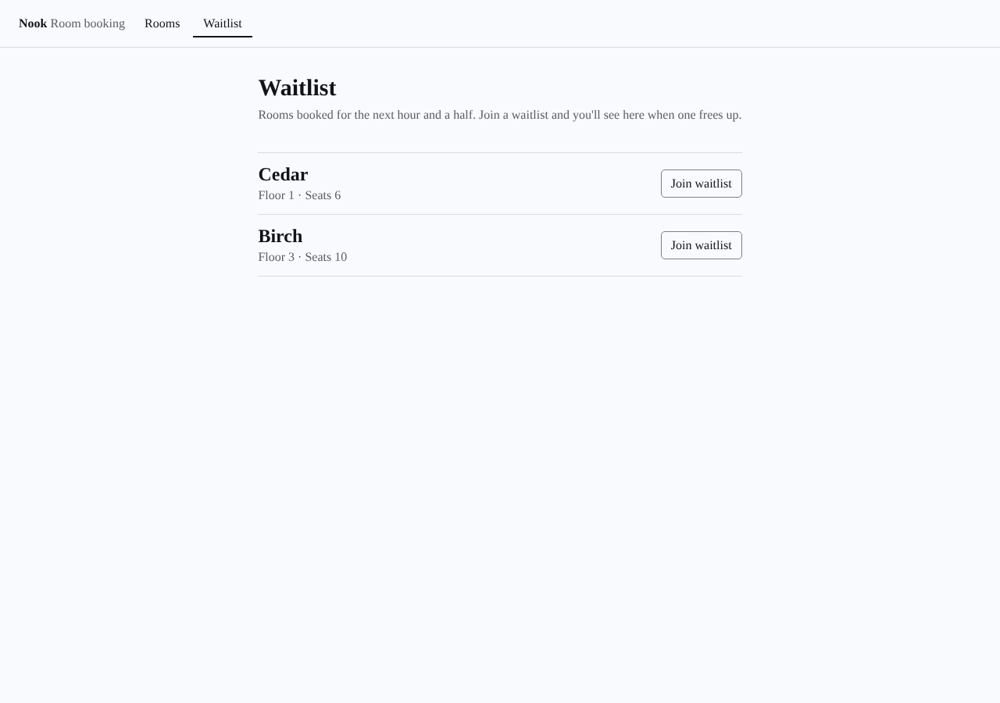](https://raw.githubusercontent.com/tounsoo/agent-design-loop/ba95684532ddf98ab616d24166001944c0459f6c/products/nook/review/screenshots/scenarios/waitlist--desktop-light.png)

## waitlist--phone-dark

[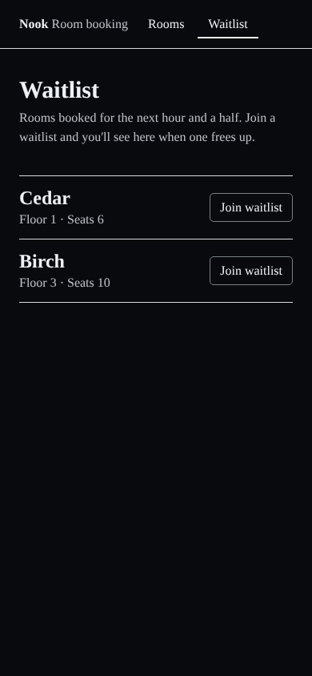](https://raw.githubusercontent.com/tounsoo/agent-design-loop/ba95684532ddf98ab616d24166001944c0459f6c/products/nook/review/screenshots/scenarios/waitlist--phone-dark.png)

## waitlist--phone-light

[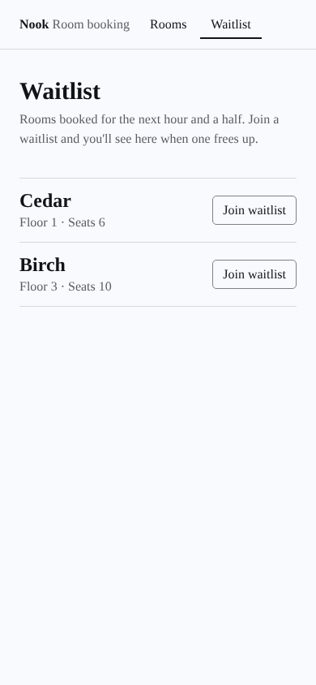](https://raw.githubusercontent.com/tounsoo/agent-design-loop/ba95684532ddf98ab616d24166001944c0459f6c/products/nook/review/screenshots/scenarios/waitlist--phone-light.png)
