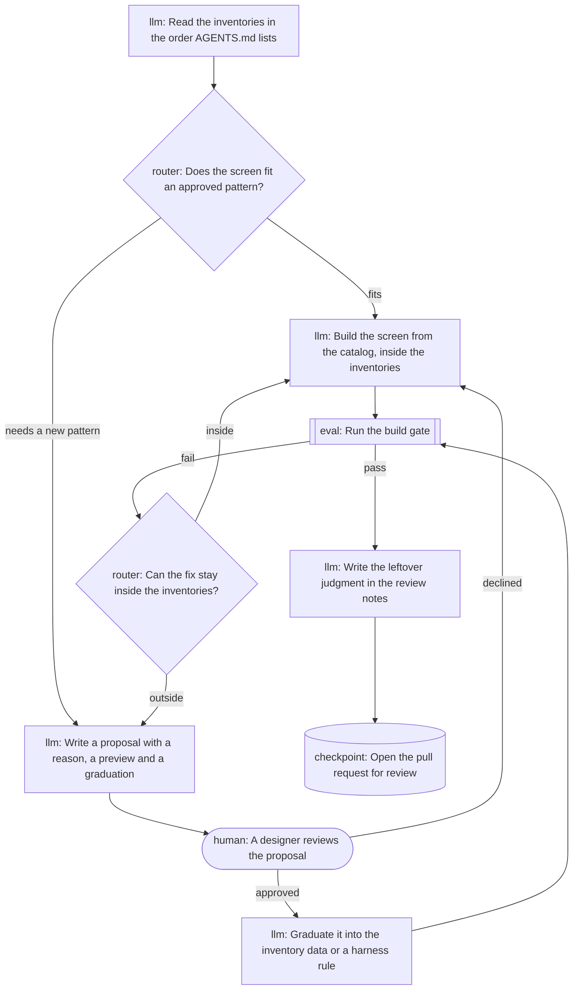

# Proposal 0009: The design loop is a graph in the harness

Status: decided. Ben decided on Nov 11 to define the design loop in the repository as a graph, in the graph-engineering sense: nodes do the work, edges decide what runs next, and shared state carries what one run leaves for the next. This records that change, which lands with its own pull request, so nothing graduates later.

Rule or input: the harness gains one data file, `packages/harness/design-loop.ts`, and one check, `check:loop`. No product input, rule cap, catalog export, flow state, adapter field or product config changes. No rule in `check:rules` changes, so no product can opt out of the new check.

## Reason

Until now the loop lived in prose: one line of `AGENTS.md` and a hand-drawn diagram in the walkthrough. Its branches, such as what a failing check leads to and where a person approves, held only while the agent read them the same way. Prose drifts and nothing fails when it does.

As a graph, the loop is structure. Each node has a kind, and each kind has a contract `check:loop` enforces:

- **llm.** The agent's own work. One edge out.
- **router.** A question. One edge per answer.
- **eval.** npm scripts. A `pass` and a `fail` edge, and the `fail` edge must come back to retry.
- **human.** A person decides. Its `gate` is a `CODEOWNERS` pattern with an owner, and its edges are `approved` and `declined`.
- **checkpoint.** Work saved for the next run. With no edge out, it ends the run.

Every path that ends must pass an eval node, so the graph cannot route around the checks. The diagram in the walkthrough is drawn from the graph, and `check:loop` fails when it is stale.

No runtime executes the graph. The agent follows it, as it followed the prose, and the checks remain the part that does not need the agent's cooperation. A runtime would add a dependency for no new guarantee today. If one is added later, it reads the same file.

## Preview

The loop, as `npm run check:loop -- --write` draws it:

The eval node runs `check:fixtures` and `check`, the build gate. The human node gates on `/proposals/`, which `CODEOWNERS` assigns to `@tounsoo`. A graduated proposal writes the inventories or the rules, the shared state the next run reads.

A broken graph fails the build. If the eval node named `check:colors`, `check:loop` prints `eval node checks runs check:colors, which is not an npm script.`

## Graduation

No file changes later. These change in the same pull request:

- `packages/harness/design-loop.ts` is the graph.
- `packages/harness/src/lib/loop.ts` holds the node kinds, the validation and the diagram, with Vitest tests in `packages/harness/src/lib/loop.test.ts`.
- `packages/harness/src/check-loop.ts` is the new check. `package.json` names it, and `check` runs it after `check:retirement`. `.github/workflows/ci.yml` runs it in the `check` job.
- The docs: `AGENTS.md` points at the graph in place of its one-line loop, and `packages/harness/docs/how-it-works.md` draws it. The harness README, the root README, `proposals/README.md` and `CLAUDE.md` name the check.
